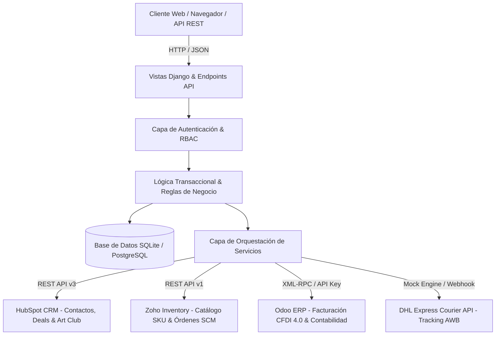

# 🎨 ArtSpace — Plataforma Transaccional de Comercio Electrónico de Arte

<div align="center">


**Plataforma transaccional de intermediación y comercialización de arte contemporáneo, físico y digital, con arquitectura empresarial desacoplada e integración en tiempo real con HubSpot (CRM), Zoho Inventory (SCM) y Odoo (ERP).**

*Proyecto de Negocios Electrónicos II — Departamento de Sistemas y Computación*  
**Instituto Tecnológico de Apizaco (TecNM)**

[Características](#-características-principales) •
[Arquitectura](#-arquitectura-empresarial) •
[Reglas de Negocio](#-reglas-de-negocio-clave) •
[Ecosistema de Servicios](#-integración-crm--scm--erp) •
[Instalación](#-instalación-y-puesta-en-marcha) •
[Demostración](#-ejecución-de-la-demostración-e2e) •
[Estructura](#-estructura-del-repositorio) •
[Documentación](#-documentación-técnica)

</div>

---

## 📌 Descripción General

**ArtSpace** es un ecosistema transaccional de comercio electrónico diseñado para resolver las fricciones críticas del mercado del arte:
1. **Singularidad del Producto:** Control estricto de concurrencia y reserva temporal (*Hold-Cart*) para piezas originales únicas (1/1).
2. **Logística de Alto Valor:** Orquestación de cadena de suministro (SCM) con cálculo automatizado de embalaje de conservación, flete especializado (DHL Express) y póliza de seguro de arte.
3. **Complejidad Fiscal y Dispersión:** Motor de cálculo fiscal dinámico (IVA 16% nacional, IVA 8% frontera norte, IVA 0% exportación digital según Ley del IVA de México) y liquidación automatizada *Split Payment 70/30* con retención de ISR RESICO (1.25%) y transferencias interbancarias SPEI.
4. **Sincronización Empresarial:** Enlace directo con plataformas líderes en la nube:
   - **CRM (HubSpot):** Gestión omnicanal del cliente, segmentación RFM y programa de lealtad *Art Club*.
   - **SCM (Zoho Inventory):** Gestión centralizada de stock, SKUs maestros y órdenes de surtido.
   - **ERP (Odoo):** Facturación electrónica CFDI 4.0, cuentas por cobrar/pagar y pólizas de diario en libro mayor contable mediante XML-RPC.

---

## 🚀 Características Principales

- **Control de Acceso Basado en Roles (RBAC):**
  - **Administrador:** Redirección automática al panel de control central `/admin/` para gobernanza global.
  - **Artista:** Portal exclusivo `/panel-artista/` con alta de catálogo, métricas de ventas y subida de obras sincronizadas en tiempo real a Zoho Inventory.
  - **Coleccionista:** Portal `/perfil/` con historial de compras, rastreo en vivo de guías AWB, certificados de autenticidad y panel de preferencias fiscales/logísticas.
  - **Invitado / Visitante:** Navegación libre, carrito protegido sin persistencia espuria y compuerta de autenticación interactiva.
- **Reserva Concurrente de Obras (RN-01):** Bloqueo transaccional temporal de 15 minutos (900 s) por obra original única con manejo de colisiones (HTTP 409 Conflict).
- **Split Payment Automatizado (RN-02):** Dispersión 70% Artista (con retención ISR) y 30% Galería con generación de clave de rastreo Banxico SPEI.
- **Motor Fiscal Sat-Compliant (RN-03):** Identificación de zonas geográficas por C.P. para aplicación de tasa fronteriza (8%) o nacional (16%) y exención por exportación digital (0%).
- **Fidelización Art Club (RN-04):** Acreditación en vivo de puntos (1 punto por cada $10 MXN) y subida dinámica de niveles (Bronce, Plata, Oro / VIP Patron).
- **API REST Robusta:** Endpoints desacoplados para carrito, impuestos, checkout y tracking de paquetería.

---

## 🏗 Arquitectura Empresarial

El sistema implementa una arquitectura multicapa bajo el patrón Modelo-Vista-Template (MVT) enriquecido con Capa de Servicios (*Service Layer*) para orquestar llamadas externas:



---

## ⚡ Integración CRM | SCM | ERP

| Servicio | Plataforma | Protocolo | Responsabilidad en ArtSpace |
| :--- | :--- | :--- | :--- |
| **CRM** | **HubSpot** | REST API (Bearer Token) | Gestión de clientes, pipeline de ventas, sincronización de tickets de soporte y balance de puntos Art Club. |
| **SCM** | **Zoho Inventory** | OAuth 2.0 / REST API | Catálogo maestro de productos, control de existencias, bodegas de curaduría y órdenes de empaque. |
| **ERP** | **Odoo** | XML-RPC (`account.move`) | Generación de facturas electrónicas timbradas CFDI 4.0, pólizas de ingresos/costos y conciliación bancaria. |
| **Logística** | **DHL Express** | REST / Mock Service | Emisión de guías aéreas internacionales AWB y seguimiento de hitos de entrega en tiempo real. |

---

## ⚖️ Reglas de Negocio Clave

1. **RN-01: Exclusividad y Bloqueo Temporal (Hold-Cart Lock)**
   - Ninguna obra original física única (1/1) puede ser adquirida simultáneamente por dos usuarios.
   - Al agregar al carrito, se emite un candado con vencimiento de 15 minutos (900 s). Intentos paralelos reciben respuesta `HTTP 409 Conflict`.
2. **RN-02: Liquidación Transaccional Split Payment (70/30)**
   - El 70% del valor de la obra pertenece al artista; el 30% corresponde a la comisión de la galería.
   - En artistas registrados bajo régimen RESICO, se descuenta automáticamente el 1.25% de retención de ISR.
3. **RN-03: Tributación Dinámica Multi-Zona**
   - **Tasa General (16% IVA):** Aplicada al territorio nacional estándar.
   - **Tasa Región Fronteriza Norte (8% IVA):** Aplicada según catálogo de Códigos Postales fronterizos (ej. Tijuana, C.P. 22000).
   - **Tasa Exportación Internacional (0% IVA):** Aplicada a compradores en el extranjero adquiriendo activos digitales (NFT/4K).
4. **RN-04: Gamificación y Fidelización Art Club**
   - Transforma compras en puntos canjeables (1 pt / $10 MXN) que escalan el estatus del coleccionista (*Bronce* $\rightarrow$ *Plata* $\rightarrow$ *Oro VIP Patron*).

---

## 💻 Instalación y Puesta en Marcha

### Prerrequisitos
- **Python 3.11, 3.12 o 3.13** instalado.
- **Git** instalado.
- Conexión a Internet para la instalación de dependencias y sincronización con APIs externas.

### 1. Clonar el repositorio
```bash
git clone https://github.com/TU_USUARIO/TU_REPOSITORIO.git
cd TU_REPOSITORIO
```

### 2. Configurar el entorno virtual
En Windows (PowerShell):
```powershell
python -m venv venv
.\venv\Scripts\Activate.ps1
```

En Linux / macOS:
```bash
python3 -m venv venv
source venv/bin/activate
```

### 3. Instalar dependencias
```bash
pip install -r requirements.txt
```
*(Si no dispones de un archivo `requirements.txt`, las dependencias base son `django`, `requests`, `python-dotenv` y `faker`).*

### 4. Configurar variables de entorno (`.env`)
Crea un archivo `.env` en la raíz del proyecto con tus credenciales:
```env
# Configuración Django
SECRET_KEY=tu_django_secret_key_aqui
DEBUG=True

# Integración HubSpot CRM
HUBSPOT_ACCESS_TOKEN=tu_token_privado_hubspot

# Integración Zoho Inventory SCM
ZOHO_ORG_ID=tu_organization_id_zoho
ZOHO_ACCESS_TOKEN=tu_access_token_zoho

# Integración Odoo ERP
ODOO_URL=https://tu-instancia.odoo.com
ODOO_DB=tu_nombre_de_bd_odoo
ODOO_USER=tu_correo_de_acceso_odoo
ODOO_PASSWORD=tu_api_key_rpc_odoo
```

### 5. Ejecutar migraciones e inicializar base de datos
```bash
python manage.py makemigrations
python manage.py migrate
```

### 6. Iniciar el servidor local de desarrollo
```bash
python manage.py runserver 127.0.0.1:8000
```
Abre tu navegador en [http://127.0.0.1:8000/](http://127.0.0.1:8000/) para explorar la galería.

---

## 🧪 Ejecución de la Demostración E2E

El repositorio incluye un arnés de prueba automatizado que ejecuta el ciclo transaccional completo, validando el Happy Path y tres escenarios de excepción (*Edge Cases*):

```bash
python demo_flujo_completo.py
```

### Resultados Validados en Consola:
- ✅ **Paso 1:** Autenticación de usuario coleccionista con nivel Art Club.
- ✅ **Paso 2:** Bloqueo temporal (*Hold-Cart*) de obra original 1/1 por 15 minutos (Status 200).
- ✅ **Paso 3:** Motor fiscal con desglose de obra, enmarcado, seguro y 16% IVA.
- ✅ **Paso 4:** Orquestación transaccional: Pedido SCM, Guía DHL, Timbrado CFDI 4.0 SAT, Split Payment 70/30 con retención ISR, Póliza contable de libro mayor cuadrada y acumulación de puntos CRM.
- ✅ **Paso 5:** Rastreo y actualización de hitos en vivo de paquetería.
- 🔴 **Edge Case A:** Mitigación de concurrencia al intentar reservar obra bloqueada (HTTP 409 Conflict).
- 🔴 **Edge Case B:** Detección de código postal fronterizo y aplicación de tasa 8% IVA.
- 🔴 **Edge Case C:** Venta internacional de activo digital sin costo de envío y 0% IVA (Exportación Art. 29 LIVA).

---

## 📂 Estructura del Repositorio

```text
pagina/
├── artspace_project/              # Configuración global del proyecto Django
│   ├── settings.py                # Ajustes, base de datos e integración de apps
│   ├── urls.py                    # Ruteo principal del proyecto
│   └── wsgi.py / asgi.py          # Interfaces para despliegue
├── gallery/                       # Aplicación central de la galería y comercio
│   ├── models.py                  # Modelos de datos (Obras, Artistas, Órdenes, Perfiles)
│   ├── views.py                   # Vistas frontend y endpoints de API REST
│   ├── forms.py                   # Formularios de registro, autenticación y perfil
│   ├── crm_service.py             # Adaptador de integración con HubSpot CRM
│   ├── scm_service.py             # Adaptador de integración con Zoho Inventory & DHL
│   ├── erp_services.py            # Adaptador de facturación y pólizas con Odoo XML-RPC
│   └── migrations/                # Historial de migraciones del esquema
├── templates/                     # Plantillas HTML con diseño responsivo
│   ├── base.html                  # Shell principal, navegación RBAC, modal de login y carrito
│   ├── index.html                 # Página de inicio con curaduría y colecciones
│   ├── galeria.html               # Catálogo dinámico con filtros por técnica y precio
│   ├── perfil.html                # Centro de control del coleccionista y preferencias
│   ├── panel_artista.html         # Portal de autogestión y subida de obras para artistas
│   └── login.html / registro.html # Flujos de autenticación y creación de cuentas
├── static/                        # Archivos estáticos (CSS, JS, imágenes)
│   ├── styles.css                 # Sistema de diseño Neo-Gallery UI
│   └── img/                       # Recursos gráficos y mockups del sistema
├── pagina/                        # Documentación técnica formal del proyecto
│   ├── arquitectura_kruchten_4_1.md
│   ├── registro_diseno_tecnico_demostracion.md
│   ├── reporte_tecnico_registro_usuarios.md
│   ├── bitacora_avance_crm.md
│   ├── bitacora_avance_scm.md
│   └── evaluacion_avance_proyecto_erp.md
├── scratch/                       # Scripts auxiliares y pruebas unitarias aisladas
├── demo_flujo_completo.py         # Script oficial de demostración transaccional E2E
├── test_auth_suite.py             # Suite de pruebas automatizadas de autenticación y RBAC
├── manage.py                      # Gestor de comandos de Django
├── .gitignore                     # Exclusión de archivos sensibles, venv y caché
└── README.md                      # Documento descriptivo principal del repositorio
```

---

## 📚 Documentación Técnica

Para consultar los documentos formales de diseño de software y auditoría de integración, dirígete al directorio [`/pagina`](./pagina/):

1. **[Arquitectura de Software (Kruchten 4+1)](./pagina/arquitectura_kruchten_4_1.md):** Vistas Lógica, de Desarrollo, de Procesos, Física y Casos de Uso.
2. **[Registro de Diseño Técnico y Demostración](./pagina/registro_diseno_tecnico_demostracion.md):** Especificación rigurosa de las reglas de negocio, endpoints y evidencias de ejecución.
3. **[Reporte Técnico de Registro y Gestión de Usuarios](./pagina/reporte_tecnico_registro_usuarios.md):** Modelo relacional de identidades, perfiles extendidos y matriz RBAC.
4. **[Bitácoras de Integración](./pagina/):** Reportes de conexión con CRM (HubSpot), SCM (Zoho Inventory) y ERP (Odoo).

---

## 👥 Datos Institucionales

- **Institución:** Instituto Tecnológico de Apizaco (TecNM)
- **Departamento:** Sistemas y Computación
- **Asignatura:** Negocios Electrónicos II
- **Proyecto:** ArtSpace E-Commerce Ecosystem v2.4


---

<div align="center">
  <sub>Desarrollado con fines académicos y de investigación en arquitecturas transaccionales para comercio electrónico. © 2026 ArtSpace.</sub>
</div>

