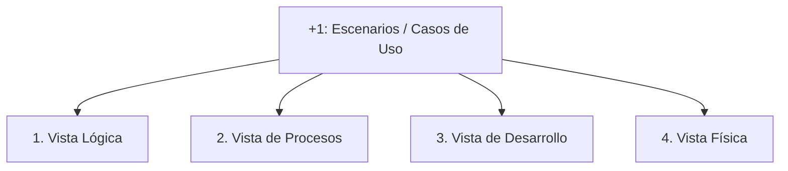
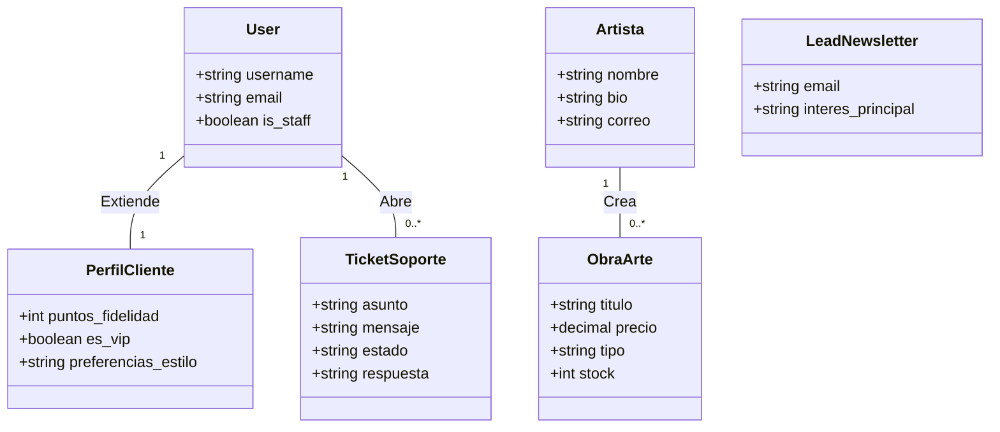
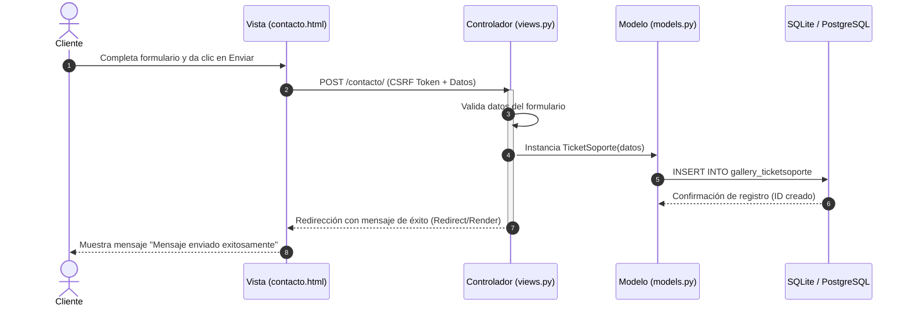
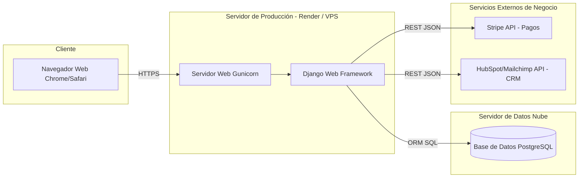

# 🏗️ Diseño de Arquitectura: Modelo de Vistas 4+1 (Kruchten) - ARTSPACE

Este documento detalla la arquitectura de software de **ARTSPACE** utilizando el modelo **4+1 de Kruchten**. Este enfoque describe la estructura del sistema a través de cinco perspectivas o vistas concurrentes para asegurar la alineación entre los requerimientos de negocio, desarrollo, procesos e infraestructura física.

---



---

## 🔑 1. Escenarios (+1)
Los escenarios conectan todas las vistas mediante casos de uso clave que describen la interacción de los roles de negocio con el sistema.

### Caso de Uso 1: Compra de Arte y Registro en CRM / SCM
*   **Actor:** Cliente (Coleccionista)
*   **Flujo:**
    1.  El cliente explora el catálogo, añade una obra única al carrito.
    2.  Inicia sesión o se registra (se genera el `PerfilCliente` en la BD).
    3.  Realiza el pago simulado.
    4.  El sistema actualiza el stock a 0 (SCM) y calcula las ganancias/comisiones (ERP).
    5.  Se genera un ticket de envío en estado de empaque (SCM) y se suman puntos de fidelidad (CRM).

### Caso de Uso 2: Soporte y CRM (Atención al Cliente)
*   **Actor:** Cliente y Administrador
*   **Flujo:**
    1.  Un visitante envía una duda sobre envíos en el formulario de contacto.
    2.  El sistema crea un registro `TicketSoporte` con estado `NUEVO`.
    3.  El Administrador inicia sesión en el Django Admin, visualiza el ticket y redacta la respuesta.
    4.  El sistema cambia el estado del ticket a `RESUELTO` e interactúa con el cliente.

---

## 🧩 2. Vista Lógica (Logical View)
Describe la estructura conceptual del sistema, representando las clases principales del dominio del negocio y cómo interactúan entre sí bajo el patrón **Django MVT (Model-View-Template)**.



---

## ⚙️ 3. Vista de Procesos (Process View)
Representa la dinámica del sistema en tiempo de ejecución, mostrando cómo interactúan los componentes durante un proceso clave, como el envío de un ticket de soporte (Atención CRM).



---

## 📦 4. Vista de Desarrollo / Implementación (Development View)
Muestra la organización modular del código en capas (Presentación, Negocios y Datos) dentro del entorno de desarrollo del proyecto Django.

```
c:\Users\AVRB9\Downloads\pagina\   <-- Raíz del Proyecto
│
├── artspace_project/               <-- Capa de Configuración (Settings y Enrutador Principal)
│   ├── settings.py                 <-- Configuración de Middleware, DB, Estáticos
│   └── urls.py                     <-- Rutas globales del negocio
│
├── gallery/                        <-- Módulo Principal de la Aplicación
│   ├── models.py                   <-- Capa de Datos (Modelos e Integración ORM)
│   ├── views.py                    <-- Capa de Negocios (Controlador y Lógica del CRM/SCM)
│   ├── urls.py                     <-- Sub-rutas específicas de la aplicación
│   └── apps.py
│
├── templates/                      <-- Capa de Presentación (HTML heredado con Django Templates)
│   ├── base.html                   <-- Plantilla Maestra con Navbar/Footer y Menú Móvil
│   ├── index.html                  <-- Vista del Catálogo Destacado
│   ├── colecciones.html            <-- Vista del Carrusel de Colecciones
│   ├── artistas.html               <-- Vista de Perfiles de Creadores
│   ├── galeria.html                <-- Vista General de Obras
│   └── contacto.html               <-- Vista del Formulario CRM (Atención)
│
├── static/                         <-- Recursos Estáticos (Assets)
│   ├── styles.css                  <-- Hoja de Estilos del Diseño Visual
│   └── img/                        <-- Imágenes de Obras y Recursos del Carrusel
│
└── manage.py                       <-- Consola de Ejecución del Servidor
```

---

## 🖥️ 5. Vista Física / Despliegue (Physical View)
Describe la topología de hardware en la que se ejecuta la aplicación, los nodos físicos de red y la distribución de los componentes del software en producción.


