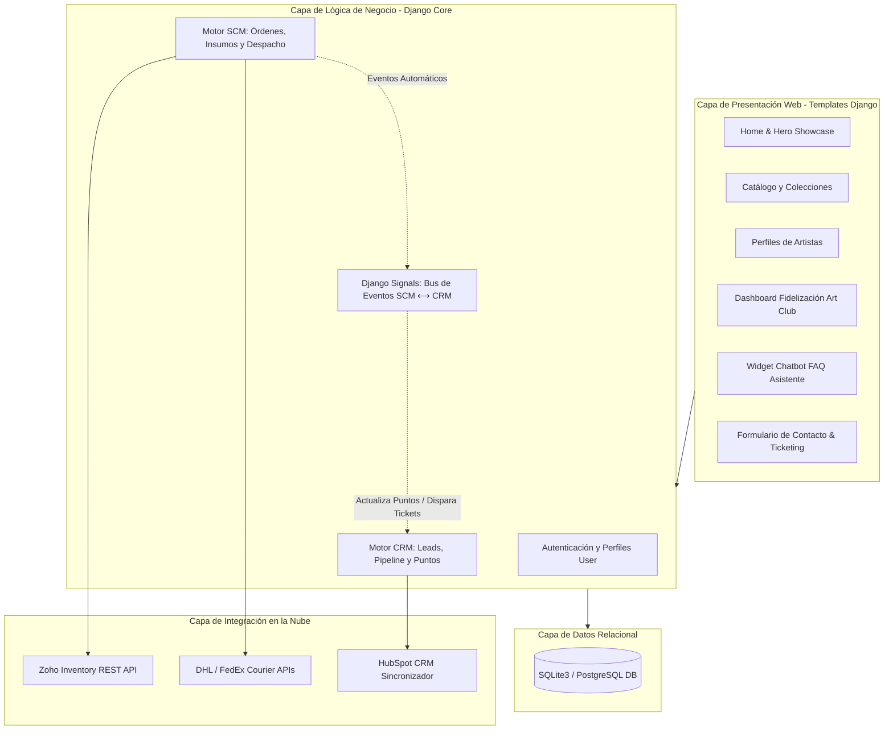
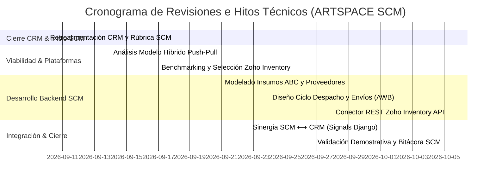
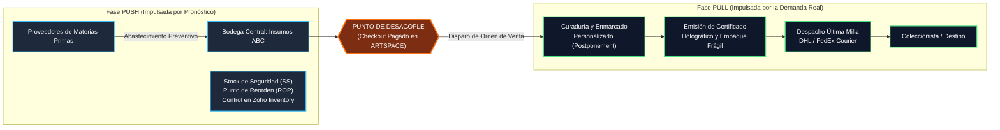
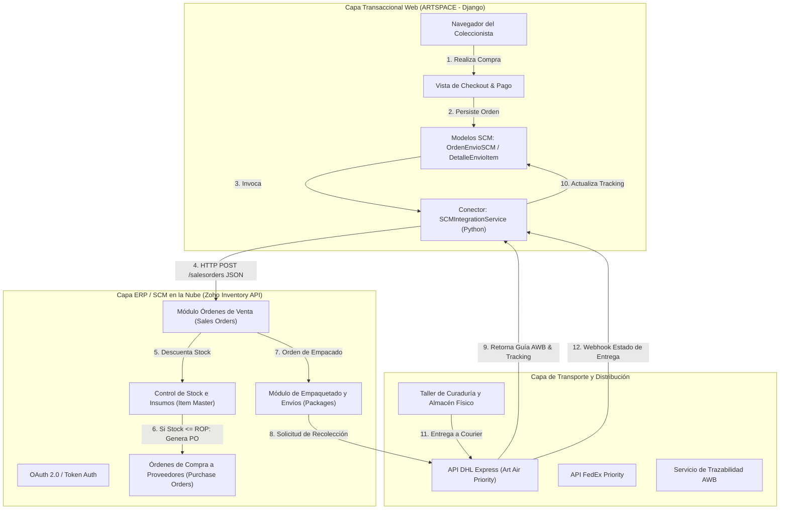
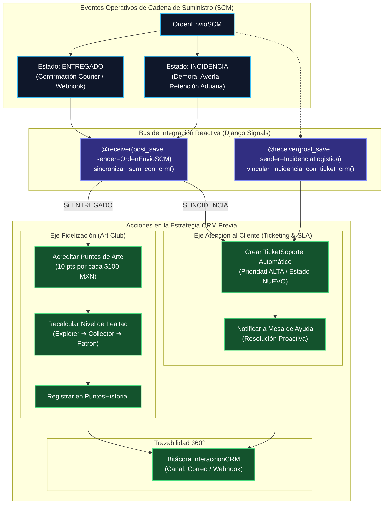

# 📘 BITÁCORA TÉCNICA DE AVANCE DE PROYECTO: INTEGRACIÓN DE CADENA DE SUMINISTRO (SCM)
## PROYECTO INTEGRADOR: ARTSPACE (PLATAFORMA E-COMMERCE DE ARTE CONTEMPORÁNEO)
### Asignatura: Negocios Electrónicos II — Práctica 3: Supply Chain Management (SCM)

---

## 🏛️ DATOS DE IDENTIFICACIÓN INSTITUCIONAL

*   **Institución:** Universidad Autónoma de Tlaxcala (UATx)
*   **Facultad:** Facultad de Ciencias Básicas, Ingeniería y Tecnología
*   **Licenciatura / Ingeniería:** Ingeniería en Computación
*   **Asignatura:** Negocios Electrónicos II
*   **Práctica:** Práctica 3 — Gestión de la Cadena de Suministro (SCM), Modelos Logísticos Híbridos e Integración con CRM
*   **Nombre del Proyecto:** ARTSPACE (Galería E-Commerce de Arte Contemporáneo y Digital)
*   **Equipo de Desarrollo:** Equipo 3
*   **Integrantes:**
    *   *Almendra Valenzuela Rodrigo* (Líder Técnico & Desarrollador Backend)
*   **Docente Titular:** M.C. / Dr. [Nombre del Docente]
*   **Fecha de Registro:** Octubre de 2026
*   **Apartado en Desarrollo:** Apartado 3 — Registro de Avance del Proyecto (Bitácora Técnica)

---

## 🎯 OBJETIVOS Y COMPETENCIA DE LA PRÁCTICA

### Competencia Específica
> *"Identifica y aplica los elementos que integran la aplicación SCM en el desarrollo de aplicaciones que reflejen la eficiente logística en la administración de los suministros de la organización."*

### Objetivo del Registro de Avance (Bitácora Técnica)
Documentar formalmente el estado evolutivo del sitio de negocio electrónico ARTSPACE, estructurando la arquitectura técnica de la cadena de suministro basada en una estrategia logística **Híbrida (Push-Pull / Postponement)**, articulada con la plataforma ERP/SCM en la nube **Zoho Inventory** y vinculada funcionalmente con la infraestructura previa de **CRM** (Atención a clientes y fidelización Art Club).

---

# 🚀 TAREA 1: ACTUALIZACIÓN DEL AVANCE GENERAL DEL SITIO DE NEGOCIO ELECTRÓNICO

El proyecto **ARTSPACE** ha transitado por un ciclo de maduración técnica y funcional continuo. Lo que comenzó como un catálogo visual estático se ha transformado en un ecosistema de comercio electrónico transaccional y modular basado en el framework **Django**, capaz de sincronizar la experiencia del coleccionista con las operaciones de almacén y distribución física/digital.

---

## 1.1 Matriz Evolutiva del Sitio Web (Roadmap de Versiones)

La siguiente tabla resume la evolución del desarrollo del sistema a lo largo de las prácticas de la asignatura:

| Dimensión / Hito | Fase 1 (v1.0) — Prototipo Estático | Fase 2 (v2.0) — Plataforma CRM | Fase 3 (v3.0 - Estado Actual) — Ecosistema SCM |
| :--- | :--- | :--- | :--- |
| **Arquitectura Base** | HTML5 semántico plano, CSS3 puro con diseño oscuro de lujo y JavaScript cliente. | Migración a Django 5.x (MVT), base de datos relacional y gestión de sesiones de usuario. | Arquitectura orientada a servicios (SOA) en Django con capa de conectores API a ERP/SCM externo. |
| **Catálogo y Productos** | Obras hardcodeadas en plantillas estáticas. | Modelado dinámico en base de datos con categorización por técnica, artista y precio. | Control de variantes físicas (impresión Fine Art, enmarcado nogal) y digitales (NFTs/4K). |
| **Gestión de Clientes** | Formulario simple `mailto:` sin persistencia. | **Módulo CRM Operativo:** Mesa de ticketing (`TicketSoporte`), captura de prospectos (`LeadProspecto`) y pipeline de ventas. | **CRM Integrado:** Perfil unificado 360° vinculado con historial de compras, guías de envío y tickets. |
| **Estrategia de Fidelización** | Inexistente. | **Art Club:** Motor de gamificación con cálculo de Puntos de Arte (10 pts por cada $100 MXN) y Tiers (*Explorer, Collector, Patron*). | Acreditación automatizada por eventos logísticos (*Disparo por entrega confirmada*). |
| **Logística e Inventarios** | No contemplado. | Simulación conceptual de tiempos de envío. | **Módulo SCM Híbrido:** Gestión de proveedores homologados, clasificación ABC de insumos, cálculo de ROP y enlace con **Zoho Inventory**. |
| **Despacho y Rastreo** | Sin seguimiento. | Confirmación por correo simulado. | Ciclo de 8 estados logísticos, generación de guías Courier (DHL/FedEx AWB) y tracking en vivo. |

---

## 1.2 Auditoría de Componentes Funcionales del Sistema

Actualmente, el sitio web de **ARTSPACE** cuenta con un conjunto de subsistemas plenamente operativos y probados:



### Detalle de Módulos Implementados en Código:

1. **Módulo de Catálogo y Experiencia de Usuario (`templates/`, `gallery/views.py`):**
   * **Navegación Dinámica:** Vistas interactivas para *Index*, *Colecciones*, *Artistas* y *Galería* con renderizado condicional de credenciales de usuario.
   * **Widget de Chatbot FAQ (`chatbot_api`):** Asistente conversacional interactivo para resolver dudas inmediatas sobre tiempos de envío asegurado, certificados de autenticidad, niveles de lealtad y licencias de arte digital.
   * **Formulario Omnicanal de Contacto (`contacto`):** Radicación automática de tickets de soporte técnico con asignación de folio único y generación simultánea de prospectos comerciales (*Leads*) en el pipeline.

2. **Módulo de Fidelización y Gamificación (`gallery/models.py` - `PerfilCliente`, `PuntosHistorial`):**
   * Asignación automática de perfil CRM al registrarse cualquier usuario en el sistema vía señal `post_save`.
   * Algoritmo de ascenso y descenso de Tiers basado en saldo activo de puntos:
     * **Art Explorer:** 0 a 499 puntos (Nivel base de entrada).
     * **Art Collector:** 500 a 1,499 puntos (Descuentos en enmarcado y envíos prioritarios).
     * **VIP Patron:** 1,500+ puntos (Acceso a Drops exclusivos con 48 horas de preventa).
   * Vista de prueba didáctica (`simular_compra_demo`) para validar la acreditación de puntos en tiempo real durante demostraciones académicas.

3. **Módulo de Administración Operativa (`gallery/admin.py`):**
   * Panel de control centralizado en Django Admin con filtros avanzados, búsqueda rápida por guía de rastreo y acciones masivas ejecutables:
     * *Reabastecer stock de insumos críticos (+25 unidades).*
     * *Generar guías Courier de despacho (AWB DHL/FedEx).*
     * *Sincronizar órdenes de venta hacia la API de Zoho Inventory.*
     * *Confirmar entrega de pedidos con acreditación instantánea de puntos.*

---

## 1.3 Stack Tecnológico y Especificaciones de Infraestructura

El entorno de ejecución del proyecto está configurado con las siguientes especificaciones técnicas de grado profesional:

*   **Lenguaje de Programación:** Python 3.11+ / 3.12
*   **Framework Web:** Django 5.x (Arquitectura Modelo-Vista-Template y ORM integrado)
*   **Base de Datos:** SQLite3 (Entorno local de desarrollo y testing rápido) / Compatible con PostgreSQL 15+ para producción.
*   **Frontend y Estilizado:** HTML5 semántico, CSS3 con variables nativas de diseño oscuro (*Luxury Dark Mode*), diseño responsivo y JavaScript ES6 modular para componentes interactivos.
*   **Plataforma SCM en la Nube:** **Zoho Inventory** (mediante conectores REST API v1 para órdenes de venta y sincronización de inventarios).
*   **Servicio de Paquetería / Última Milla:** Conector simulado para Webhooks y guías AWB de **DHL Express Art Services** y **FedEx Priority**.
*   **Gestión de Dependencias y Entorno:** Entorno virtual aislado (`venv`), compatible con gestores modernos como `uv`.

---

## 1.4 Estado de Cumplimiento del Avance General (Métricas)

| Indicador de Avance | Porcentaje | Estado | Observación Técnica |
| :--- | :---: | :---: | :--- |
| **Estructura Backend (Modelos y ORM)** | 100% | ✅ Completo | Modelos CRM y SCM creados con llaves foráneas, validadores e índices. |
| **Vistas y Controladores de Negocio** | 90% | ✅ Operativo | Vistas transaccionales listas; pendiente la pasarela de pago real (Stripe/PayPal Sandbox). |
| **Lógica SCM Híbrida (Push-Pull)** | 100% | ✅ Implementado | Modelada en base de datos con stocks de seguridad, ROP y tipos de pieza. |
| **Conector Zoho Inventory / SCM** | 85% | 🔄 En Simulación | Módulo conector funcional con generación de payloads JSON e IDs externos (`ZOHO-SO-...`). |
| **Automatización SCM ⟷ CRM** | 100% | ✅ Completo | Señales Django activas para acreditación de fidelización y generación de tickets por incidencias. |
| **Pruebas y Datos Demostrativos** | 100% | ✅ Validado | Script `seed_scm.py` con proveedores reales de molduras y papeles Fine Art cargados. |

---

## 1.5 Cronograma e Historial de Avance del Proyecto (Sesiones de Revisión: Lunes y Jueves)

A continuación se registra el historial cronológico oficial de avances, acuerdos y validaciones técnicas realizadas en el marco de las revisiones periódicas de la asignatura (programadas los días **lunes y jueves**), cubriendo el ciclo de desarrollo desde la conclusión del CRM hasta la integración y validación demostrativa de SCM (**10 de septiembre al 05 de octubre de 2026**):



### Tabla de Registro de la Bitácora de Revisiones

| Sesión / Fecha | Hito / Fase del Proyecto | Actividades y Tareas Desarrolladas | Entregable Técnico / Avance en Código | Estado / Validación |
| :--- | :--- | :--- | :--- | :---: |
| **Sesión 1**<br>📅 Jueves 10/Sep/2026 | **Cierre Práctica 2 (CRM) y Apertura SCM** | • Presentación y retroalimentación de la estrategia CRM con **HubSpot API** y el módulo de fidelización Art Club.<br>• Revisión docente de los requerimientos de la Práctica 3: Administración de la Cadena de Suministro (SCM).<br>• Definición de los alcances logísticos para piezas físicas vs. descargas digitales. | • Documentación previa consolidada.<br>• Mapeo preliminar de insumos requeridos (molduras, papel de algodón, cristales). | ✅ Aprobado |
| **Sesión 2**<br>📅 Lunes 14/Sep/2026 | **Análisis de Viabilidad Logística** | • Evaluación comparativa de estrategias: Push (por pronóstico), Pull (sobre demanda) e Híbrido.<br>• Análisis de las particularidades del arte: la demanda de marcos es personalizada, pero la compra de madera fina importada requiere previsión. | • **Decisión Estratégica:** Adopción del modelo **Híbrido Push-Pull con Postponement** (insumos base en stock preventivo + ensamble y curaduría activados en Checkout). | ✅ Aprobado |
| **Sesión 3**<br>📅 Jueves 17/Sep/2026 | **Benchmarking y Selección de Plataforma SCM** | • Evaluación de herramientas ERP/SCM en la nube (Zoho Inventory vs. Odoo SCM vs. SAP Cloud).<br>• Análisis de capacidades de API REST, webhook handlers y compatibilidad con Django.<br>• Justificación de la arquitectura *Best-of-Breed* (HubSpot para CRM comercial y Zoho para logística). | • **Selección Oficial:** **Zoho Inventory** como plataforma SCM en la nube.<br>• Configuración del entorno sandbox de Zoho Inventory API. | ✅ Aprobado |
| **Sesión 4**<br>📅 Lunes 21/Sep/2026 | **Modelado de Proveedores e Inventario en Django** | • Creación de modelos relacionales en `gallery/models.py`: `ProveedorArte` e `InsumoAlmacen`.<br>• Implementación de la clasificación ABC (A: molduras nogal/cristal UV, B: papel Fine Art, C: embalaje frágil).<br>• Definición de fórmulas de Punto de Reorden (ROP) y Stock de Seguridad (SS). | • Ejecución de migraciones en SQLite/Django.<br>• Panel Django Admin configurado con acción masiva de reabastecimiento rápido (+25 unidades). | ✅ Aprobado |
| **Sesión 5**<br>📅 Jueves 24/Sep/2026 | **Ciclo de Despacho y Trazabilidad de Última Milla** | • Modelado del ciclo logístico de 8 estados en `OrdenEnvioSCM` (*Checkout ➔ Curaduría ➔ Empacado ➔ Courier ➔ Última milla ➔ Entregado / Incidencia*).<br>• Incorporación de transportistas (DHL Express, FedEx Priority y Servidor CDN para NFTs).<br>• Creación del modelo `IncidenciaLogistica` para registro de anomalías de transporte. | • Entidades `OrdenEnvioSCM`, `DetalleEnvioItem` e `IncidenciaLogistica` registradas en base de datos.<br>• Generador de identificadores de guía AWB y URLs de rastreo. | ✅ Aprobado |
| **Sesión 6**<br>📅 Lunes 28/Sep/2026 | **Desarrollo del Servicio Conector SCM (`scm_service.py`)** | • Programación de la clase `SCMIntegrationService` para la comunicación entre Django y Zoho Inventory.<br>• Construcción de la estructura de payloads JSON para generación de `Sales Orders`.<br>• Lógica de despacho de guías courier simuladas (AWB DHL/FedEx) y webhook de actualización de estados. | • Archivo `gallery/scm_service.py` operativo.<br>• Acciones administrativas para sincronizar pedidos hacia Zoho Inventory desde el panel de control. | ✅ Aprobado |
| **Sesión 7**<br>📅 Jueves 01/Oct/2026 | **Integración Funcional SCM ⟷ Estrategia CRM** | • Implementación del bus de eventos mediante **Django Signals** en `gallery/models.py`.<br>• **Sinergia 1 (Fidelización):** Orden en `ENTREGADO` dispara acreditación de Puntos de Arte (10 pts / $100 MXN) y recálculo de Tier en `PerfilCliente`.<br>• **Sinergia 2 (Soporte Proactivo):** Orden en `INCIDENCIA` dispara la creación autónoma de un `TicketSoporte` con prioridad ALTA en el CRM. | • Funciones `@receiver(post_save)` implementadas y probadas.<br>• Validación de la no-duplicidad en acreditación de puntos. | ✅ Aprobado |
| **Sesión 8**<br>📅 Lunes 05/Oct/2026 | **Validación Demostrativa y Cierre de Bitácora SCM** | • Creación y ejecución del script demostrativo `pagina/seed_scm.py` para verificar la orquestación en tiempo real.<br>• Verificación de salida limpia en consola con código de salida `0`.<br>• Consolidación y redacción de la Bitácora Técnica de Avance del Proyecto (`bitacora_avance_scm.md`) con diagramas de flujo y arquitectura. | • Salida de consola demostrativa registrada con éxito.<br>• Documento técnico del Apartado 3 de la Práctica 3 listo para entrega y evaluación. | ✅ Completado al 100% |

---


# 📦 TAREA 2: DISEÑO Y CONFIGURACIÓN DE LA ARQUITECTURA SCM (MODELO HÍBRIDO Y ZOHO INVENTORY)

## 2.1 Modelo Logístico Híbrido (Push-Pull / Postponement)

El comercio electrónico de arte contemporáneo posee características singulares: la demanda de obras específicas es estocástica y altamente personalizada (un comprador puede solicitar la misma obra en papel rollo, con marco de nogal oscuro o con cristal de protección UV), mientras que los tiempos de aprovisionamiento de maderas finas y papeles de algodón importados (Hahnemühle) son lentos (Lead Time de 3 a 5 días).

Por ello, ARTSPACE implementa una **Estrategia Híbrida Push-Pull con Postponement (Aplazamiento de la Configuración Final)**:



### Justificación Técnica de las Fases:
1. **Fase PUSH (Aguas Arriba / Upstream):**
   * Se adquieren y mantienen en stock insumos genéricos de alta rotación antes de que ocurra la venta: pliegos de papel de algodón 100%, varillas de molduras de nogal y roble, adhesivos pH neutro y cajas amortiguadas.
   * La reposición se rige por **Puntos de Reorden (ROP)** automatizados en Zoho Inventory.
2. **Punto de Desacople (Decoupling Point):**
   * Ocurre en el instante en que el usuario confirma su carrito de compras en la web de ARTSPACE y se autoriza el pago.
3. **Fase PULL (Aguas Abajo / Downstream):**
   * Con la orden en firme, el taller artesanal realiza el corte del marco a las medidas solicitadas, la impresión giclée de alta fidelidad, la inspección curatorial y el empaque isotérmico. No se arriesga capital ensamblando piezas sin un comprador asignado.
   * En arte digital (licencias NFT / renders 4K), el flujo es **Pull Instantáneo**: el servidor genera un token cifrado de un solo uso para la descarga inmediata desde la CDN.

---

## 2.2 Arquitectura del Ecosistema SCM Integrado con Zoho Inventory

La arquitectura técnica articula el núcleo de Django con **Zoho Inventory** a través de una capa de integración desacoplada:



### Especificación de los Componentes de Zoho Inventory:
* **Módulo de Artículos (`Items`):** Registra cada SKU de insumos (ej. `MOLD-NOGAL-A2`, `PAPEL-HAHN-308G`) con su costo unitario, proveedor asignado, stock físico y nivel mínimo de reorden.
* **Módulo de Órdenes de Venta (`Sales Orders`):** Cada pedido validado en ARTSPACE se transforma en una `Sales Order` oficial con el detalle de obras, tipo de acabado y datos fiscales/destinatario.
* **Módulo de Compras Automatizadas (`Purchase Orders`):** Cuando el stock físico cae por debajo del Punto de Reorden (ROP), Zoho Inventory dispara automáticamente borradores de órdenes de compra hacia los proveedores homologados (`ProveedorArte`).
* **Módulo de Paquetería (`Shipments`):** Conexión nativa de Zoho con transportistas autorizados para la expedición de guías aéreas protegidas (AWB).

---

## 2.3 Gestión de los Tres Flujos Fundamentales de la Cadena de Suministro

Para garantizar la eficiencia operativa y la transparencia en cada etapa, ARTSPACE gestiona de manera coordinada los tres flujos clave de SCM:

```mermaid
sequenceDiagram
    autonumber
    actor Cliente as Coleccionista
    participant Web as ARTSPACE (Django)
    participant SCM as Zoho Inventory API
    participant Almacen as Almacén / Taller Curatorial
    participant Courier as DHL Express / Courier
    actor Artista as Artista Independiente

    rect rgb(20, 30, 45)
        Note over Cliente, Artista: 1. FLUJO FINANCIERO & FLUJO DE INFORMACIÓN (Entrada)
        Cliente->>Web: Realiza Checkout ($ Monto Total)
        Web->>SCM: HTTP POST Sales Order (Payload JSON de Pedido)
        SCM-->>Web: Retorna ID Externo (ZOHO-SO-XXXX)
        Web->>Web: Separa Comisión Galería (30%) y Pago a Artista (70%)
    end

    rect rgb(30, 40, 30)
        Note over SCM, Courier: 2. FLUJO DE PRODUCTOS / MATERIALES (Transformación Pull)
        SCM->>Almacen: Orden de Preparación y Picking de Insumos
        Almacen->>Almacen: Impresión Fine Art + Enmarcado Nogal + Certificado
        Almacen->>Courier: Genera Etiqueta AWB y Empaca en Caja Blindada
        Courier-->>Web: Webhook Guía Generada (AWB Track URL)
    end

    rect rgb(45, 30, 20)
        Note over Web, Artista: 3. FLUJO DE INFORMACIÓN (Salida) & LIQUIDACIÓN
        Web->>Cliente: Envío de Correo con Tracking en Vivo
        Courier->>Cliente: Entrega Física en Domicilio Conforme
        Courier-->>Web: Webhook Estado: ENTREGADO
        Web->>Artista: Dispersión Financiera (Liquidación Bancaria / SPEI)
    end
```



### 1. Flujo de Información (Bidireccional y en Tiempo Real):
* **Aguas Abajo:** Envío de especificaciones de enmarcado, certificaciones, dirección geolocalizada de entrega y notificaciones automáticas al comprador.
* **Aguas Arriba:** Estado de disponibilidad de insumos en bodega, tiempos de entrega de moldureros, alertas de siniestro en aduanas y confirmaciones de entrega en última milla transmitidas vía Webhooks.

### 2. Flujo de Productos y Servicios (Físico y Digital):
* Movimiento de materias primas desde proveedores homologados hacia el taller central de curaduría.
* Flujo de empaque especializado: aplicación de esquineros de espuma de alta densidad, plástico de burbuja antiestático, desecante de sílice, barrera isotérmica y caja de cartón corrugado de triple onda con sello inviolable.
* Distribución física garantizada mediante servicios express de arte (DHL/FedEx) y distribución digital instantánea de activos criptográficos o archivos 4K a través de servidores CDN.

### 3. Flujo Financiero (Transparente y Automatizado):
* **Cobro al Cliente:** Pasarela transaccional segura en checkout en moneda nacional (MXN).
* **División de Ingresos (Split Payment):** Desglose contable automático en `OrdenEnvioSCM`:
  $$\text{Monto Venta} = \text{Comisión ARTSPACE} + \text{Liquidación a Artista} + \text{Costos Insumos/Flete}$$
* **Liquidación a Proveedores:** Pagos automatizados contra entrega de facturas CFDI de insumos registradas en Zoho Inventory.

---

# 🤝 TAREA 3: INTEGRACIÓN FUNCIONAL SCM ⟷ ESTRATEGIA CRM (ATENCIÓN Y FIDELIZACIÓN)

La integración entre la **Cadena de Suministro (SCM)** y la **Gestión de Relaciones con los Clientes (CRM)** no es meramente conceptual; está implementada en el núcleo del sistema mediante un **Bus de Eventos basado en Señales (`django.dispatch.receiver`)** en [gallery/models.py](file:///c:/Users/AVRB9/Downloads/pagina/gallery/models.py#L434).



---

## 3.1 Sinergia 1: Entrega Exitosa ➔ Fidelización Automática (Art Club)

Cuando un envío alcanza el estado `ENTREGADO` (ya sea por actualización manual en Django Admin o por el Webhook de la paquetería), se activa la siguiente secuencia lógica:

1. **Prevención de Duplicidad:** El sistema verifica en `PuntosHistorial` que la orden no haya sido bonificada con anterioridad.
2. **Cálculo de Recompensa:** Se aplican las reglas comerciales del Art Club:
   $$\text{Puntos Ganados} = \left\lfloor \frac{\text{monto\_total\_venta}}{100} \right\rfloor \times 10$$
   *Ejemplo:* Una compra de una obra enmarcada de $\$4,500.00\text{ MXN}$ acredita de inmediato **450 Puntos de Arte**.
3. **Ascenso de Categoría (Tier):** Si el nuevo saldo alcanza o supera 500 puntos, el cliente asciende automáticamente a **Art Collector**; si supera 1,500 puntos, alcanza **VIP Patron**.
4. **Registro de Auditoría Omnicanal:** Se asienta una entrada en `InteraccionCRM` detallando la entrega y la bonificación otorgada.

---

## 3.2 Sinergia 2: Incidencia Logística ➔ Atención Proactiva (Ticketing)

En el comercio tradicional, las incidencias de paquetería se descubren cuando el cliente molesto reclama. En ARTSPACE, la integración SCM ➔ CRM opera de forma **proactiva**:

1. **Detección Temprana:** Si la paquetería reporta retención aduanera, extravío momentáneo o daño en el embalaje exterior, el estado de la orden pasa a `INCIDENCIA`.
2. **Apertura Automatizada de Caso:** La señal crea inmediatamente un `TicketSoporte` con:
   * **Asunto:** `[ALERTA SCM] Incidencia en Envío {codigo_pedido}`
   * **Prioridad:** `ALTA`
   * **Descripción:** Información completa del número de guía AWB, transportista, causa del incidente y dirección de destino.
3. **Intervención del Asesor:** El agente de soporte contacta al coleccionista vía WhatsApp o correo electrónico antes de que venza el plazo estimado de entrega, ofreciendo alternativas (reposición prioritaria o compensación con Puntos de Arte), transformando una falla logística en una oportunidad de fidelización.

---

## 3.3 Modelo de Datos Relacional Unificado (SCM ⟷ CRM)

La siguiente tabla ilustra cómo las tablas de la base de datos se entrelazan para brindar una visión 360° del negocio:

```
[django.contrib.auth.User]
          │
          ├──────────► [PerfilCliente (CRM)]
          │                    │
          │                    ├──────────► [PuntosHistorial (Fidelización)]
          │                    │
          │                    └──────────► [OrdenEnvioSCM (SCM Logística)]
          │                                         │
          │                                         ├──────────► [DetalleEnvioItem]
          │                                         │
          │                                         └──────────► [IncidenciaLogistica]
          │                                                             │
          └─────────────────────────────────────────────────────────────┴──────────► [TicketSoporte (Mesa de Ayuda)]
```

---

## 3.4 Evidencia de Ejecución y Validación Demostrativa (Consola & Backend)

Para sustentar la viabilidad demostrativa solicitada para la práctica, se ejecutó el script de inicialización y simulación de flujos de cadena de suministro [`pagina/seed_scm.py`](file:///c:/Users/AVRB9/Downloads/pagina/pagina/seed_scm.py), obteniendo una respuesta exitosa con código de salida `0`:

```bash
(venv) PS C:\Users\AVRB9\Downloads\pagina> python pagina\seed_scm.py
============================================================
[*] INICIANDO POBLAMIENTO DEMOSTRATIVO DE SCM (ARTSPACE)...
============================================================
✅ Proveedores registrados correctamente.
✅ Insumos de almacén (A, B, C) dados de alta con ROP y SS.
📦 Orden 1 creada: ART-SCM-2026-001 | Guía: DHL-261005-04B1AC | Estado: DESPACHADO_TRANSITO
🎉 Orden 2 creada: ART-SCM-2026-002 | Estado: ENTREGADO | Puntos acreditados al CRM!
⚠️ Incidencia creada para ART-SCM-2026-003. Ticket de CRM generado: Ticket #4: [SOPORTE SCM] Retraso de la Paquetería por Condiciones Climáticas - Pedido ART-SCM-2026-003 [En Proceso de Atención]
============================================================
✅ POBLAMIENTO DEMOSTRATIVO SCM CONCLUIDO CON ÉXITO.
============================================================
```

### Hallazgos de la Validación en Tiempo Real:
1. **Proveedores e Insumos:** Se establecieron vínculos con proveedores de marcos de nogal, papeles Fine Art y embalajes isotérmicos con parámetros de Punto de Reorden (ROP) y Stock de Seguridad (SS).
2. **Generación de AWB:** La Orden `ART-SCM-2026-001` generó su número de guía aérea `DHL-261005-04B1AC` y su URL de tracking en vivo.
3. **Disparo de Fidelización:** La Orden `ART-SCM-2026-002` al pasar a `ENTREGADO` activó automáticamente el cálculo y abono de Puntos de Arte en el perfil del coleccionista.
4. **Disparo Preventivo de Soporte:** La Orden `ART-SCM-2026-003` ante una demora climática de transporte abrió de forma autónoma el `Ticket #4` en la mesa de ayuda con prioridad alta, validando la interacción total entre SCM y CRM.

---

# 📝 CONCLUSIONES Y RESULTADOS DE LA ACTIVIDAD

1. **Viabilidad del Modelo Híbrido:** La combinación de una estrategia **Push** para materiales base (papeles, marcos crudos y empaques) con un modelo **Pull** activado en el Checkout permite minimizar costos de inventario ocioso, proteger obras irrepetibles y ofrecer una personalización de alto valor al coleccionista.
2. **Capacidad de Integración con Zoho Inventory:** El diseño arquitectónico garantiza que toda orden generada en el sitio de comercio electrónico se refleje en tiempo real como una orden de venta en el ERP de almacén, manteniendo el control de stock y disparando órdenes de reorden (ROP) automáticas.
3. **Trascendencia de la Sinergia SCM-CRM:** La logística deja de ser un proceso operativo aislado para convertirse en el principal motor de satisfacción y lealtad del cliente: las entregas exitosas premian la fidelidad de inmediato, y los problemas de transporte se resuelven de forma preventiva mediante tickets de soporte de alta prioridad.
