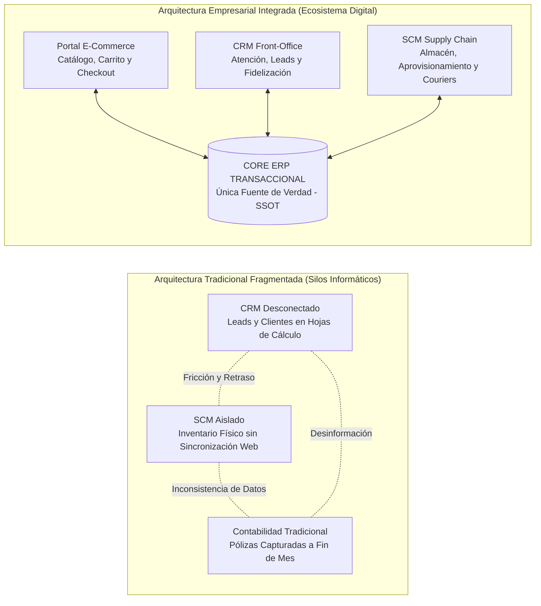
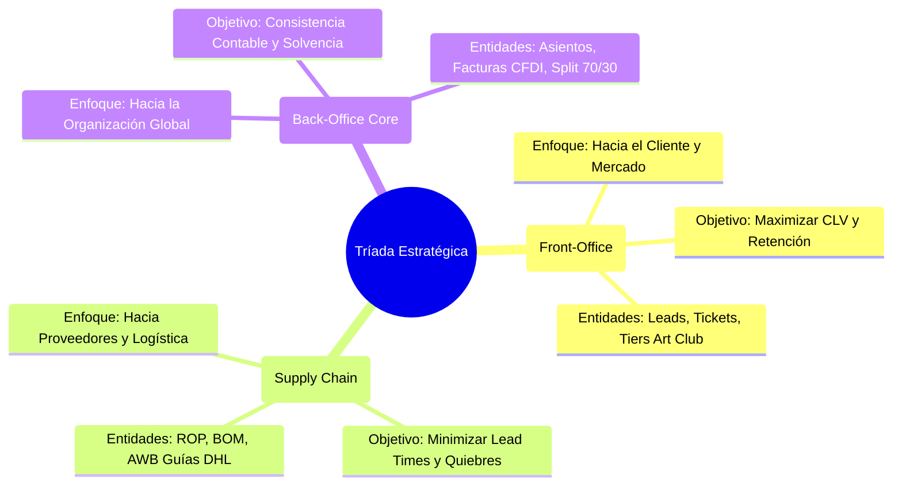
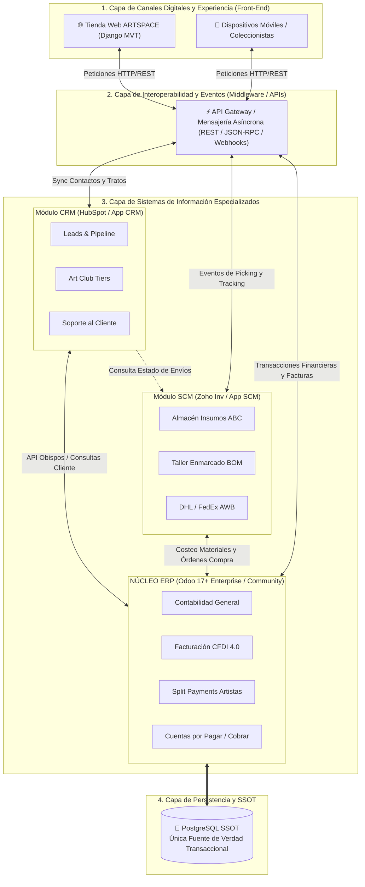
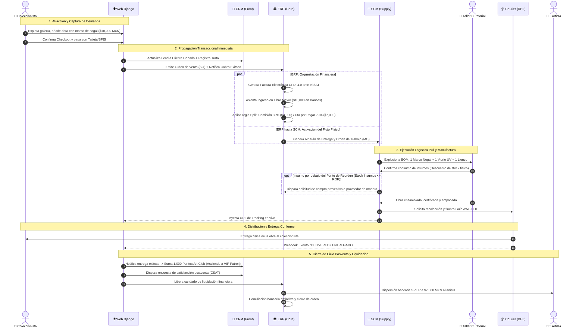

# 📑 ENSAYO ACADÉMICO Y TÉCNICO: LA INTERRELACIÓN ESTRATÉGICA CRM — SCM — ERP EN LA ARQUITECTURA DE NEGOCIOS ELECTRÓNICOS MODERNOS

---

## 🏛️ DATOS DE IDENTIFICACIÓN INSTITUCIONAL
* **Institución:** Instituto Tecnológico de Apizaco (TecNM Campus Apizaco)
* **Facultad:** Departamento de Sistemas y Computación
* **Licenciatura / Ingeniería:** Ingeniería en Computación
* **Asignatura:** Negocios Electrónicos II
* **Eje Temático:** Eje 1 — Ensayo Explicativo: Interrelación CRM - SCM - ERP y Flujo de Valor Digital
* **Proyecto Integrador:** ARTSPACE (Galería E-Commerce de Arte Contemporáneo y Digital)
* **Equipo de Desarrollo:** Equipo 3
* **Integrantes:**
  * *Almendra Valenzuela Rodrigo* (Líder Técnico & Desarrollador Backend)
* **Docente Titular:** M.C. / Dr. [Nombre del Docente]
* **Fecha de Elaboración:** Octubre de 2026

---

## 📋 RESUMEN (ABSTRACT)

El presente ensayo analiza con rigor académico y técnico la articulación simbiótica entre los sistemas de Gestión de Relaciones con los Clientes (**CRM**), Gestión de la Cadena de Suministro (**SCM**) y Planificación de Recursos Empresariales (**ERP**) dentro del ecosistema de comercio electrónico contemporáneo. Históricamente, las organizaciones operaron bajo modelos departamentales fragmentados («islas de información»), lo que en la era digital representa una pérdida crítica de competitividad, inconsistencia operativa y degradación de la experiencia del usuario. A través de un enfoque basado en arquitecturas empresariales modernas orientadas a servicios (SOA) y eventos (EDA), se demuestra que la viabilidad y rentabilidad de un negocio electrónico no reside en la sofisticación aislada de su interfaz gráfica, sino en la sincronización orquestada de una **Única Fuente de Verdad (Single Source of Truth - SSOT)**. Se examina a fondo la mecánica del flujo transaccional y de datos bidireccional entre la captura de demanda (Front-Office), el cumplimiento físico-logístico (Supply Chain) y el control contable, financiero y tributario (Back-Office), tomando como caso de aplicación empírica el proyecto **ARTSPACE**. Finalmente, se reflexiona sobre los desafíos de interoperabilidad técnica y gestión del cambio organizacional que condicionan el éxito de estas plataformas integradas.

* **Palabras Clave:** CRM, SCM, ERP, Negocios Electrónicos, Flujo de Datos, Cadena de Valor, Única Fuente de Verdad, Interoperabilidad, Arquitectura Empresarial.

---

## 1. INTRODUCCIÓN Y PLANTEAMIENTO DEL PROBLEMA

Durante las primeras etapas del desarrollo del comercio electrónico a escala global, predominó una concepción marcadamente transaccional y tecnocéntrica. Las organizaciones asumían que bastaba con implementar un catálogo web accesible y acoplar una pasarela de pagos electrónicos para garantizar el éxito comercial en entornos digitales (Laudon & Laudon, 2020). No obstante, la rápida sofisticación de los consumidores, la hipercompetencia en canales digitales y la proliferación de cadenas de suministro globales e híbridas han dejado al descubierto las profundas limitaciones de este paradigma reduccionista. 

Un sitio de comercio electrónico no es una entidad aislada; constituye la frontera digital visible de una compleja red operativa, logística y financiera. Cuando las aplicaciones que sostienen las diferentes áreas funcionales operan de forma inconexa —lo que en la literatura de sistemas de información se cataloga como «silos organizacionales» o «islas informáticas» (Davenport, 1998; Monk & Wagner, 2013)—, la organización experimenta fricciones estructurales inmediatas: duplicidad en la captura de información, discrepancias críticas entre los inventarios publicados y las existencias físicas en bodega, retrasos en la facturación y dispersión fiscal, y una incapacidad generalizada para construir una visión integral del cliente (visión 360°).

Ante esta problemática, la teoría moderna de la administración de operaciones y las ciencias computacionales postulan que la excelencia competitiva y la resiliencia operativa en los negocios electrónicos dependen de la **articulación armónica de tres plataformas troncales**:
1. El **CRM (Customer Relationship Management)**, orientado a la gestión estratégica del cliente y la demanda (Front-Office).
2. El **SCM (Supply Chain Management)**, enfocado en la sincronización eficiente del flujo físico de materiales e inventarios (Supply Chain).
3. El **ERP (Enterprise Resource Planning)**, que funge como el sistema nervioso central, asegurando la consistencia transaccional, contable, financiera y de gobernanza (Back-Office & Core).

El objetivo central de este ensayo es analizar cómo interactúan y se complementan estas tres soluciones tecnológicas dentro de una arquitectura empresarial moderna, desentrañando el flujo de datos y el valor económico que generan al integrarse en el marco de una plataforma de negocios electrónicos.

---

## 2. FUNDAMENTOS Y ROLES ESTRATÉGICOS DE LA TRÍADA TECNOLÓGICA

Para desentrañar su interrelación, resulta indispensable caracterizar con precisión el dominio de responsabilidad, los objetivos de negocio y las fronteras operativas de cada componente de la tríada.

### 2.1 El CRM: Gestión de la Demanda y Experiencia del Cliente (Front-Office)
El CRM trasciende la noción convencional de una agenda digitalizada de contactos; constituye una filosofía corporativa y un conjunto de herramientas tecnológicas diseñadas para maximizar el valor de vida del cliente (*Customer Lifetime Value - CLV*) y reducir la tasa de deserción (*Churn Rate*) (O'Brien & Marakas, 2011). En el contexto de un e-commerce especializado como **ARTSPACE**, el CRM opera en la capa frontal, interactuando directamente con el usuario final. 

Sus responsabilidades primordiales comprenden:
* **Captación y Nutrición de Prospectos (Inbound Marketing):** Registro sistemático de visitantes interesados en obras artísticas o preventas mediante formularios activos y suscripciones a boletines especializados.
* **Pipeline de Ventas y Seguimiento Comercial:** Modelado de embudos por etapas (prospección, calificación, propuesta, cierre ganado/perdido), permitiendo a los curadores y asesores brindar acompañamiento consultivo en obras de alta gama.
* **Atención al Cliente Omnicanal (Service Desk):** Resolución estructurada de dudas sobre autenticidad, condiciones de conservación y políticas de devolución mediante canales sincrónicos (chatbots interactivos) y asincrónicos (sistemas de ticketing con Acuerdos de Nivel de Servicio - SLA preestablecidos).
* **Fidelización y Gamificación:** Gobernanza de programas de lealtad (como *Art Club*), acreditando puntos canjeables por cada compra confirmada y segmentando a los coleccionistas en niveles de privilegio (*Explorer, Collector, Patron*).

Sin embargo, el CRM posee una limitación estructural inherente: **no administra el inventario físico ni los balances contables**. Un CRM aislado puede prometer una obra exclusiva a un coleccionista sin contar con la certeza de si la pieza física está disponible en bodega, si los insumos de enmarcado están agotados o si el pago ya fue debidamente acreditado y timbrado fiscalmente.

### 2.2 El SCM: Sincronización del Flujo Físico y Aprovisionamiento (Logística de Cadena)
El SCM se encarga de la planificación, ejecución y control de todas las actividades vinculadas al flujo y transformación de bienes, desde la adquisición de materias primas hasta la entrega del producto terminado en las manos del consumidor final (Chopra & Meindl, 2016). En el comercio electrónico moderno, el SCM enfrenta el reto de gobernar tanto cadenas tradicionales como modelos de cumplimiento deslocalizados (*fulfillment*, comercio transfronterizo y logística inversa).

En el modelo de negocio de ARTSPACE, el SCM gestiona la dualidad de la oferta:
* **Estrategias Push (Pronóstico de Demanda):** Aprovisionamiento preventivo y control de stock físico de láminas pre-impresas (*prints* de colección) e insumos estandarizados con alta rotación (varillas de madera noble, cristales de protección UV, cajas blindadas de transporte).
* **Estrategias Pull (Fabricación Bajo Demanda / Justo a Tiempo):** Activación de órdenes de producción curatorial y enmarcado artesanal únicamente cuando una orden de compra ha sido confirmada en la pasarela de pagos (*Postponement* o aplazamiento logístico).
* **Gestión de Proveedores y Umbrales de Stock:** Homologación de proveedores críticos (moldureras, papeleras de bellas artes, artistas directos) bajo métricas de cumplimiento de tiempos de entrega (*Lead Time*) y calidad (SLA), gobernando el inventario mediante modelos de Clasificación ABC, Cálculo de Punto de Reorden (ROP) y Stock de Seguridad (SS).
* **Distribución de Última Milla y Trazabilidad:** Integración mediante interfaces de programación de aplicaciones (APIs) con paqueterías internacionales de primer nivel (DHL Express, FedEx Priority) para generar de forma inmediata cartas porte, guías aéreas (AWB) y monitorear el estado del despacho en tiempo real.

No obstante, al igual que el CRM, el SCM carece de la visión de conjunto financiero: optimiza la ruta de transporte y el nivel de existencias, pero no determina la rentabilidad neta de la venta, no procesa la liquidación de comisiones a los creadores independientes ni emite comprobantes fiscales conformes a la legislación tributaria.

### 2.3 El ERP: El Núcleo de Gobernanza y la Única Fuente de Verdad (Back-Office)
El sistema ERP representa el cimiento sobre el cual se sustenta la arquitectura corporativa. Definido por Davenport (1998) y Sumner (2014) como una plataforma modular de software que integra de manera desasistida y estandarizada los procesos neurálgicos de la organización, su principal virtud radica en su modelo de datos unificado: la **Base de Datos Centralizada o Única Fuente de Verdad (*Single Source of Truth - SSOT*)**.

En una empresa digital, el ERP no compite con el CRM ni con el SCM; por el contrario, actúa como su **orquestador central**:
* **Contabilidad General y Libro Mayor:** Cada transacción originada en el portal de ventas, cada flete pagado a la paquetería y cada compra de insumos a crédito se traduce automáticamente en asientos contables balanceados (débito y crédito), eliminando por completo los reprocesos de conciliación mensual.
* **Cumplimiento Tributario y Facturación Electrónica:** Automatización de la emisión y timbrado de comprobantes fiscales por Internet (CFDI 4.0 en México), aplicando los impuestos correspondientes (IVA, retenciones de ISR para creadores independientes) de acuerdo con los marcos normativos vigentes.
* **Liquidación Financiera de Proveedores (*Split Payments*):** En modelos de galería e-commerce donde participan artistas independientes, el ERP ejecuta la lógica de partición de fondos: retiene la comisión correspondiente a la plataforma (ej. 30%) y programa la cuenta por pagar y dispersión bancaria neta al artista (70%) una vez certificada la entrega física conforme.
* **Control Presupuestal y Análisis de Rentabilidad:** Consolidación de ingresos brutos, costos de mercancías vendidas (COGS), gastos de embalaje y fletes, arrojando estados de resultados y márgenes de contribución en tiempo real para la toma de decisiones directivas.

---

## 3. ARTICULACIÓN Y COMPLEMENTARIEDAD EN UNA ARQUITECTURA EMPRESARIAL MODERNA

La integración exitosa de CRM, SCM y ERP no se logra mediante la simple interconexión ad-hoc de bases de datos mediante scripts aislados (*spaghetti architecture*), sino a través del diseño formal de una **Arquitectura Empresarial en Capas**, orientada a servicios (SOA) y gobernada por eventos (*Event-Driven Architecture - EDA*).

### 3.1 Superación de la Fragmentación: El Paradigma de la Información Unificada
En las arquitecturas fragmentadas, cada aplicación mantiene su propio catálogo de clientes y productos. Un cliente que actualiza su dirección fiscal en el portal de soporte no ve reflejado el cambio en la bodega de envíos, lo que genera paquetes devueltos y sobrecostos por reexpedición. 

En una arquitectura integrada articulada por el ERP:
1. **El catálogo de entidades es universal:** Existe una única entidad `Partner/Cliente` compartida entre el CRM y el ERP. Si el cliente asciende de nivel en el programa de lealtad en el CRM, el ERP habilita de inmediato condiciones de crédito o descuentos preferenciales en la orden de venta.
2. **El catálogo de productos es dinámico y multipropósito:** Para el CRM, una obra de arte es un artículo aspiracional con fotos en alta resolución e información biográfica del artista; para el SCM, es una unidad de almacenamiento con dimensiones físicas, peso volumétrico y requerimientos de embalaje rígido; para el ERP, es un activo inventariable asociado a una cuenta contable de inventario, con un costo de adquisición específico y un régimen de gravamen fiscal determinado.

### 3.2 Mecanismos de Interoperabilidad: APIs, Webhooks y Acoplamiento Débil
La articulación moderna no recurre a bases de datos compartidas sin control (*database sharing*), lo cual generaría cuellos de botella y vulnerabilidades de integridad referencial. Por el contrario, se implementa un **acoplamiento débil (*loose coupling*)** sustentado en:
* **APIs Web Estándar (REST y JSON-RPC):** El backend del e-commerce (ej. Django) interactúa con el CRM y el ERP mediante llamadas remotas autenticadas. Cuando se procesa el cobro exitoso de una obra, el servidor web emite una petición `POST` al endpoint `/api/sale/order` del ERP, transmitiendo el identificador del comprador, las líneas de productos y el comprobante de pago digital.
* **Webhooks y Notificaciones Asíncronas:** Las paqueterías (DHL) o las pasarelas de pago no son sondeadas continuamente mediante peticiones repetitivas (*polling* ineficiente); en su lugar, cuando el transportista escanea el paquete como «Entregado», dispara un Webhook hacia el sistema. Este evento actualiza simultáneamente la orden en el SCM, desencadena la acreditación de puntos en el CRM y autoriza la dispersión de fondos al artista en el ERP.

---

## 4. ANÁLISIS DEL FLUJO DE DATOS Y CADENA DE VALOR DIGITAL

La verdadera potencia de la interrelación CRM — SCM — ERP se manifiesta en el flujo continuo de datos a través de los procesos neurálgicos del negocio. Michael Porter (1985) definió la **Cadena de Valor** como el conjunto de actividades primarias y de soporte mediante las cuales una empresa genera valor económico superior para sus clientes. En los negocios electrónicos, la cadena de valor física es impulsada y guiada por una **Cadena de Valor Virtual de la Información** (Rayport & Sviokla, 1995).

Para ilustrar de forma concreta este fenómeno, se modela a continuación el ciclo de vida transaccional completo en **ARTSPACE** ante la adquisición de una obra de arte físico enmarcada:

### 4.1 Análisis Fase por Fase de la Generación de Valor

#### Fase 1: Atracción, Conversión y Captura de Demanda (CRM ➔ ERP)
* **Datos Involucrados:** Perfil del coleccionista, historial de navegación, código de obra, especificaciones de acabado y datos fiscales (RFC, Código Postal, Régimen Fiscal).
* **Flujo de Valor:** El CRM aporta inteligencia comercial previa. Al momento del pago, transforma una interacción efímera en una orden formal confirmada (`Sales Order`), evitando la pérdida del cliente y eliminando tiempos muertos de cotización.

#### Fase 2: Compromiso Fiscal y Orquestación de Recursos (ERP Core)
* **Datos Involucrados:** Folio fiscal digital, desglose de impuestos (IVA 16%), porcentaje de retención fiscal y cuentas contables auxiliares.
* **Flujo de Valor:** El ERP dota de **certeza jurídica y solidez financiera** a la operación digital. En el mismo segundo en que el dinero ingresa por la pasarela de pagos, se emite el comprobante fiscal digital ante la autoridad tributaria (evitando sanciones por evasión) y se provisiona de forma estricta la deuda con el artista independiente (`Cuentas por Pagar`), blindando el flujo de caja operativo de la empresa.

#### Fase 3: Despliegue de Fabricación Justo a Tiempo y Abasto (ERP ➔ SCM)
* **Datos Involucrados:** Lista de materiales (*Bill of Materials - BOM*), consumos de molduras y pliegos de papel de algodón, niveles de existencias y tiempos de entrega (*Lead Time*).
* **Flujo de Valor:** El ERP instruye al SCM para activar el ensamble únicamente sobre demanda confirmada (Estrategia Pull / Postponement). Esto reduce a cero el riesgo de producir cuadros terminados que no se vendan y evita el capital inmovilizado en bodega. Si el consumo de varillas de nogal hace que el stock caiga por debajo del Punto de Reorden (ROP), el sistema alerta de inmediato la reposición preventiva hacia el proveedor homologado.

#### Fase 4: Trazabilidad, Despacho y Logística de Última Milla (SCM ➔ Couriers ➔ Cliente)
* **Datos Involucrados:** Peso volumétrico, dimensiones en centímetros, código de barras del embalaje, número de guía de transporte internacional (AWB) y coordenadas de geolocalización.
* **Flujo de Valor:** El SCM aporta certidumbre física. Al automatizar la generación de etiquetas con DHL Express, se reducen a cero los errores humanos de rotulación manual en bodega. La inyección automática de la URL de rastreo en el portal del cliente reduce drásticamente las consultas ansiosas de soporte («¿Dónde está mi pedido?»), disminuyendo los costos de atención al cliente.

#### Fase 5: Posventa, Fidelización y Liquidación Automática (CRM ⟷ ERP)
* **Datos Involucrados:** Confirmación de entrega vía Webhook, saldo de puntos de fidelidad, nivel de lealtad (Tier) y cuenta CLABE interbancaria para dispersión SPEI.
* **Flujo de Valor:** Se cierra el círculo virtuoso del negocio digital. La confirmación del transportista dispara simultáneamente dos acciones que antes requerían días de trámites burocráticos:
  1. *Hacia el Cliente (CRM):* Se le premia inmediatamente por su compra con 1,000 Puntos de Arte, promoviéndolo a una categoría VIP que asegura su recompra futura.
  2. *Hacia el Artista (ERP):* Se realiza la dispersión bancaria desasistida del 70% correspondiente a sus honorarios. Esto construye lealtad en la red de creadores, atrayendo a los mejores artistas independientes a la plataforma debido a la puntualidad y transparencia en los pagos.

### 4.2 Matriz de Intercambio de Información entre Sistemas

La siguiente matriz sintetiza el flujo de entidades de datos entre los tres sistemas y el impacto directo en la creación de valor empresarial:

| Entidad de Información | Sistema Emisor | Sistema Receptor | Disparador Operativo (*Trigger*) | Impacto Directo en la Cadena de Valor |
| :--- | :--- | :--- | :--- | :--- |
| **Nuevo Cliente y Carrito Confirmado** | Portal Web / CRM | ERP | Checkout exitoso del comprador. | Registro instantáneo de la orden contable y reserva de existencias. |
| **Factura CFDI 4.0 Timbrada** | ERP | CRM / Portal | Validación de cobro bancario. | Entrega inmediata del comprobante fiscal PDF/XML al comprador; cumplimiento legal. |
| **Orden de Trabajo / Ensamble (MO)** | ERP | SCM (Taller MRP) | Confirmación de orden de venta pagada. | Inicio de enmarcado artesanal bajo demanda (cero inventario ocioso terminado). |
| **Consumo de Insumos y Alerta ROP** | SCM (Almacén) | ERP (Compras) | Descuento físico de molduras y cristales. | Generación automática de orden de compra a proveedores de materias primas. |
| **Número de Guía Courier (AWB)** | SCM (DHL/FedEx) | CRM / Portal | Generación de etiqueta de envío en almacén. | Trazabilidad en tiempo real y erradicación de la incertidumbre en el comprador. |
| **Evento de Entrega Conforme** | SCM (Webhook) | CRM | Escaneo de entrega firmado por el cliente. | Acreditación automática de puntos de fidelidad y detonación de encuesta CSAT. |
| **Dispersión SPEI (Split 70/30)** | SCM / CRM | ERP | Cierre de ciclo logístico sin reclamaciones. | Pago desasistido al artista; fidelización de la red de proveedores de talento. |

---

## 5. DISCUSIÓN CRÍTICA: DESAFÍOS TÉCNICOS, FACTOR HUMANO Y RIESGOS DE ADOPCIÓN

A pesar de los incuestionables beneficios que aporta la integración tripartita CRM — SCM — ERP, la literatura académica y la práctica profesional demuestran que entre el **50% y el 70% de los proyectos de implementación de sistemas empresariales integrados fracasan** en cumplir con sus expectativas de presupuesto, tiempo o alcance (Davenport, 2000; Standish Group, 2020). Por tanto, un análisis riguroso exige abordar los factores críticos de riesgo que condicionan su éxito:

```mermaid
mindmap
  root((Desafíos de Integración))
    Técnicos y Arquitectónicos
      Consistencia de Datos (ACID vs Base)
      Latencia y Dependencia de APIs
      Seguridad y Gobernanza de Datos
    Financieros y Costos Ocultos
      TCO a Mediano Plazo
      Consultoría Especializada
      Costos de Licenciamiento por Asiento
    Organizacionales y Humanos
      Resistencia Cultural al Cambio
      Capacitación Insuficiente de Usuarios
      Silos Departamentales Arraigados
```

### 5.1 Desafíos Técnicos y de Integración de Datos
* **Consistencia Transaccional vs. Consistencia Eventual:** En arquitecturas distribuidas basadas en microservicios o sistemas híbridos (ej. Django conectado a Odoo y HubSpot), mantener la atomicidad de las operaciones representa un reto complejo. Si el pago se procesa en el banco pero la API del ERP sufre una interrupción temporal de red, se requiere la implementación rigurosa de patrones arquitectónicos avanzados (como el patrón *Saga* o colas de mensajes con reintentos exponenciales) para evitar inconsistencias de inventario o facturas huérfanas.
* **Gobernanza de Datos y Calidad de la Información (*Data Hygiene*):** La máxima computacional «basura entra, basura sale» (*garbage in, garbage out*) adquiere una dimensión crítica en sistemas integrados. Si el formulario web permite la captura de direcciones erróneas o RFCs inválidos, el error se propaga en cascada al ERP (rechazo de timbrado por el SAT) y al SCM (paquete retenido en paquetería). La validación estricta de datos en el punto de entrada es un prerrequisito innegociable.

### 5.2 El Factor Humano y la Gestión del Cambio Organizacional
El error más común de los equipos de ingeniería de software consiste en asumir que la integración es un problema meramente tecnológico. Como señalan Somers & Nelson (2001), los sistemas ERP/CRM/SCM transforman la forma en que las personas trabajan, alteran las relaciones de poder y exigen una transparencia operativa que con frecuencia despierta **resistencia al cambio**:
* El personal de almacén puede percibir el registro minucioso de cada metro de moldura consumido como una sobrecarga burocrática o un mecanismo invasivo de fiscalización laboral.
* Los vendedores o curadores pueden resistirse a capturar sus prospectos en el CRM, prefiriendo conservar sus contactos en agendas privadas.
* Para mitigar estos riesgos, la adopción debe acompañarse de estrategias formales de **Gestión del Cambio Organizacional (*Organizational Change Management - OCM*)**, incluyendo la designación de usuarios clave (*Champions*), esquemas de capacitación basados en roles reales y un fuerte patrocinio directivo que sancione la permanencia de prácticas informales fuera del sistema.

### 5.3 Viabilidad Financiera y Selección de Software Adecuado
El mercado de software empresarial ofrece desde suites corporativas de costo prohibitivo (SAP S/4HANA, Salesforce Enterprise, Oracle Cloud) diseñadas para corporaciones multinacionales, hasta soluciones modulares de código abierto y suites para pequeñas y medianas empresas (Odoo, Zoho One, ERPNext). 
Intentar implementar un sistema sobredimensionado para el volumen transaccional de una PyME de comercio electrónico puede desembocar en el agotamiento del capital de trabajo de la empresa. De ahí la importancia de aplicar procedimientos metodológicos rigurosos de evaluación multicriterio y cálculo de Costo Total de Propiedad (**TCO**) —como los desarrollados en la práctica técnica previa de este proyecto— para garantizar que la solución adoptada maximice el retorno sobre la inversión (ROI).

---

## 6. CONCLUSIONES

A lo largo de este ensayo se ha demostrado que, en el contexto del comercio electrónico y los negocios digitales contemporáneos, **la fragmentación tecnológica constituye el principal obstáculo para la escalabilidad y la rentabilidad empresarial**. 

1. **Sinergia Inseparable:** El CRM, el SCM y el ERP no son alternativas excluyentes ni aplicaciones que deban competir por presupuesto en la organización; conforman una tríada simbiótica indivisible. El CRM identifica, capta y retiene la demanda; el SCM asegura el suministro de materiales, la producción ágil y la entrega física; y el ERP gobierna el flujo financiero, liquida a los participantes de la cadena y garantiza la consistencia contable y legal de la organización.
2. **La Información como Activo Estratégico:** La integración de estos tres pilares sobre una Única Fuente de Verdad (SSOT) transforma los datos transaccionales en un activo estratégico. Al sincronizar en tiempo real las ventas web con la contabilidad y la logística, la empresa reduce sus costos de transacción, erradica los quiebres de inventario y optimiza su capital de trabajo.
3. **Equilibrio entre Tecnología y Organización:** La exitosa articulación de estos sistemas depende en igual medida del rigor en la arquitectura de software (APIs limpias, servicios desacoplados, validación de datos) y de la madurez organizacional para adoptar mejores prácticas y gestionar el cambio cultural en los equipos de trabajo.

Para el proyecto **ARTSPACE**, la adopción coordinada de esta tríada estratégica representa el paso definitivo para trascender la condición de un prototipo web estático y consolidarse como una plataforma formal, transparente y altamente competitiva en la economía digital.

---

## 7. REFERENCIAS BIBLIOGRÁFICAS (NORMA APA 7.ª EDICIÓN)

1. **Chopra, S., & Meindl, P. (2016).** *Supply Chain Management: Strategy, Planning, and Operation* (6th ed.). Pearson Education.
2. **Davenport, T. H. (1998).** *Putting the Enterprise into the Enterprise System.* Harvard Business Review, 76(4), 121–131.
3. **Davenport, T. H. (2000).** *Mission Critical: Realizing the Promise of Enterprise Systems.* Harvard Business School Press.
4. **Laudon, K. C., & Laudon, J. P. (2020).** *Management Information Systems: Managing the Digital Firm* (16th ed.). Pearson Education.
5. **Monk, E. F., & Wagner, B. J. (2013).** *Concepts in Enterprise Resource Planning* (4th ed.). Cengage Learning.
6. **O'Brien, J. A., & Marakas, G. M. (2011).** *Management Information Systems* (10th ed.). McGraw-Hill/Irwin.
7. **Porter, M. E. (1985).** *Competitive Advantage: Creating and Sustaining Superior Performance.* Free Press.
8. **Rayport, J. F., & Sviokla, J. J. (1995).** *Exploiting the Virtual Value Chain.* Harvard Business Review, 73(6), 75–85.
9. **Shang, S., & Seddon, P. B. (2002).** *Assessing and Managing the Benefits of Enterprise Systems: The Business Manager's Perspective.* Information & Management, 39(4), 271–299. https://doi.org/10.1016/S0378-7206(01)00098-8
10. **Somers, T. M., & Nelson, K. (2001).** *The Impact of Critical Success Factors Across the Stages of Enterprise Resource Planning Implementations.* Proceedings of the 34th Annual Hawaii International Conference on System Sciences, IEEE. https://doi.org/10.1109/HICSS.2001.927129
11. **Standish Group. (2020).** *The Chaos Report: Beyond Infinity.* The Standish Group International.
12. **Sumner, M. (2014).** *Enterprise Resource Planning.* Pearson New International Edition.
13. **Verville, J., & Halingten, A. (2002).** *An Investigation of the Decision Process for Selecting an ERP Software: The Scoping and Evaluation Phases.* IEEE Transactions on Engineering Management, 49(3), 206–216. https://doi.org/10.1109/TEM.2002.803378
14. **Wei, C. C., Chien, C. F., & Wang, M. J. J. (2005).** *An AHP-based Approach to ERP System Selection.* International Journal of Production Economics, 96(1), 47–62. https://doi.org/10.1016/j.ijpe.2004.03.004

---

### 📂 Navegación de la Práctica (Ejes de Entrega)
* [Eje 1: Ensayo Académico y Técnico de Interrelación CRM - SCM - ERP](file:///c:/Users/AVRB9/Downloads/pagina/pagina/ensayo_interrelacion_crm_scm_erp.md)
* [Eje 2: Reporte de Evaluación del Avance del Proyecto y Diagnóstico de Cuellos de Botella](file:///c:/Users/AVRB9/Downloads/pagina/pagina/evaluacion_avance_proyecto_erp.md)
* [Eje 3: Propuesta Formal de Integración de Módulos ERP y Documentación](file:///c:/Users/AVRB9/Downloads/pagina/pagina/propuesta_integracion_modulos_erp.md)

