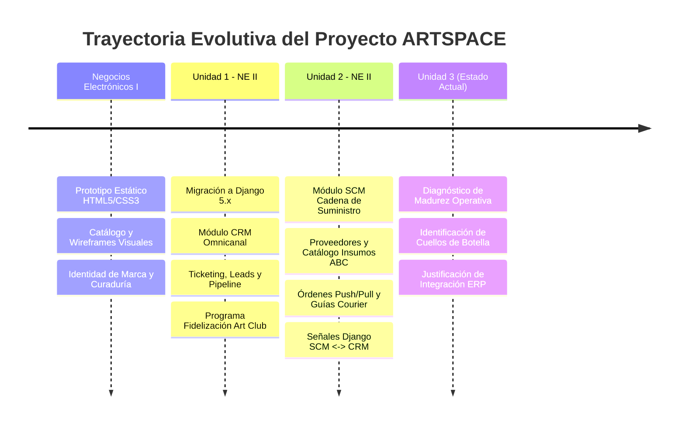
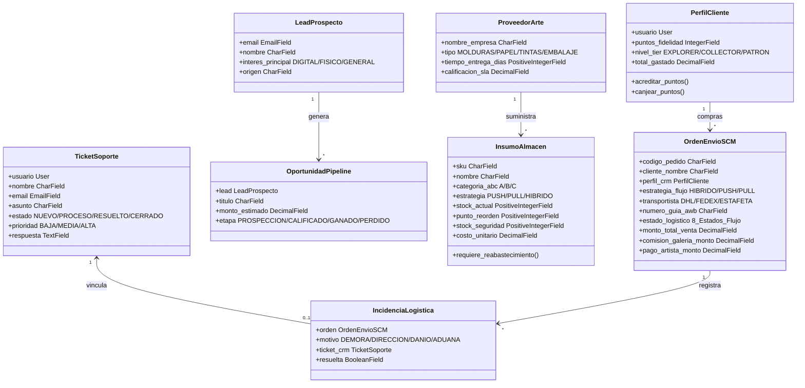
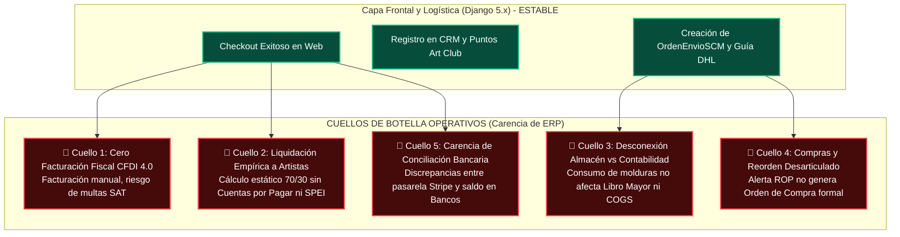

# 📊 REPORTE DE EVALUACIÓN DEL AVANCE DEL PROYECTO ELECTRÓNICO Y DIAGNÓSTICO DE CUELLOS DE BOTELLA OPERATIVOS
## EJE 2: EVALUACIÓN DE MADUREZ OPERATIVA Y REQUERIMIENTOS PARA LA INTEGRACIÓN ERP
### PROYECTO INTEGRADOR: ARTSPACE (E-COMMERCE DE ARTE CONTEMPORÁNEO Y DIGITAL)
#### Asignatura: Negocios Electrónicos II — Universidad Autónoma de Tlaxcala

---

## 🏛️ DATOS DE IDENTIFICACIÓN INSTITUCIONAL

* **Institución:** Universidad Autónoma de Tlaxcala (UATx)
* **Facultad:** Facultad de Ciencias Básicas, Ingeniería y Tecnología
* **Licenciatura / Ingeniería:** Ingeniería en Computación
* **Asignatura:** Negocios Electrónicos II
* **Eje de Entrega:** Eje 2 — Evaluación del Avance del Proyecto Electrónico (Unidades 1 y 2) y Diagnóstico de Cuellos de Botella
* **Nombre del Proyecto:** ARTSPACE (Galería E-Commerce de Arte Contemporáneo y Digital)
* **Equipo de Desarrollo:** Equipo 3
* **Integrantes:**
  * *Almendra Valenzuela Rodrigo* (Líder Técnico & Desarrollador Backend)
* **Docente Titular:** M.C. / Dr. [Nombre del Docente]
* **Fecha de Emisión:** Octubre de 2026

---

## 🎯 OBJETIVO DE LA EVALUACIÓN

Evaluar de manera crítica y cuantitativa el estado actual de madurez técnica, funcional y de negocio del proyecto de comercio electrónico **ARTSPACE**, analizando los módulos implementados a lo largo de las **Unidades 1 (CRM)** y **2 (SCM)** en el marco de la asignatura Negocios Electrónicos II (y sus fundamentos previos en Negocios Electrónicos I), con el fin de diagnosticar las áreas de oportunidad, los cuellos de botella transaccionales y los requerimientos operativos no cubiertos que fundamentan y exigen la integración de módulos de **Planificación de Recursos Empresariales (ERP)**.

---

# 🚀 1. ANÁLISIS DEL ESTADO ACTUAL DEL PROYECTO (HISTORIAL EVOLUTIVO)

El proyecto **ARTSPACE** ha seguido un ciclo de vida de desarrollo iterativo e incremental. Lo que inició como una propuesta conceptual y un prototipo visual estático en Negocios Electrónicos I se ha consolidado como una plataforma web transaccional desarrollada sobre el framework de grado industrial **Django 5.x**, estructurada en el patrón Modelo-Vista-Template (MVT) y soportada por una base de datos relacional.

---

## 1.1 Matriz de Evolución por Fases del Sistema

A continuación se audita formalmente la evolución funcional del sistema a través de las etapas del plan de estudios:

| Dimensión Técnica / Funcional | Fase Inicial (NE I) — Prototipo Estático | Fase Unidad 1 (NE II) — Plataforma CRM | Fase Unidad 2 (NE II) — Ecosistema SCM | Estado Actual (Línea Base para ERP) |
| :--- | :--- | :--- | :--- | :--- |
| **Arquitectura de Software** | Archivos planos HTML5, CSS3 vanilla sin backend ni persistencia. | Backend **Django 5.x**, ORM relacional SQLite/PostgreSQL y vistas MVT. | Arquitectura orientada a servicios (SOA) en Django con modelo transaccional. | Plataforma web robusta pero con el Back-Office financiero y contable desconectado. |
| **Catálogo de Obras** | Obras codificadas rígidamente (*hardcoded*) en plantillas HTML. | Modelado dinámico en base de datos con categorización por técnica y artista. | Manejo de variantes: obra digital (NFT/4K), física con marco nogal y lámina rollo. | Catálogo comercial funcional, sin costeo automatizado de insumos en libro mayor. |
| **Gestión de Clientes (CRM)** | Formulario básico de contacto con redirección `mailto:` sin registro. | **Módulo CRM Operativo:** `TicketSoporte`, `LeadProspecto`, `OportunidadPipeline`. | **CRM Enlazado:** Perfil 360° del cliente asociado a guías de despacho y tickets de soporte. | Completa trazabilidad de leads y tickets; sin enlace a cuentas corrientes financieras. |
| **Fidelización y Gamificación** | Inexistente. | **Art Club:** Algoritmo de puntos (10 pts por $100 MXN) y tiers (*Explorer, Collector, Patron*). | Acreditación automatizada disparada por evento logístico de entrega exitosa en SCM. | Programa de lealtad activo en CRM; sin impacto en listas de precios dinámicas del ERP. |
| **Cadena de Suministro (SCM)** | No contemplada. | Simulación conceptual de tiempos de envío en textos estáticos. | **Módulo SCM Híbrido:** `ProveedorArte`, inventario ABC `InsumoAlmacen`, ROP y Stock de Seguridad. | Gestión física de almacén funcional; sin emisión automática de órdenes de compra (PO). |
| **Logística y Despacho** | Sin seguimiento ni transportistas. | Confirmación por correo electrónico simulado. | Ciclo de 8 estados logísticos (`OrdenEnvioSCM`), simulación de guías Courier (DHL/FedEx AWB). | Control de envíos y mesa de incidencias; falta de conciliación de fletes y seguros. |
| **Finanzas, Contabilidad y CFDI** | Inexistente. | Registro básico de montos en oportunidad comercial. | Cálculo numérico referencial de partición (*Split 70% Artista / 30% Galería*). | **CRÍTICO / CERO AUTOMATIZACIÓN:** Sin timbrado fiscal SAT, sin asientos contables ni libro mayor. |

---

## 1.2 Auditoría del Código Backend y Modelos Implementados en Django

La infraestructura desarrollada y verificada en el archivo [gallery/models.py](file:///c:/Users/AVRB9/Downloads/pagina/gallery/models.py) demuestra una sólida base de datos relacional para Front-Office y Logística, organizada en los siguientes submódulos:

### Fortalezas Técnicas Demostradas en la Operación Actual:
1. **Atención y Fidelización Omnicanal (Unidad 1):** El sistema captura leads desde el newsletter del pie de página y procesa solicitudes de soporte mediante vistas validadas en [gallery/views.py](file:///c:/Users/AVRB9/Downloads/pagina/gallery/views.py). El motor de gamificación calcula puntos de forma estricta y asciende automáticamente de nivel (*Tier*) al coleccionista.
2. **Logística Híbrida y Despacho Físico (Unidad 2):** Implementación del concepto de *Postponement* (aplazamiento), manteniendo insumos base prealmacenados (Push) y detonando el ensamblado de marcos de madera noble y cristales de conservación UV únicamente al confirmarse la orden de compra (Pull).
3. **Automatización por Señales (`django.db.models.signals`):** Conexión reactiva entre módulos:
   * Cuando una `OrdenEnvioSCM` cambia su estado a `ENTREGADO`, la señal `sincronizar_scm_con_crm` acredita puntos automáticamente al perfil del comprador en el CRM.
   * Si la orden pasa a `INCIDENCIA` logística, se dispara automáticamente la apertura de un `TicketSoporte` con prioridad alta para intervención preventiva del equipo de atención.

---

# ⚠️ 2. IDENTIFICACIÓN Y DIAGNÓSTICO DE CUELLOS DE BOTELLA Y ÁREAS DE OPORTUNIDAD

A pesar de la madurez alcanzada en la interfaz del cliente y en los controladores logísticos, una auditoría técnica profunda revela que **ARTSPACE opera actualmente como un negocio digital truncado en su Back-Office**. La falta de una plataforma ERP centralizada genera fricciones operativas críticas, dependencia de procesos manuales y riesgos fiscales severos que impiden la escalabilidad del proyecto.

---

## 2.1 Cuello de Botella 1: Inexistencia de Facturación Electrónica Fiscal Automatizada (CFDI 4.0 / SAT)
* **Situación Actual en el Proyecto:** Cuando un coleccionista realiza el checkout y paga una obra por $10,000 MXN en el portal de Django, el sistema únicamente persiste un registro en la base de datos y muestra una confirmación en pantalla. 
* **Falla Operativa:** No existe integración con un Proveedor Autorizado de Certificación (PAC) para timbrar comprobantes fiscales digitales por Internet (CFDI 4.0). Si el cliente solicita factura, la administración debe ingresar de forma manual al portal del SAT para re-capturar los datos del cliente, el régimen fiscal, el uso del CFDI y las claves de producto/servicio (ej. clave SAT `60121000 - Arte y artesanías`).
* **Riesgo para el Negocio:** 
  1. Incumplimiento de la legislación fiscal mexicana aplicable a plataformas digitales (Código Fiscal de la Federación).
  2. Demoras de hasta 72 horas para entregar facturas al cliente, deteriorando el indicador de satisfacción (CSAT).
  3. Errores humanos de captura en RFC y montos de IVA trasladado (16%).

---

## 2.2 Cuello de Botella 2: Desarticulación en la Liquidación Financiera a Artistas (*Split Payments* 70/30)
* **Situación Actual en el Proyecto:** En el modelo `OrdenEnvioSCM` de Django se incluyeron los campos calculados `monto_total_venta`, `comision_galeria_monto` y `pago_artista_monto`. Por ejemplo, en una venta de $10,000 MXN, el modelo calcula matemáticamente $3,000 MXN de comisión (30%) y $7,000 MXN para el artista (70%).
* **Falla Operativa:** El modelo en Django solo guarda números flotantes en una tabla aislada. **No existe una integración financiera real**:
  1. No se genera una `Cuenta por Pagar (AP)` programada en un calendario de tesorería.
  2. No se retiene legalmente el Impuesto Sobre la Renta (ISR) ni el IVA aplicable a personas físicas independientes con actividad empresarial.
  3. No existe un conector bancario automatizado para realizar la transferencia electrónica interbancaria (SPEI) al artista tras la entrega de la obra.
* **Riesgo para el Negocio:** Retrasos en los pagos a los creadores de arte, desconfianza de los artistas hacia la galería e inconsistencias contables al no tener provisionado el pasivo financiero en libros mayores.

---

## 2.3 Cuello de Botella 3: Desconexión entre el Inventario Físico (SCM) y la Contabilidad de Costos (ERP)
* **Situación Actual en el Proyecto:** En la Unidad 2 se construyó el modelo `InsumoAlmacen`, que descuenta unidades físicas (piezas de varilla de nogal, vidrios de conservación UV, metros de embalaje rígido) conforme se preparan los pedidos.
* **Falla Operativa:** Existe una **ruptura absoluta entre la bodega física y la contabilidad**:
  1. Cuando un operario consume 2 metros de moldura de nogal (costo unitario $450 MXN), el stock disminuye de 50 a 48 unidades en la tabla de la base de datos, pero **no se genera ningún asiento contable** que disminuya la cuenta de Activo Circulante (*Inventario de Materias Primas*) ni se incremente la cuenta de Resultados (*Costo de Mercancías Vendidas - COGS*).
  2. No se cuenta con valuación formal de inventario bajo métodos contables normativos (PEPS / FIFO o Promedio Ponderado).
* **Riesgo para el Negocio:** Distorsión severa de los estados financieros. La dirección general no puede conocer en tiempo real el margen de contribución real de cada venta ni el valor monetario real inmovilizado en bodega.

---

## 2.4 Cuello de Botella 4: Aprovisionamiento y Compras Reactivo (Ruptura del Algoritmo ROP)
* **Situación Actual en el Proyecto:** En el modelo `InsumoAlmacen` se programó la propiedad lógica `@property def requiere_reabastecimiento(self): return self.stock_actual <= self.punto_reorden`.
* **Falla Operativa:** Cuando un insumo crítico (como el vidrio anti-reflejo UV) cae por debajo del Punto de Reorden (ROP), la aplicación simplemente marca un indicador visual de alerta en el panel de administración de Django (`⚠️ REORDENAR`). **El proceso se detiene ahí**:
  1. No se emite automáticamente una Solicitud de Cotización (RFQ) hacia el proveedor homologado (`ProveedorArte`).
  2. No se genera una Orden de Compra formal (`PO - Purchase Order`) sujeta a aprobación presupuestal.
  3. No se asienta la factura del proveedor por pagar al momento de recibir la mercancía en bodega.
* **Riesgo para el Negocio:** Compras de emergencia con sobreprecios de hasta el 35%, retrasos en la entrega de cuadros enmarcados y riesgo constante de roturas de stock ante picos imprevistos de demanda.

---

## 2.5 Cuello de Botella 5: Ausencia de Conciliación Bancaria y Trazabilidad del Flujo de Efectivo
* **Situación Actual en el Proyecto:** Las transacciones se reciben a través de la pasarela de pagos web (Stripe/SPEI), pero los registros en Django asumen que el 100% del dinero ingresó limpiamente a la cuenta de la galería.
* **Falla Operativa:** No se registran ni concilian las comisiones cobradas por las pasarelas de pago (ej. 3.6% + $3 MXN por transacción de Stripe) ni los costos de retención de impuestos aplicados por el procesador de pagos. Al cierre de mes, el saldo reportado en el e-commerce no coincide con el estado de cuenta bancario institucional.
* **Riesgo para el Negocio:** Cierres contables que toman semanas de auditoría manual para rastrear diferencias de centavos y pesos, fuga no detectada de capital por comisiones financieras y falta de visibilidad del flujo de efectivo disponible (*Cash Flow*).

---

# 📋 3. MATRIZ DE REQUERIMIENTOS OPERATIVOS PARA LA INTEGRACIÓN ERP

Para erradicar de raíz los cuellos de botella diagnosticados, se formula a continuación la matriz de requerimientos operativos, especificando el área organizacional afectada, el módulo de **Odoo ERP** que proveerá la solución y el indicador clave de desempeño (KPI) que se optimizará tras la integración:

| ID Requerimiento | Área Funcional Afectada | Cuello de Botella Diagnosticado en ARTSPACE | Módulo ERP Asignado (Solución Técnica) | Lógica de Solución Integrada con Django | KPI de Negocio Impactado |
| :---: | :--- | :--- | :--- | :--- | :--- |
| **REQ-ERP-01** | **Finanzas / Fiscal** | Facturación electrónica manual ante el SAT; riesgo tributario y demoras. | `odoo.account` (*Invoicing / Localización MX*) | Webhook desde Django Checkout hacia Odoo para timbrar CFDI 4.0 de forma desasistida en < 5 segundos. | • Tiempo de emisión de factura: de **72 h ➔ 5 segundos**. • Errores fiscales de captura: **0%**. |
| **REQ-ERP-02** | **Finanzas / Tesorería** | Liquidación empírica a artistas creadores (Split 70/30 sin programación formal). | `odoo.account` + `odoo.payment` (*Cuentas por Pagar*) | Regla de partición contable automática al cerrar venta: generación de pasivo a favor del artista y orden de dispersión SPEI. | • Puntualidad en pagos a artistas: **100% en tiempo**. • Retención de creadores en plataforma: **+40%**. |
| **REQ-ERP-03** | **Almacén / Contabilidad** | Consumo físico de molduras y cristales en SCM sin reflejo en el Libro Mayor (COGS). | `odoo.stock` + `odoo.account` (*Valoración de Inventario*) | Asiento contable automatizado en tiempo real por cada picking de almacén: Cargo a Costo de Ventas y Abono a Inventarios. | • Exactitud del balance de activos: **100% en tiempo real**. • Tiempo de cierre de mes: de **15 días ➔ 2 horas**. |
| **REQ-ERP-04** | **Compras y Abasto** | Alertas de ROP huérfanas en Django que no detonan compras formales ni presupuestos. | `odoo.purchase` (*Compras Automatizadas*) | Regla de reabastecimiento automático en Odoo: si `Stock <= ROP`, emite RFQ/PO automática al proveedor del insumo. | • Quiebres de stock en bodega: **Reducción del 90%**. • Costo por fletes de emergencia: **-85%**. |
| **REQ-ERP-05** | **Taller / Curaduría** | Ensamble de marcos sin control formal de Lista de Materiales (BOM) ni mano de obra. | `odoo.mrp` (*Manufacturing / Taller*) | Explosión de BOM de enmarcado ligada a la orden de venta: registro de tiempos de operario y mermas de madera. | • Control de desperdicio de molduras: **Reducción del 25%**. • Estandarización de tiempos de entrega: **SLA 98%**. |
| **REQ-ERP-06** | **Tesorería / Auditoría** | Descuadre entre saldos de pasarelas de pago y estados de cuenta bancarios reales. | `odoo.account` (*Conciliación Bancaria*) | Sincronización de extractos bancarios e imputación desasistida de comisiones de Stripe y liquidaciones SPEI. | • Conciliación bancaria: **Automatizada al 95%**. • Fuga de capital por comisiones no registradas: **0%**. |

---

# 🎯 4. CONCLUSIONES DEL DIAGNÓSTICO DE MADUREZ OPERATIVA

1. **Madurez Técnica Lograda en Unidades 1 y 2:** El proyecto ARTSPACE cuenta con una arquitectura de software limpia y funcional en Django para la interacción con el cliente (CRM) y el control físico de bodega y despachos (SCM). La lógica de fidelización y la sincronización mediante señales representan activos de ingeniería de alto valor.
2. **La Barrera del Back-Office:** El diagnóstico demuestra fehacientemente que la plataforma no puede escalar a un entorno comercial real sin resolver sus profundos cuellos de botella en fiscalidad (CFDI 4.0), dispersión de comisiones (*Split Payments*) y valorización contable de inventarios.
3. **Justificación Irrefutable de la Integración ERP:** La incorporación formal de los módulos de **Odoo ERP** (`odoo.account`, `odoo.stock`, `odoo.purchase`, `odoo.mrp` y `odoo.sale`) no constituye un capricho tecnológico, sino la **solución obligada** para conectar la demanda del cliente con la rentabilidad financiera y el cumplimiento fiscal del negocio electrónico.

---

### 📂 Enlaces y Referencias Internas del Repositorio
* Documento del Eje 1 (Ensayo Explicativo): [ensayo_interrelacion_crm_scm_erp.md](file:///c:/Users/AVRB9/Downloads/pagina/pagina/ensayo_interrelacion_crm_scm_erp.md)
* Modelos Backend de CRM y SCM en Django: [gallery/models.py](file:///c:/Users/AVRB9/Downloads/pagina/gallery/models.py)
* Bitácora de Integración SCM: [bitacora_avance_scm.md](file:///c:/Users/AVRB9/Downloads/pagina/pagina/bitacora_avance_scm.md)
* Bitácora de Integración CRM: [bitacora_avance_crm.md](file:///c:/Users/AVRB9/Downloads/pagina/pagina/bitacora_avance_crm.md)
* Reporte de Fundamentos y Evaluación de ERP: [reporte_fundamentos_evaluacion_erp.md](file:///c:/Users/AVRB9/Downloads/pagina/pagina/reporte_fundamentos_evaluacion_erp.md)
