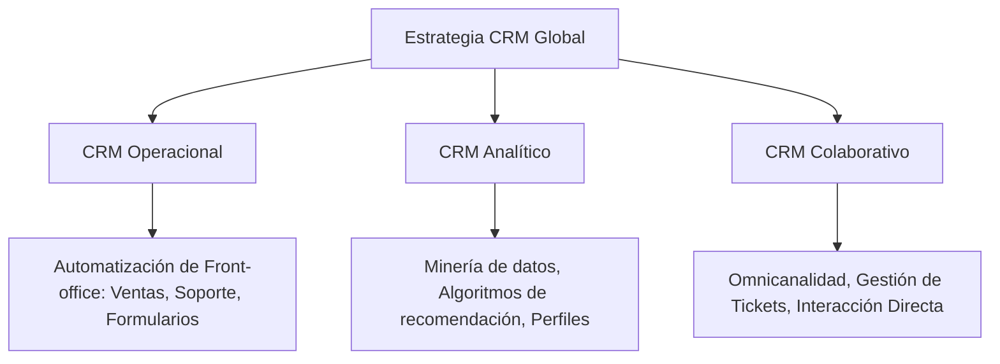

# 📋 Informe Ejecutivo: Análisis de Integración CRM - ARTSPACE

Este informe ejecutivo técnico sirve como el marco teórico y la base conceptual requerida para la **Práctica de Integración CRM** en la asignatura de **Negocios Electrónicos II**.

---

## 📝 Resumen Ejecutivo

El presente informe expone el análisis teórico y estratégico para la implementación de un sistema de Gestión de Relaciones con los Clientes (CRM) dentro de la galería de arte digital **ARTSPACE**. En primer lugar, se establece el marco teórico del CRM, analizando la transición del marketing tradicional hacia el marketing relacional y detallando las dimensiones operacional, analítica y colaborativa. Posteriormente, se presenta un caso de estudio enfocado en **Netflix**, identificando cómo el uso del CRM analítico resolvió la retención de usuarios a través de la personalización algorítmica. Finalmente, se definen los criterios operativos y técnicos para incorporar estas mejores prácticas al proyecto integrador en Django, estructurando estrategias para atención al cliente, seguimiento de prospectos y programas de fidelización mediante un esquema de base de datos relacional.

---

## 📚 Sección I: Fundamentos y Marco Teórico de CRM

### 1. Evolución del Marketing: Del Producto al Cliente
El marketing ha evolucionado desde un enfoque transaccional (centrado en el producto y en ventas de una sola vez) hacia un enfoque **relacional** (centrado en el cliente y en el valor a largo plazo). 

*   **Marketing Transaccional (Tradicional):** Orientado a maximizar el volumen de ventas individuales. La relación termina al concretar la transacción.
*   **Marketing Relacional (Centrado en el Cliente):** Busca construir y mantener relaciones duraderas, interactivas y rentables con los clientes, aumentando su confianza y lealtad a lo largo del tiempo.

### 2. Las Tres Dimensiones del CRM
Para que una estrategia de gestión de clientes sea efectiva, debe integrar tres pilares tecnológicos y operativos:



1.  **CRM Operacional:** Gestiona las interacciones cotidianas con los clientes (front-office). Incluye la automatización de la fuerza de ventas, el marketing (captación de correos) y los servicios de atención al cliente (mesa de ayuda/tickets).
2.  **CRM Analítico:** Analiza los datos de comportamiento recopilados por el operacional para segmentar clientes, identificar patrones de compra y construir modelos de recomendación personalizada.
3.  **CRM Colaborativo:** Facilita la comunicación entre el cliente y los diferentes departamentos de la empresa a través de canales omnicanal (correo, chat, redes sociales).

### 3. Ciclo de Vida del Cliente en el E-Commerce
*   **Adquisición / Prospección:** Atracción de visitantes mediante marketing de contenidos y captación de leads (ej. suscripciones a newsletters con incentivos).
*   **Retención / Fidelización:** Mantener al cliente satisfecho mediante soporte de alta calidad, resolviendo dudas rápidamente y ofreciendo una experiencia de compra personalizada.
*   **Crecimiento:** Fomentar nuevas compras mediante venta sugerida (**Cross-selling** de obras relacionadas) y venta incremental (**Up-selling** ofreciendo acabados premium).

### 4. Métricas Clave y KPIs
*   **CAC (Costo de Adquisición de Clientes):** Inversión total para adquirir un nuevo cliente.
*   **CLV (Customer Lifetime Value):** El valor financiero neto proyectado que un cliente aportará a la empresa durante toda su relación comercial.
*   **Churn Rate (Tasa de Abandono):** Porcentaje de clientes o suscriptores que dejan de interactuar o comprar en la plataforma en un periodo dado.
*   **Tasa de Conversión:** Porcentaje de visitantes que completan una acción deseada (ej. comprar u registrarse).
*   **NPS (Net Promoter Score):** Métrica que mide la lealtad y probabilidad de que el cliente recomiende la marca a otros.

---

## 🎬 Sección II: Análisis de Caso de Estudio Real (Netflix)

Como líder en entretenimiento por suscripción, **Netflix** es un caso de éxito internacional en la aplicación de un **CRM Analítico** de alto impacto.

### 1. Problemática Previa a la Implementación
En sus inicios (transición de envío de DVDs a streaming), Netflix enfrentaba un alto riesgo de fuga de suscriptores (alto *Churn Rate*) debido a la sobrecarga de información: los usuarios pasaban demasiado tiempo buscando qué ver y abandonaban la plataforma por frustración. La retención dependía de ser capaces de predecir con exactitud el gusto de cada usuario individual.

### 2. Solución Implementada y Tipo de CRM Predominante
Netflix implementó un robusto sistema centrado en el **CRM Analítico**:
*   **El Algoritmo de Recomendación:** Analiza datos masivos (tiempo de visualización, búsquedas, pausas, días de la semana, e incluso las miniaturas que atraen el clic del usuario).
*   **CRM Colaborativo:** Canales automatizados de envío de notificaciones push y correos personalizados (ej. *"Se ha estrenado una película que coincide con tu gusto en un 98%"*).

### 3. Resultados y Mejores Prácticas
*   **Impacto:** Netflix mantiene una tasa de retención mensual superior al **93%**, una de las más altas de la industria tecnológica.
*   **Mejores Prácticas:**
    *   *Hiperpersonalización:* No existen dos pantallas de inicio de Netflix iguales en el mundo.
    *   *Uso Inteligente de Datos:* Los datos de visualización guían la creación de contenido original nuevo (estrategia sin desperdicio de producción).

---

## 🎨 Sección III: Propuesta y Criterios de Implementación en ARTSPACE

Tomando como base los fundamentos y el caso de Netflix, definimos los **criterios operativos y técnicos** para el CRM de nuestra galería de arte digital:

```
[ CRM Operacional ] ➔ Formularios de Registro, Newsletter y Tickets de Soporte en Django.
[ CRM Analítico ]   ➔ Motor básico de recomendación cruzada en fichas de producto (obras del mismo estilo/artista).
[ CRM Colaborativo] ➔ Notificaciones de respuesta a tickets y correos de bienvenida automáticos.
```

### 📋 Criterios Operativos y Funcionales

1.  **Mesa de Ayuda y Canales de Atención (Atención a Clientes):**
    *   El formulario de contacto capturará el nombre, email, asunto y mensaje del cliente, guardándolo en la base de datos de Django (`TicketSoporte`).
    *   El Administrador dispondrá de un panel visual para clasificar los tickets en estados (`NUEVO`, `PROCESO`, `RESUELTO`) e ingresar las respuestas pertinentes.
2.  **Captura de Leads e Intereses (Seguimiento Comercial):**
    *   El formulario de newsletter capturará el email del visitante y sus preferencias iniciales de arte (Digital, Físico o Ambos) para segmentación inicial.
3.  **Algoritmo de Venta Cruzada e Incentivos (Fidelización):**
    *   **Up-selling:** Al visualizar un *print* digital de $200 MXN, ofrecer la "Obra Física Original" enmarcada destacando su carácter único.
    *   **Cross-selling:** Mostrar una sección de *"Obras recomendadas"* del mismo estilo artístico o creadas por el mismo autor en el detalle del producto.
    *   **Sistema de Fidelidad:** Cada compra sumará un 10% de su valor en puntos. Al superar 1,000 puntos, el cliente pasa a perfil **VIP**, liberando preventas exclusivas.

### 💾 Criterios Técnicos (Modelos de Datos en Django)

Estos modelos serán mapeados en la base de datos del proyecto para cumplir con los requerimientos técnicos del CRM:

```python
# Django Models (gallery/models.py)

class LeadNewsletter(models.Model):
    email = models.EmailField(unique=True)
    fecha_registro = models.DateTimeField(auto_now_add=True)
    interes_principal = models.CharField(max_length=50, default='GENERAL')

class TicketSoporte(models.Model):
    nombre = models.CharField(max_length=100)
    email = models.EmailField()
    asunto = models.CharField(max_length=200)
    mensaje = models.TextField()
    estado = models.CharField(max_length=20, default='NUEVO') # NUEVO, EN PROCESO, RESUELTO
    respuesta = models.TextField(blank=True, null=True)
    fecha_creacion = models.DateTimeField(auto_now_add=True)

class PerfilCliente(models.Model):
    usuario = models.OneToOneField('auth.User', on_delete=models.CASCADE)
    puntos_fidelidad = models.PositiveIntegerField(default=0)
    es_vip = models.BooleanField(default=False)
```

---

## 📚 Referencias Bibliográficas (Formato APA)

1.  **Buttle, F., & Maklan, S. (2019).** *Customer Relationship Management: Concepts and Technologies* (4th ed.). Routledge.
2.  **Kumar, V., & Reinartz, W. (2018).** *Customer Relationship Management: Concept, Strategy, and Tools* (3rd ed.). Springer.
3.  **Gomez, L. (2021).** *El marketing relacional en el comercio electrónico: Estrategias de retención y lealtad*. Editorial Universitaria Mexicana.
4.  **Netflix Technology Blog. (2020).** *Artwork Personalization at Netflix*. Recuperado de https://netflixtechblog.com/artwork-personalization-c5890075ad76
5.  **Peppers, D., & Rogers, M. (2016).** *Managing Customer Experience and Relationships: A Strategic Framework* (3rd ed.). Wiley.
