# 🎨 REPORTE FORMAL: MAQUETADO DE LOS COMPONENTES DEL SITIO DE NEGOCIOS ELECTRÓNICOS
## UNIDAD 4: ELEMENTOS DE E-BUSINESS, BASE DE DATOS Y TRANSACCIÓN DIGITAL
### PROYECTO INTEGRADOR: ARTSPACE (GALERÍA E-COMMERCE DE ARTE CONTEMPORÁNEO Y DIGITAL)
#### ASIGNATURA: NEGOCIOS ELECTRÓNICOS II

---

# 🏛️ UNIVERSIDAD AUTÓNOMA DE TLAXCALA
### FACULTAD DE CIENCIAS BÁSICAS, INGENIERÍA Y TECNOLOGÍA
**Licenciatura en Ingeniería en Computación**

---

### REPORTE TÉCNICO DE PRÁCTICA
**"Maquetado de los Componentes del Sitio de Negocios Electrónicos"**

**Unidad Temática:** Unidad 4 — Elementos de E-Business, Experiencia de Usuario y Transacción Digital  
**Proyecto Integrador:** ARTSPACE (Galería E-Commerce de Arte Contemporáneo y Obras Digitales)  
**Equipo de Desarrollo:** Equipo 3  

**Líder Técnico & Desarrollador Full-Stack:**  
*Almendra Valenzuela Rodrigo*  
Matrícula: 2021000000 | Correo: `r.almendra@alumnos.uatx.mx`

**Docente Titular:**  
M.C. / Dr. [Nombre del Docente]

**Fecha de Emisión:**  
Noviembre de 2026 — Ciclo Otoño 2026  
Tlaxcala, Tlax., México

---

## 🎯 DATOS DE LA ASIGNATURA Y COMPETENCIAS

* **Asignatura:** Negocios Electrónicos II
* **Semestre:** 9no Semestre — Ingeniería en Computación
* **Competencia Específica:** Identifica los elementos que integran un sitio de negocio electrónico para aplicarlos en el desarrollo de soluciones de negocio digital.
* **Objetivo de la Práctica:** Diseñar el maquetado (wireframes o bocetos de alta/media fidelidad) y los diagramas de flujo funcional de los componentes clave de un sitio de e-commerce (catálogo, carrito, pasarela/procesos de pago, comercialización, cálculo de impuestos y atención a clientes), alineados al proyecto de negocio electrónico del equipo.

---

# 📖 1. INTRODUCCIÓN Y ALCANCE

## 1.1 Descripción General del Negocio Electrónico: ARTSPACE
**ARTSPACE** es una plataforma de comercio electrónico de grado industrial concebida para democratizar y dinamizar el mercado del arte contemporáneo y digital en México y América Latina. El proyecto nace como respuesta a las barreras tradicionales que enfrentan los artistas plásticos y creadores visuales independientes: elevados márgenes de intermediación de galerías físicas (que suelen retener entre el 50% y el 60% del valor de la obra), falta de transparencia en la autenticación de piezas y nula presencia digital transaccional.

La plataforma opera bajo un modelo de negocio híbrido **B2C (Business-to-Consumer)** y **C2C curado (Creator-to-Consumer)**, integrando un catálogo selecto compuesto por:
1. **Obras Físicas Originales Únicas (1/1):** Pinturas al óleo, acrílicos, técnicas mixtas, esculturas y grabados artesanales certificados. Cada pieza cuenta con inventario estricto de una sola unidad y requiere embalaje especializado de grado museo.
2. **Láminas Seriadas y Prints de Alta Fidelidad (*Giclée*):** Impresiones de autor sobre papel fine-art de algodón (Hahnemühle) producidas en lotes limitados con inventario continuo (logística *Push*).
3. **Arte Digital y Coleccionables Criptográficos (NFTs / Render 3D 4K):** Activos digitales transferidos mediante contratos inteligentes y descargables en alta definición, comercializados bajo esquema de exportación de servicios intangibles.

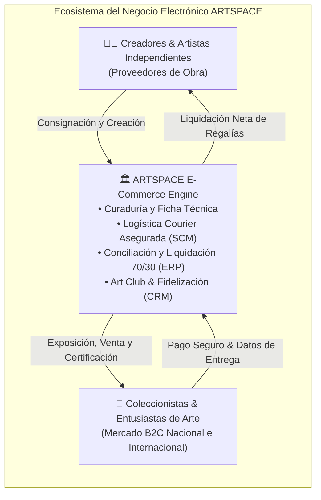

## 1.2 Alcance del Proyecto en la Unidad 4
El alcance técnico de la presente práctica abarca el diseño arquitectónico de la interfaz de usuario (**UI/UX**) y el modelado funcional de los seis componentes neurálgicos que transforman la plataforma en una solución de e-commerce transaccional completa:

1. **Catálogo de Artículos:** Estructura de filtrado facetado, taxonomías de búsqueda y visualización inmersiva de la obra con su ficha técnica curatorial y certificaciones de procedencia.
2. **Carrito de Compras y Checkout:** Gestión de estados de compra con el patrón *Hold Cart* (bloqueo temporal de 15 minutos para piezas únicas), control de cantidades restringidas y flujo de checkout estructurado en tres fases secuenciales de baja fricción.
3. **Procesos y Pasarela de Pago:** Arquitectura de cobro multimodal resiliente (tarjetas de crédito/débito con autenticación bancaria 3D-Secure 2.0 mediante Stripe, transferencias electrónicas SPEI/STP con CLABE referenciada, monederos digitales como PayPal/Apple Pay y billeteras Web3 para activos digitales).
4. **Comercialización y Promoción:** Despliegue de banners de campañas estacionales, badges dinámicos de descuento, ventas privadas para miembros del programa de lealtad *Art Club* y motor de venta cruzada (*Up-selling* y *Cross-selling*).
5. **Configurador de Cálculo de Impuestos y Fletes:** Motor algorítmico de transparencia fiscal que desglosa en tiempo real el Subtotal, Flete regional asegurado (cotizado con DHL/FedEx), aplicación del **IVA al 16%** (nacional), **IVA al 8%** (franja fronteriza norte) o **Tasa 0%** (exportación digital), integrando la captura de datos fiscales para timbrado automático de **CFDI 4.0** ante el SAT.
6. **Atención a Clientes:** Ecosistema omnicanal de soporte compuesto por un widget interactivo con asistente virtual (*ArtBot*), botón directo de WhatsApp Business con curadores y formulario formal enlazado a la base de datos del módulo CRM (`TicketSoporte`).

## 1.3 Fundamentación: Investigación y Referencia Visual (Benchmarking de Mercado)
Para garantizar estándares visuales y de usabilidad de clase mundial, se realizó un análisis exhaustivo de tres plataformas comerciales líderes en el mercado del arte y bienes de lujo digital: **Artsy (artsy.net)**, **Saatchi Art (saatchiart.com)** y **Singulart / 1stDibs (singulart.com)**.

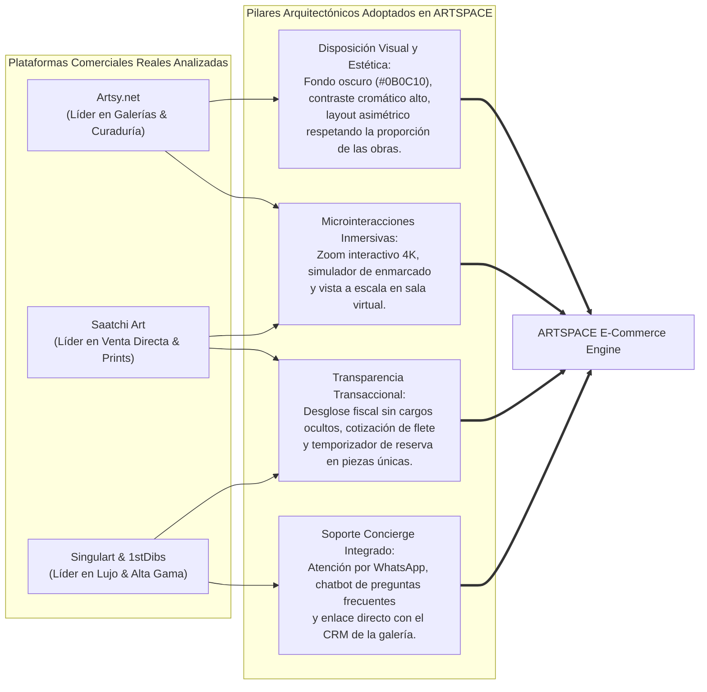

### Hallazgos de la Investigación Visual:
* **Artsy:** Destaca por su enfoque minimalista y su página de detalle de producto (*Split View* 60/40), donde la obra ocupa la mayor parte de la pantalla y el panel derecho permanece fijo (*Sticky*) con los botones de acción inmediata. Implementa sellos de verificación de galería y certificados de autenticidad que incrementan la confianza del comprador.
* **Saatchi Art:** Resalta por su **configurador interactivo de marcos**, permitiendo al coleccionista visualizar la obra en madera natural, marco negro o bastidor flotante con actualización inmediata de precio. Su checkout reduce fricciones solicitando datos en pasos progresivos.
* **Singulart y 1stDibs:** Pioneros en la venta transfronteriza y de alto valor. Resuelven el temor a costos imprevistos calculando aranceles, fletes asegurados y desglosando el IVA con antelación. Además, ofrecen soporte directo vía WhatsApp y transferencias bancarias protegidas para montos superiores a los límites de tarjetas de crédito.

---

# 🗺️ 2. DIAGRAMAS DE FLUJO DE NAVEGACIÓN Y PROCESOS

## 2.1 Diagrama de Navegación Global de la Plataforma (Sitemap Funcional)
El siguiente mapa modela la arquitectura de información y la navegación del usuario en el sitio, clasificando las áreas de exploración pública, el túnel transaccional protegido y los canales de soporte:

```mermaid
graph TD
    Home["🏠 INICIO (index.html)\n• Hero Banner Dinámico\n• Curadurías Destacadas\n• Acceso a Art Club"]

    subgraph EXPLORACION ["Área de Exploración y Curaduría"]
        Cat["🎨 Catálogo de Obras (galeria.html)\n• Filtros Facetados\n• Buscador Predictivo"]
        Col["🏛️ Colecciones Temáticas (colecciones.html)"]
        Art["👨‍🎨 Perfiles de Artistas (artistas.html)"]
        PDP["🖼️ Ficha de Obra / Producto (PDP)\n• Visor 4K y Realidad Aumentada\n• Ficha Técnica y Certificado COA\n• Configurador de Enmarcado"]
    end

    subgraph TRANSACCIONAL ["Túnel Transaccional de Compra"]
        Cart["🛒 Drawer Lateral de Carrito\n• Hold-Cart Timer (15 min)\n• Control Stock Único (1/1)\n• Validación de Cupones"]
        Check1["📦 Checkout Paso 1: Envío (SCM)\n• Dirección de Entrega\n• Selección Courier DHL/FedEx"]
        Check2["🧾 Checkout Paso 2: Impuestos & Factura\n• Cálculo IVA 16% / 8% / 0%\n• Captura RFC CFDI 4.0"]
        Check3["💳 Checkout Paso 3: Pasarela de Pagos\n• Stripe 3DS / SPEI STP / Wallets"]
        Success["✅ Confirmación de Orden (Thank You)\n• Folio de Compra\n• Guía AWB & Puntos Art Club"]
    end

    subgraph SOPORTE ["Atención Omnicanal"]
        Contact["✉️ Formulario de Contacto (contacto.html)"]
        FAQ["❓ Centro de Ayuda & FAQ"]
        Bot["🤖 Asistente Virtual ArtBot"]
        WA["🟢 Asesoría Concierge WhatsApp"]
    end

    Home --> Cat & Col & Art & Contact & FAQ
    Cat --> PDP
    Col --> PDP
    Art --> PDP
    PDP --> Cart
    Cart --> Check1
    Check1 --> Check2
    Check2 --> Check3
    Check3 --> Success
    Success --> Home

    Home -.-> Bot & WA
    PDP -.-> Bot & WA
    Cart -.-> Bot
    Contact -.-> Bot
```

---

## 2.2 Diagrama de Flujo Transaccional End-to-End: Del Catálogo a la Confirmación de la Orden
Modela el camino crítico del comprador (*Buyer's Journey*), incluyendo las validaciones de negocio, bloqueos de inventario y ramificaciones de pago:

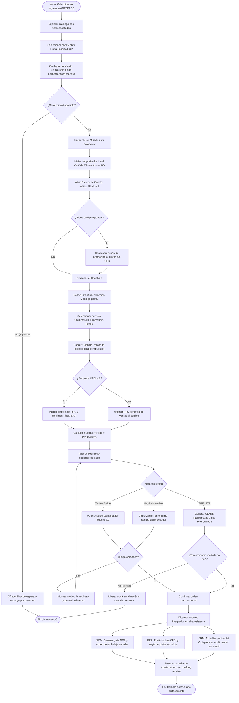

---

## 2.3 Diagrama del Algoritmo de Cálculo de Impuestos y Fletes Regionales
Garantiza el cumplimiento estricto del régimen fiscal de plataformas digitales en México y la cotización transparente de fletes especializados:

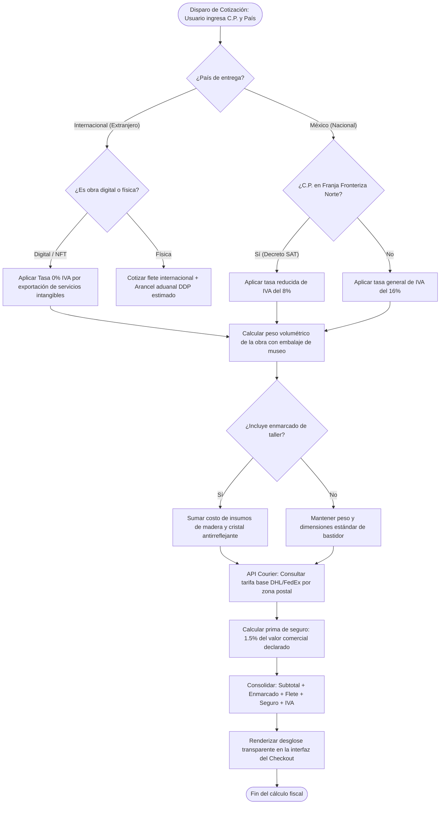

---

## 2.4 Diagrama del Flujo de Atención al Cliente y Escalamiento Omnicanal
Ilustra el sistema de soporte interactivo para resolver dudas sobre autenticidad, envíos delicados o solicitudes a medida:

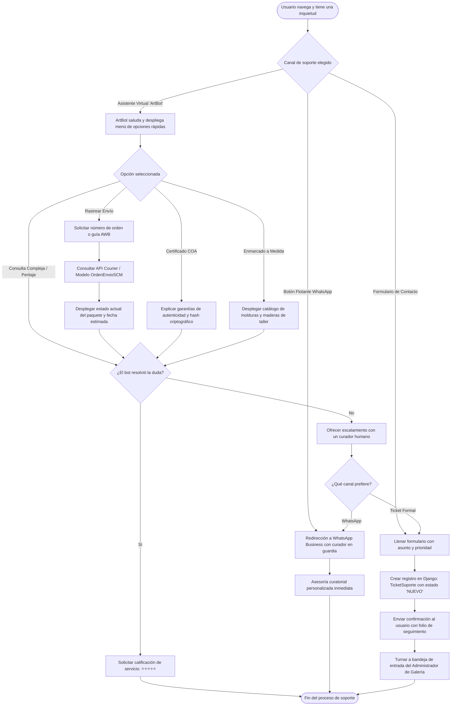

---

# 📐 3. SECCIÓN DE MAQUETADO (WIREFRAMES / MOCKUPS Y EXPLICACIÓN TÉCNICA/FUNCIONAL)

A continuación se presentan las maquetaciones visuales de alta fidelidad desarrolladas para cada uno de los seis componentes obligatorios de la práctica, ilustrando la disposición visual (*layout*), jerarquía, tipografía y microinteracciones inspiradas en las plataformas líderes del mercado (**Artsy**, **Saatchi Art** y **1stDibs**), acompañadas de su respectiva justificación técnica y funcional.

---

## 3.1 Componente A: Catálogo de Artículos y Ficha Técnica de Producto (PDP)

### Muestra Visual A.1: Catálogo de Obras con Filtros Facetados (Grid de Exploración)

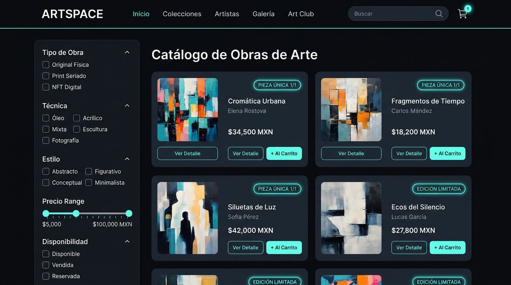

*Figura 3.1. Interfaz de Exploración del Catálogo de Obras en ARTSPACE con Filtros Facetados por Técnica, Precio y Disponibilidad.*

### Muestra Visual A.2: Ficha Técnica de Producto (Product Detail Page - PDP)

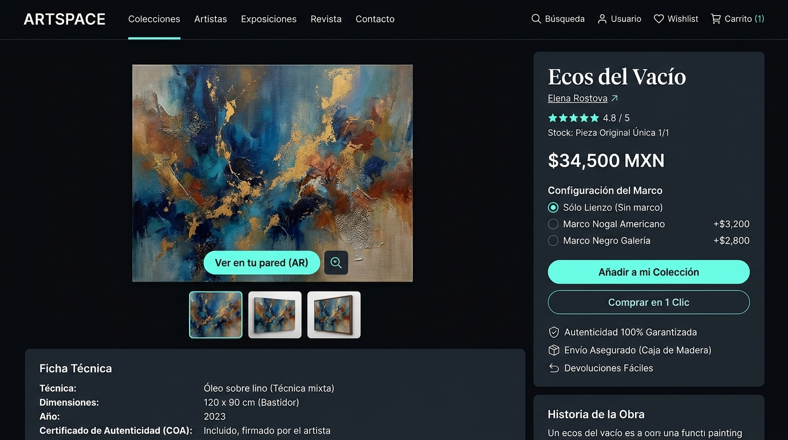

*Figura 3.2. Ficha de Detalle de Obra (PDP) en Disposición Split View (60/40), Visor Ultra HD 4K, Realidad Aumentada y Configurador de Enmarcado.*

### Explicación Técnica y Funcional del Componente A:
1. **Propósito en la Experiencia de Usuario (UX):**
   * Reducir la fricción cognitiva durante la exploración curatorial mediante una categorización facetada fluida que permite acotar el inventario por criterios artísticos esenciales: tipo de obra (original 1/1, print seriado, digital NFT), técnica plástica (óleo, acrílico, escultura, grabado), dimensiones y rango de precio.
   * En la Ficha de Producto (PDP), el patrón *Split View* (60% visor de medios / 40% panel transaccional fijo) prioriza el disfrute estético de la pieza mediante zoom interactivo de texturas y simulación a escala en pared con Realidad Aumentada (*WebXR*), mientras el panel de compra provee certeza inmediata sobre la procedencia y el valor de la inversión.
2. **Elementos de Interfaz (UI):**
   * *Barra lateral de filtros reactivos:* Checkboxes, sliders numéricos de rango de precio y selectores de disponibilidad que actualizan la cuadrícula asíncronamente mediante peticiones `Fetch/AJAX` sin recargar la página.
   * *Tarjetas de obra:* Imagen en proporción natural (*Masonry Layout*), insignia (*badge*) de técnica y exclusividad (`PIEZA ÚNICA 1/1`), nombre del artista enlazado a su biografía, precio en moneda nacional (MXN) y botones directos de acción (`Ver Detalle` y `+ Al Carrito`).
   * *Configurador dinámico de enmarcado:* Opciones en radio buttons (`Lienzo solo`, `Marco Nogal Americano`, `Marco Negro Galería Flotante`) que recalculan instantáneamente el costo total y el peso de envío.
3. **Validaciones y Lógica de Negocio:**
   * **Restricción de inventario para piezas únicas:** Si una obra está catalogada como original (1/1), el selector de cantidad se inhabilita permanentemente en `1`.
   * **Cálculo de financiamiento:** Algoritmo en JavaScript que desglosa automáticamente mensualidades sin intereses (3 y 6 MSI) sobre el precio de lista.
   * **Certificado de Autenticidad (COA):** La ficha visualiza el sello de certificación de galería respaldado con un hash criptográfico único registrado en la base de datos de ARTSPACE.

---

## 3.2 Componente B: Carrito de Compras y Checkout

### Muestra Visual B.1: Carrito en Drawer Lateral y Flujo Secuencial de Checkout

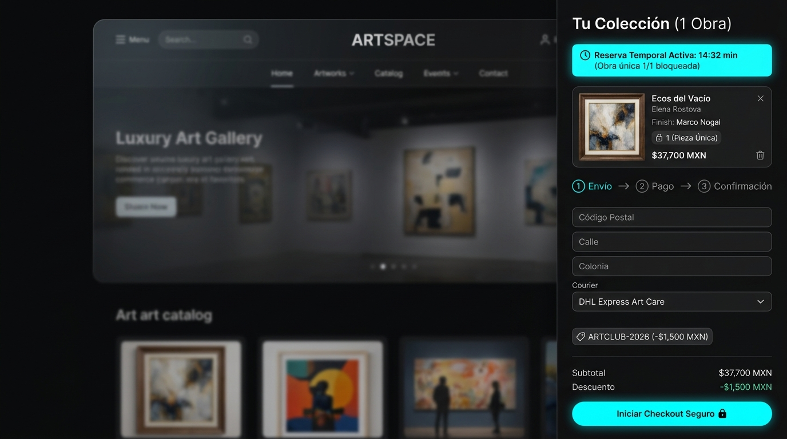

*Figura 3.3. Drawer Lateral de Carrito con Temporizador de Reserva 'Hold-Cart' (15 min), Control de Stock Único y Túnel de Checkout en Tres Pasos.*

### Explicación Técnica y Funcional del Componente B:
1. **Propósito en la Experiencia de Usuario (UX):**
   * Proporcionar un acceso no invasivo a la orden en curso mediante un panel lateral deslizante (*Off-canvas Drawer*) que no interrumpe la navegación del usuario por la galería.
   * Implementar un flujo de checkout lineal dividido en tres etapas transparentes y de baja fricción: **(1) Datos de Envío y Selección Courier** $\rightarrow$ **(2) Pago y Facturación Fiscal** $\rightarrow$ **(3) Confirmación y Guía de Rastreo**.
2. **Elementos de Interfaz (UI):**
   * *Banner de Reserva Temporal (Hold-Cart):* Alerta visual prominente con cuenta regresiva activa (`14:32 min`) que informa al coleccionista que la pieza física original se encuentra bloqueada temporalmente a su favor en la base de datos.
   * *Fila de producto detallada:* Miniatura en alta resolución, título de la obra, autor, acabado seleccionado (ej. *Marco Nogal*), indicador de cantidad inmutable (`1 - Pieza Única`) y enlace para remover el ítem.
   * *Módulo de cupones:* Campo de captura con validación en línea de códigos de descuento o canje de puntos de lealtad (`ARTCLUB-2026`).
   * *Selector de paqueterías de arte (SCM):* Radio buttons para elegir entre opciones de mensajería certificada con embalaje rígido de museo (`DHL Express Art Care` vs. `FedEx Priority Fine Art`).
3. **Validaciones y Lógica de Negocio:**
   * **Manejo de concurrencia y expiración:** Si el temporizador de 15 minutos expira sin que el usuario concrete el pago, una señal en el backend de Django libera el bloqueo de la obra en el inventario para que vuelva a estar disponible en el catálogo general, notificando al usuario en pantalla.
   * **Validación geográfica de entrega:** Al ingresar el Código Postal (5 dígitos), el sistema valida mediante catálogos postales oficiales (SEPOMEX) el municipio, estado y tipo de cobertura de entrega.

---

## 3.3 Componente C: Procesos y Pasarela de Pago

### Muestra Visual C.1: Selector de Métodos de Pago Multimodal y Seguridad Bancaria

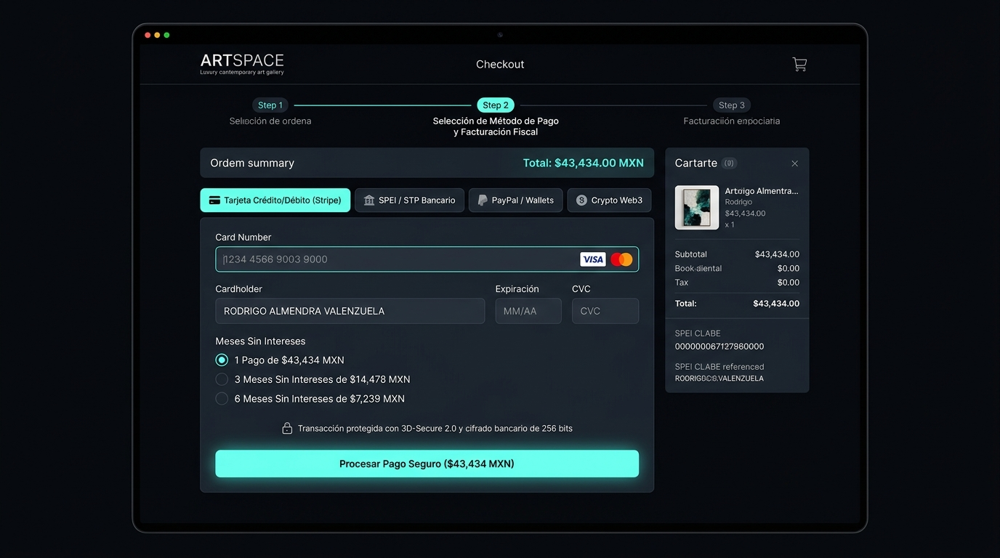

*Figura 3.4. Selector de Métodos de Pago Integrados (Stripe con 3D-Secure 2.0, Transferencia SPEI STP con CLABE de 24h, Billeteras Digitales y Cripto Web3).*

### Explicación Técnica y Funcional del Componente C:
1. **Propósito en la Experiencia de Usuario (UX):**
   * Atender la diversidad de perfiles de compradores de arte: desde compras ágiles de prints seriados mediante tarjetas o billeteras digitales, hasta transacciones de alto valor (superiores a $50,000 MXN) que requieren transferencias bancarias directas para evitar bloqueos por límites crediticios bancarios.
2. **Elementos de Interfaz (UI):**
   * *Pestañas de selección modular (Tabs):* Distribución horizontal que permite alternar con un solo clic entre cuatro métodos: `Tarjeta de Crédito/Débito`, `SPEI / Transferencia Bancaria`, `PayPal / Billeteras` y `Crypto Web3`.
   * *Campos de tarjeta tokenizados:* Entradas numéricas integradas mediante *Stripe Elements / iframes* seguros con detección automática del emisor bancario (Visa, Mastercard, American Express) e indicador visual de cifrado SSL.
   * *Selector de financiamiento a Meses Sin Intereses (MSI):* Opciones dinámicas de diferimiento de pagos (pago único, 3 MSI o 6 MSI) calculadas según convenios bancarios.
   * *Emisión de CLABE referenciada (SPEI STP):* Bloque informativo que genera una CLABE interbancaria única de 18 dígitos con vigencia temporal de 24 horas para liquidación por banca móvil.
3. **Validaciones y Lógica de Negocio:**
   * **Cumplimiento PCI-DSS Nivel 1:** Ningún dato confidencial de la tarjeta (número PAN o CVC) se almacena ni transita por los servidores de ARTSPACE; toda la información viaja directamente a la pasarela cifrada de Stripe.
   * **Autenticación Fuerte de Clientes (SCA / 3D-Secure 2.0):** Para tarjetas mexicanas e internacionales, se dispara la validación obligatoria con token bancario o código SMS provisto por el banco emisor.
   * **Conciliación automatizada por Webhook:** En transferencias SPEI, la API de STP notifica al backend en cuanto los fondos son recibidos, acreditando el pedido automáticamente sin requerir comprobantes manuales en PDF.

---

## 3.4 Componente D: Comercialización y Promoción

### Muestra Visual D.1: Banners de Campaña, Ofertas Dinámicas y Motor de Recomendación

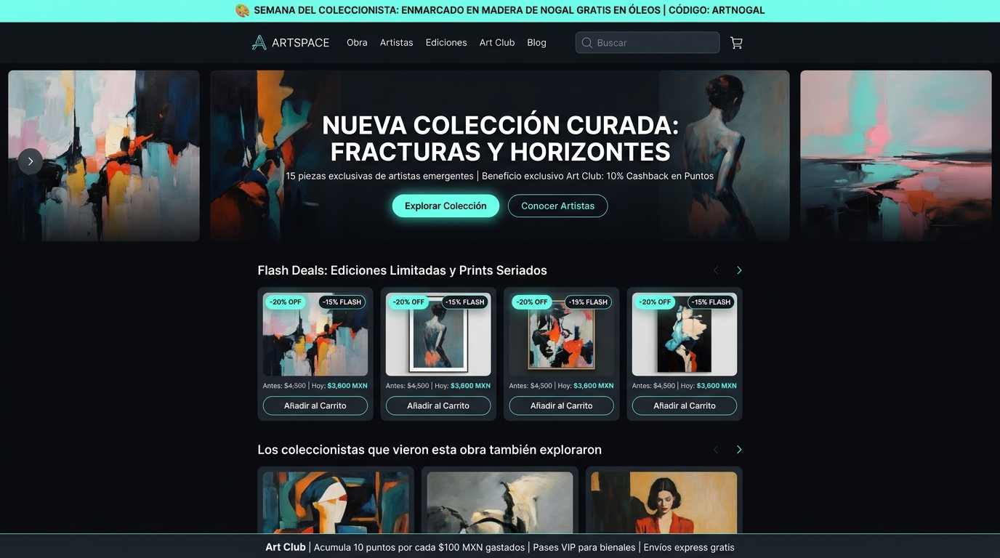

*Figura 3.5. Módulo de Comercialización y Promoción: Top Bar Informativa, Slider Hero Curado, Ofertas con Descuento Dinámico y Motor de Recomendación Personalizada.*

### Explicación Técnica y Funcional del Componente D:
1. **Propósito en la Experiencia de Usuario (UX):**
   * Fomentar el descubrimiento guiado de obras emergentes, elevar la tasa de conversión en visitantes indecisos y potenciar el valor del ciclo de vida del coleccionista (*Customer Lifetime Value - LTV*) mediante incentivos exclusivos de fidelización.
2. **Elementos de Interfaz (UI):**
   * *Top Notification Bar:* Cintillo superior de alta visibilidad con mensaje promocional estacional (ej. *"Semana del Coleccionista: Enmarcado en nogal gratis en óleos"*), código de activación y botón de cierre.
   * *Hero Banner Slider:* Área principal de impacto visual con fotografías de alta resolución de exposiciones temáticas (*"Fracturas y Horizontes"*), beneficios para miembros del club y botones de llamado a la acción (*CTA*).
   * *Sección de Ofertas Flash en Ediciones Seriadas:* Cuadrícula de prints y litografías con distintivos de descuento porcentual (`-20% OFF`, `-15% FLASH`), precio regular tachado y precio promocional resaltado.
   * *Motor de Recomendaciones Contextuales:* Sección interactiva *"Los coleccionistas que vieron esta obra también exploraron"*, que sugiere obras estilísticamente afines.
3. **Validaciones y Lógica de Negocio:**
   * **Reglas de negocio de promociones:** El backend valida condiciones estrictas para la aplicación de cupones (monto mínimo de compra, exclusión de piezas catalogadas como donación o subasta benéfica).
   * **Algoritmo de recomendación:** Filtro basado en contenido que analiza vectores de similitud: técnica pictórica, gama cromática dominante y movimiento artístico del autor consultado.
   * **Gamificación del Art Club:** Conexión con el modelo de fidelización de la Unidad 1 para calcular en tiempo real los puntos de coleccionista acumulables (10 puntos por cada $100 MXN gastados).

---

## 3.5 Componente E: Configurador de Cálculo de Impuestos y Fletes Regionales

### Muestra Visual E.1: Cotizador Fiscal en Tiempo Real y Formulario para Factura SAT CFDI 4.0

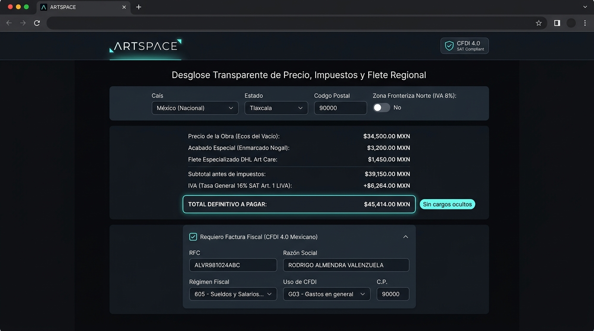

*Figura 3.6. Configurador de Cálculo de Impuestos y Fletes Regionales con Desglose Fiscal en Tiempo Real (IVA 16% / 8% Fronterizo) y Módulo de Emisión de CFDI 4.0 ante el SAT.*

### Explicación Técnica y Funcional del Componente E:
1. **Propósito en la Experiencia de Usuario (UX):**
   * Eliminar una de las causas primordiales de abandono de carritos en el comercio digital: los cobros imprevistos al final del túnel de compra (*hidden fees*). El comprador conoce desde el primer instante el desglose exacto de su dinero y puede formalizar su comprobante fiscal con total respaldo de la legislación mexicana.
2. **Elementos de Interfaz (UI):**
   * *Selectores geográficos:* Menús desplegables para País (`México`), Estado (`Tlaxcala`), campo para Código Postal (`90000`) y selector de condición fronteriza.
   * *Tabla de desglose estructurada:* Visualización línea por línea con alineación decimal de: (1) Precio base de la obra $\rightarrow$ (2) Costo de insumos de taller/enmarcado $\rightarrow$ (3) Flete Courier asegurado $\rightarrow$ (4) Subtotal $\rightarrow$ (5) Impuesto al Valor Agregado (IVA) $\rightarrow$ (6) **Total definitivo a pagar**.
   * *Módulo expandible para Facturación Fiscal (CFDI 4.0):* Casilla de verificación que despliega los campos obligatorios del SAT: RFC receptor, Razón Social, Régimen Fiscal (menú oficial SAT), Uso de CFDI y Correo Fiscal.
3. **Validaciones y Lógica de Negocio:**
   * **Determinación de tasa de IVA según geolocalización:** El motor fiscal audita el código postal del destinatario. Si pertenece a la Franja Fronteriza Norte (decreto presidencial fiscal), aplica la tasa preferencial del **8% de IVA**; para el resto del territorio nacional calcula la tasa general del **16%**.
   * **Tratamiento de arte digital de exportación:** Si la transacción involucra obras digitales o NFTs adquiridas por usuarios con domicilio fiscal en el extranjero, el sistema aplica **Tasa 0% de IVA** por concepto de exportación de servicios digitales intangibles (Art. 29 de la Ley del IVA).
   * **Validación de RFC y Régimen Fiscal:** Validación sintáctica mediante expresiones regulares de 12 (personas morales) o 13 caracteres (personas físicas) y cruce con la matriz de regímenes válidos del SAT.

---

## 3.6 Componente F: Canales Integrados de Atención a Clientes

### Muestra Visual F.1: Ecosistema Omnicanal con Widget ArtBot, WhatsApp Business y Tickets CRM

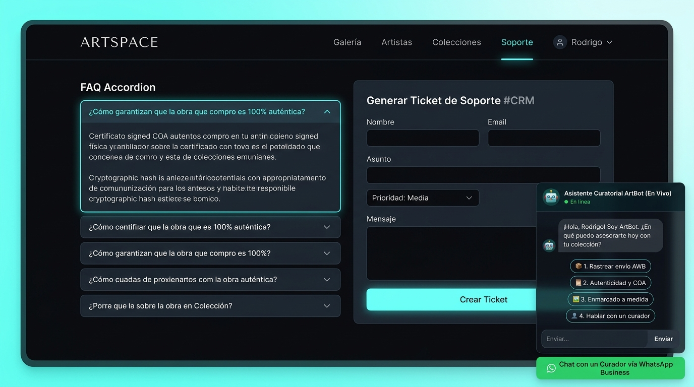

*Figura 3.7. Suite de Soporte Omnicanal: Widget Interactivo con Asistente Virtual 'ArtBot' (En Vivo), Acceso Directo a WhatsApp Concierge, FAQ Acordeón y Formulario de Soporte CRM.*

### Explicación Técnica y Funcional del Componente F:
1. **Propósito en la Experiencia de Usuario (UX):**
   * Acompañar al coleccionista en decisiones de alta trascendencia emocional y financiera, resolviendo dudas críticas sobre autenticidad, condiciones de conservación, garantías de devolución o estado del envío mediante una combinación eficiente de autoservicio 24/7 y atención humana calificada.
2. **Elementos de Interfaz (UI):**
   * *Botón flotante omnicanal (FAB):* Elemento circular suspendido en la esquina inferior derecha con icono de chat interactivo y badge de disponibilidad en tiempo real.
   * *Ventana interactiva de Asistente Virtual (ArtBot):* Saludo contextual al usuario autenticado, indicador de estado (*"En línea"*), botones de menú rápido (*Quick Replies*: `Rastrear envío AWB`, `Autenticidad COA`, `Enmarcado`, `Hablar con un curador`), caja de texto para consultas libres y botón verde de acceso inmediato a WhatsApp Business.
   * *Acordeón de Preguntas Frecuentes (FAQ):* Componente desplegable ordenado por categorías que responde con claridad técnica las inquietudes sobre embalajes de museo, seguros de transporte y políticas de devolución.
   * *Formulario formal de soporte:* Entradas estructuradas para radicar consultas formales con selector de nivel de urgencia (`Baja`, `Media`, `Urgente`).
3. **Validaciones y Lógica de Negocio:**
   * **Rastreo automatizado:** Al solicitar el rastreo, ArtBot consulta de forma interna la tabla `OrdenEnvioSCM` en Django para devolver el estatus físico del paquete y la fecha estimada de entrega sin intervención del personal humano.
   * **Persistencia en el módulo CRM:** Las solicitudes radicadas a través del formulario de soporte crean automáticamente una instancia en el modelo relacional `TicketSoporte` de la base de datos, asignando un folio único de seguimiento, turnándolo a la bandeja del Administrador de la Galería y enviando acuse de recibo al correo del usuario.

---

# 💡 4. COMENTARIOS PERSONALES

El desarrollo de esta práctica de maquetado para la **Unidad 4** ha representado una experiencia formativa integral dentro de la asignatura de **Negocios Electrónicos II**. A lo largo del ejercicio, se evidenció que concebir un sitio de comercio electrónico va mucho más allá de diseñar pantallas visualmente atractivas; demanda comprender la profunda interrelación entre la psicología del consumidor, la ergonomía de la interfaz y la arquitectura transaccional de los sistemas backend.

Uno de los mayores retos enfrentados durante la concepción de los wireframes para **ARTSPACE** radicó en la naturaleza única de los productos comercializados. A diferencia de un e-commerce tradicional de bienes de consumo masivo (donde un usuario puede solicitar decenas de unidades de un mismo artículo), en una galería de arte contemporáneo nos enfrentamos a piezas físicas originales únicas (stock = 1). Diseñar el componente del carrito requirió implementar el patrón de reserva temporal (*Hold Cart Timer* de 15 minutos), una solución indispensable para prevenir que dos coleccionistas paguen simultáneamente por la misma obra de arte, eliminando de raíz costosos cuellos de botella y problemas de reputación.

Asimismo, el diseño del **Configurador de Cálculo de Impuestos y Fletes** permitió aplicar de manera práctica los conocimientos normativos del comercio electrónico en México. Comprender cómo impacta la ubicación geográfica (la distinción entre la tasa general del 16% y el decreto fronterizo del 8% de IVA), así como las reglas de exportación a tasa 0% en activos digitales y la obligatoriedad de capturar datos precisos para el timbrado del **CFDI 4.0**, demostró la importancia de evitar costos ocultos (*hidden fees*), factor que los estudios de usabilidad identifican como la causa número uno de abandono de carritos en el mundo.

Finalmente, la integración de los canales de atención omnicanal reforzó el valor del trabajo previo realizado en las Unidades 1 (CRM), 2 (SCM) y 3 (ERP). Ver cómo un botón de contacto en la interfaz web no es un elemento aislado, sino el punto de partida que genera un ticket en el CRM, dispara una reserva en el almacén de SCM y eventualmente prepara una factura en el ERP, consolida una visión holística de la ingeniería de software aplicada a los negocios digitales. Esta práctica sienta las bases definitivas para llevar a cabo la codificación y despliegue del proyecto integrador con los más altos estándares de calidad académica y profesional.

---

# 📚 5. REFERENCIAS BIBLIOGRÁFICAS / FUENTES DE CONSULTA (FORMATO APA 7)

1. **Artsy Inc.** (2026). *The Art Market Online Report: Collector behaviors and digital transactional patterns*. Artsy Editorial. Recuperado de [https://www.artsy.net](https://www.artsy.net)
2. **Baymard Institute.** (2025). *Checkout Usability: 48 Guidelines for E-Commerce Checkout Design & Cart Abandonment Mitigation*. Baymard Reports. Recuperado de [https://baymard.com/research/checkout-usability](https://baymard.com/research/checkout-usability)
3. **Cámara de Diputados del H. Congreso de la Unión.** (2025). *Ley del Impuesto al Valor Agregado: Régimen de las actividades y servicios digitales*. Diario Oficial de la Federación (DOF). Ciudad de México, México.
4. **Laudon, K. C., & Traver, C. G.** (2024). *E-commerce: Business, Technology, Society* (18.ª ed.). Pearson Education.
5. **Nielsen, J., & Budiu, R.** (2025). *Mobile Usability and E-Commerce User Experience (UX)* (3.ª ed.). Nielsen Norman Group. Recuperado de [https://www.nngroup.com](https://www.nngroup.com)
6. **Saatchi Art.** (2026). *Framing and Shipping Fine Art Worldwide: Collector Experience Guidelines*. Saatchi Art Operations. Recuperado de [https://www.saatchiart.com](https://www.saatchiart.com)
7. **Servicio de Administración Tributaria (SAT).** (2025). *Guía de llenado de los comprobantes fiscales digitales por Internet (CFDI) versión 4.0 para plataformas tecnológicas*. Secretaría de Hacienda y Crédito Público (SHCP). Ciudad de México, México.
8. **Singulart & 1stDibs.** (2026). *Cross-Border Taxation, Luxury Art Logistics and High-Value Payment Gateways*. Singulart Industry Analysis. Recuperado de [https://www.singulart.com](https://www.singulart.com)
9. **Stripe Inc.** (2026). *Strong Customer Authentication (SCA) and 3D Secure 2.0 Integration Guide for Modern E-Commerce*. Stripe Developer Documentation. Recuperado de [https://stripe.com/docs/strong-customer-authentication](https://stripe.com/docs/strong-customer-authentication)
10. **Tidwell, J., Brewer, C., & Valencia-Valencia, A.** (2024). *Designing Interfaces: Patterns for Effective Interaction Design* (3.ª ed.). O'Reilly Media.
