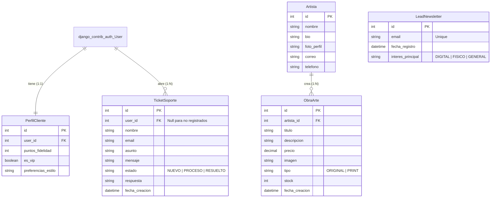

# 👥 Roles de Negocio y Estructura de Modelos de Base de Datos - ARTSPACE

Este documento detalla los **roles de negocio** de la plataforma, la **estructura técnica de las tablas** en la base de datos de Django y el **diagrama Entidad-Relación (ER)** correspondiente para su inclusión en la bitácora escolar.

---

## 🎭 1. Roles de Negocio

El modelo de negocios de ARTSPACE involucra a tres actores clave en el flujo del comercio electrónico y la gestión de relaciones:

| Rol de Negocio | Descripción | Interacción con el Sistema (Casos de Uso) |
| :--- | :--- | :--- |
| **Administrador de Galería** *(Staff)* | Persona encargada de la operación comercial y soporte. | <ul><li>Gestiona el inventario de obras y precios (ERP).</li><li>Valida y aprueba el registro de nuevos artistas.</li><li>Responde los tickets de soporte del cliente (CRM).</li><li>Supervisa el embudo de ventas y leads del newsletter.</li></ul> |
| **Artista Independiente** *(Proveedor)* | Creador de las obras físicas y digitales ofertadas. | <ul><li>Expone su catálogo, biografía e identidad visual.</li><li>Recibe liquidaciones por ventas con desglose de comisiones (ERP).</li><li>Define stock disponible (SCM: Push vs. Pull).</li></ul> |
| **Cliente / Coleccionista** *(Comprador)* | Usuario final de la galería. | <ul><li>Explora el catálogo dinámico con filtros y búsquedas.</li><li>Agrega obras al carrito y realiza la compra.</li><li>Genera tickets de soporte y se suscribe al newsletter (CRM).</li><li>Acumula puntos de recompensa y accede a preventas exclusivas (Fidelidad).</li></ul> |

---

## 📊 2. Diagrama Entidad-Relación (ER)

El siguiente diagrama representa cómo interactúan las tablas del sistema, incluyendo los modelos básicos del negocio y los modelos específicos para la estrategia CRM de la asignatura:

---

## 📐 3. Definición Técnica de Modelos (Data Layer)

### A. Modelos del Núcleo de Negocio (Core)
*   **`Artista`:** Almacena la información de los creadores de arte que colaboran con la galería.
*   **`ObraArte`:** Almacena el catálogo de productos con stock dinámico para diferenciar la logística *Push* (Prints listos) de la *Pull* (Obras originales únicas con stock = 1).

### B. Modelos de la Estrategia CRM y Fidelización
*   **`PerfilCliente`:** Extensión del modelo de usuario nativo de Django para almacenar información de fidelidad (puntos acumulados y estatus VIP).
*   **`TicketSoporte`:** Registra consultas directas del formulario de contacto para el canal de soporte al cliente (Mesa de ayuda).
*   **`LeadNewsletter`:** Captura de clientes potenciales desde el formulario del pie de página para campañas de marketing.
