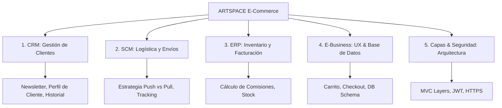

# Plan de Implementación: ARTSPACE - Negocios Electrónicos II

Este documento detalla el plan de trabajo y el mapeo curricular para la evolución del proyecto **ARTSPACE (ARTÉRIA)**, alineando el desarrollo del software con los temas de la materia de **Negocios Electrónicos II**. El objetivo es transformar el prototipo estático actual en una plataforma de comercio electrónico multinivel segura, escalable y funcional.

---

## 🗺️ Mapeo del Proyecto con el Temario



### Unidad 1: Customer Relationship Management (CRM)
El enfoque estará en capturar, retener e incentivar las relaciones con los coleccionistas y entusiastas de arte.
*   **Implementación Técnica:**
    *   **Newsletter y Captación:** Formulario activo para capturar correos (leads) interesados en preventas de arte.
    *   **Perfiles de Cliente:** Creación de un panel de usuario donde el comprador pueda ver sus obras favoritas (Whislist), su carrito guardado e historial de compras.
    *   **Evaluación e Integración:** Conexión simulada con APIs de CRM comerciales (ej. **HubSpot** o **Mailchimp**) para envío automático de correos de bienvenida o abandono de carrito.

### Unidad 2: Supply Chain Management (SCM)
El e-commerce de arte requiere dos tipos claros de logística según la naturaleza de la obra:
*   **Estrategia Push (Empujar):**
    *   *Concepto:* Inventario listo de láminas o *prints* autografiados pre-impresos.
    *   *Implementación:* Control de stock físico del almacén de la galería y cálculo de tiempos estándar de entrega express.
*   **Estrategia Pull (Jalar):**
    *   *Concepto:* Obras originales únicas o encargos personalizados (comisiones) donde la producción inicia solo cuando el cliente paga.
    *   *Implementación:* Flujo interactivo para solicitar comisiones a artistas, con estados del pedido ("En proceso de pintura", "Secado", "Empaquetado").
*   **Logística y Envíos:** Simulación de cálculo de tarifas y generación de guías de envío utilizando APIs de logística comercial (ej. DHL, FedEx o Shippo).

### Unidad 3: Enterprise Resource Planning (ERP)
Gestión del negocio interno de la galería digital.
*   **Implementación Técnica:**
    *   **Cálculo de Ganancias y Comisiones:** Lógica del negocio donde del 100% de la venta de una obra, el *X%* va al artista independiente y el *Y%* es la comisión de la plataforma.
    *   **Facturación Electrónica:** Generador de recibos de compra listos para exportar en PDF con desglose de costos.
    *   **Inventario Centralizado:** Evitar la venta duplicada de obras de arte originales (piezas únicas).

### Unidad 4: Elementos de E-Business, Base de Datos y Autenticación
Esta es la transición principal de páginas estáticas HTML a un sistema funcional de negocios electrónicos.
*   **Catalogo de artículos:** Implementación de filtros dinámicos (Pintura, Digital, Ilustración) y búsquedas por artista o rango de precios.
*   **Carrito de compras:** Gestión del estado de la compra utilizando almacenamiento persistente local (`localStorage`) sincronizado con la sesión del usuario.
*   **Proceso de pago (Checkout):** Formulario interactivo simulando una pasarela de pago (integrando la API Sandbox de **Stripe**).
*   **Configurador del cálculo de impuestos:** Cálculo dinámico del IVA (16% para México) e impuestos aduanales o arancelarios si el envío es internacional.
*   **Atención a clientes:** Integración de un chatbot inteligente de soporte para preguntas frecuentes (envíos, devoluciones, autenticidad del arte).
*   **Base de Datos (DB):** Diseño y despliegue de un esquema de base de datos relacional (PostgreSQL) o no relacional (MongoDB) con las colecciones: `Usuarios`, `Productos`, `Órdenes`, `Artistas` y `Soporte`.
*   **Registro y autenticación:** Sistema de Login/Registro seguro con contraseñas encriptadas con `bcrypt` y sesiones manejadas por Tokens JWT.

### Unidad 5: Arquitectura en Capas y Seguridad
*   **Capa de Presentación (Presentation Layer):** Migración de las vistas estáticas del proyecto a componentes React / Next.js o vistas dinámicas estructuradas.
*   **Capa de Negocio (Business Layer):** Lógica del servidor (Express/Node.js) encargada de procesar las transacciones, comisiones del ERP, y validaciones de stock de SCM.
*   **Capa de Datos (Data Layer):** Controladores y modelos de acceso seguro a la base de datos (ej. Mongoose para MongoDB o Sequelize/Prisma para SQL).
*   **Mecanismos de Seguridad:**
    *   Encriptación de contraseñas (Hashing).
    *   Protección contra ataques comunes (SQL Injection mediante ORM/ODM, XSS mediante sanitización de inputs).
    *   Implementación de cabeceras seguras (Helmet) y control de origen de peticiones (CORS).

---

## 📅 Cronograma Propuesto de Trabajo (Fases de Desarrollo)

```
[ Fase 1: DB y Auth ] ➔ [ Fase 2: E-Business Core ] ➔ [ Fase 3: Integración CRM/SCM ] ➔ [ Fase 4: ERP & Seguridad ]
```

| Fase | Duración | Temas Cubiertos | Entregable Técnico |
| :--- | :--- | :--- | :--- |
| **Fase 1: Cimientos y Auth** | Semana 1-2 | 4.2, 4.3, 5.2 | Base de datos diseñada en la nube. Registro y Login funcional con encriptación. |
| **Fase 2: Motor de Ventas** | Semana 3-4 | 4.1.1, 4.1.2, 4.1.3, 4.1.5 | Catálogo dinámico conectado a la DB. Carrito de compras y pasarela de pago simulada con cálculo de impuestos automático. |
| **Fase 3: CRM y SCM (Operaciones)** | Semana 5-6 | 1.1 - 1.5, 2.1 - 2.5 | Módulo de soporte/newsletter conectado a CRM. Panel de logística con selección de envío Push (Stock) o Pull (Comisiones). |
| **Fase 4: ERP y Seguridad Total** | Semana 7-8 | 3.1 - 3.5, 5.3, 5.4 | Panel administrativo para control de stock, cálculo automático de comisiones de artistas y auditoría de seguridad del backend. |

---

## 🛠️ Stack Tecnológico Sugerido

*   **Frontend (Capa de Presentación):** React / Next.js + CSS Vanilla (manteniendo la identidad premium de ARTSPACE) o Tailwind CSS.
*   **Backend (Capa de Negocios):** Node.js con Express.
*   **Base de Datos (Capa de Datos):** MongoDB (Atlas) o PostgreSQL (Supabase/Neon).
*   **Pasarela de Pago:** Stripe API (Modo Test).
*   **Autenticación:** JWT (JSON Web Tokens) + bcryptjs.
