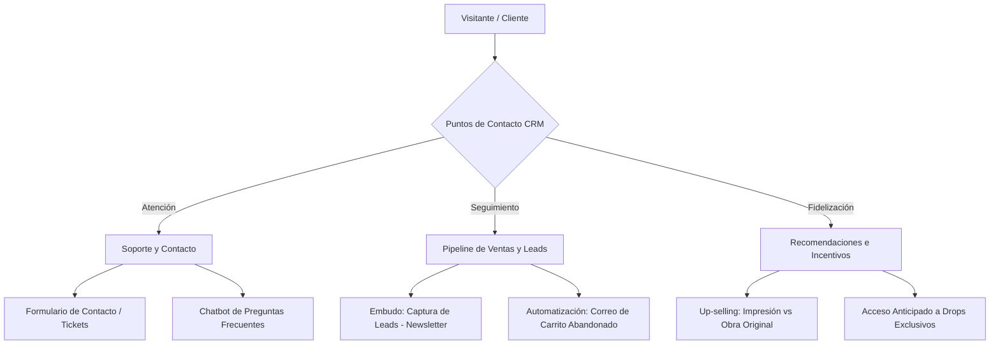

# 📘 Propuesta y Diseño Técnico del Módulo CRM - ARTSPACE

Este documento sirve como base para tu **Bitácora de Avance de Proyecto** y **Presentación Técnica**. Define la estrategia de CRM (Customer Relationship Management) adaptada a la galería digital **ARTSPACE**, alineando los requisitos funcionales con la arquitectura en Django.

---

## 🎯 1. Alineación Conceptual de la Estrategia CRM

Para una galería de arte digital, el CRM no es solo un registro de clientes; es la herramienta que conecta la sensibilidad del coleccionista con el catálogo de los artistas.



---

## 🛠️ 2. Estructuración de los Ejes del CRM

### 📞 Eje A: Atención a Clientes (Soporte Digital)
*   **Canal de Contacto Integrado (Mesa de Ayuda):** 
    *   *Funcionalidad:* El formulario de la sección `contacto.html` ya no será estático. Se conectará a un modelo Django llamado `TicketSoporte`.
    *   *Flujo:* Cuando un usuario envíe una duda (ej. *"¿Hacen envíos enmarcados a Monterrey?"*), se creará un ticket en la base de datos.
    *   *Gestión (Mesa de Ayuda):* El administrador responderá desde el panel de Django Admin. El sistema enviará una notificación por correo al cliente con la respuesta.
*   **Chatbot de Soporte (Widget Flotante):**
    *   *Funcionalidad:* Un bot de chat en vivo con respuestas predefinidas sobre políticas de envío, autenticidad de obras de arte físicas y descarga de archivos digitales.

### 📈 Eje B: Seguimiento Comercial (Ventas & Leads Pipeline)
*   **Captura de Leads (Newsletter):**
    *   *Funcionalidad:* El campo de newsletter en el footer guardará correos en el modelo `LeadNewsletter`.
    *   *Segmentación:* Se clasificará a los prospectos según su comportamiento de navegación (ej. si visitaron más arte digital o pintura física).
*   **Automatización de Notificaciones (Postventa y Abandono):**
    *   *Abandono de Carrito:* Si un cliente logueado agrega obras al carrito pero no compra en 24 horas, Django gatillará un recordatorio automático por correo (ej. *"¡Tu obra de arte favorita te está esperando!"*).
    *   *Seguimiento Postventa:* Envío automatizado 7 días después de la entrega de una obra física, solicitando una reseña del producto para generar confianza y verificar la satisfacción del cliente.

### 🎁 Eje C: Programa de Fidelización (Retención de Clientes)
*   **Estrategia de Up-selling & Cross-selling:**
    *   *Up-selling (Aumentar valor):* En la ficha de una obra, ofrecer la opción de adquirir la "Obra Original Firmada" o el "Print Enmarcado de Lujo" en lugar del print estándar digital.
    *   *Cross-selling (Venta cruzada):* En el carrito, sugerir obras del mismo artista o colecciones similares mediante un algoritmo simple de recomendación basado en categorías.
*   **Acceso Exclusivo y Lanzamientos (Drops):**
    *   *Fidelización Premium:* Clasificar a usuarios con más de 2 compras exitosas como "Coleccionistas VIP", otorgándoles acceso prioritario de 48 horas a los nuevos lanzamientos (*Drops*) de artistas exclusivos antes de que estén disponibles al público general.

---

## 📐 3. Diseño Técnico en Django (Data Layer)

Para que la bitácora sea aprobada técnicamente, debemos plasmar el diseño de la base de datos. Estos modelos se integrarán en la aplicación de Django:

```python
from django.db import models
from django.contrib.auth.models import User

# 1. CRM - Captura de Prospectos
class LeadNewsletter(models.Model):
    email = models.EmailField(unique=True)
    fecha_registro = models.DateTimeField(auto_now_add=True)
    interes_principal = models.CharField(
        max_length=50, 
        choices=[('DIGITAL', 'Arte Digital'), ('FISICO', 'Obra Física'), ('GENERAL', 'General')],
        default='GENERAL'
    )

    def __str__(self):
        return self.email

# 2. CRM - Atención al Cliente (Mesa de Ayuda)
class TicketSoporte(models.Model):
    ESTADOS = [
        ('NUEVO', 'Nuevo'),
        ('PROCESO', 'En Proceso'),
        ('RESUELTO', 'Resuelto'),
    ]
    usuario = models.ForeignKey(User, on_delete=models.CASCADE, null=True, blank=True)
    nombre = models.CharField(max_length=100)
    email = models.EmailField()
    asunto = models.CharField(max_length=200)
    mensaje = models.TextField()
    estado = models.CharField(max_length=10, choices=ESTADOS, default='NUEVO')
    respuesta = models.TextField(blank=True, null=True)
    fecha_creacion = models.DateTimeField(auto_now_add=True)

    def __str__(self):
        return f"{self.asunto} - {self.estado}"

# 3. CRM - Programa de Fidelización (Clientes Premium)
class PerfilCliente(models.Model):
    usuario = models.OneToOneField(User, on_delete=models.CASCADE)
    puntos_fidelidad = models.PositiveIntegerField(default=0)
    es_vip = models.BooleanField(default=False)
    preferencias_estilo = models.CharField(max_length=100, blank=True)

    def __str__(self):
        return f"Perfil de {self.usuario.username}"
```
