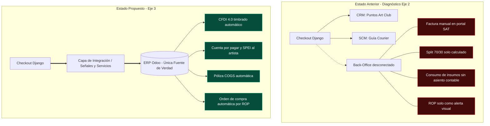
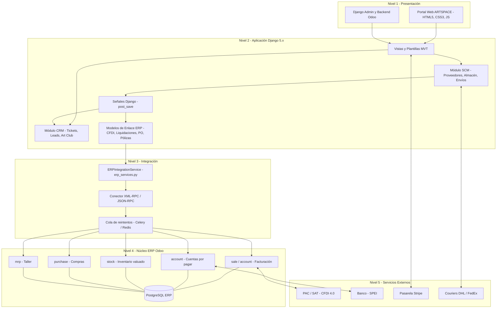
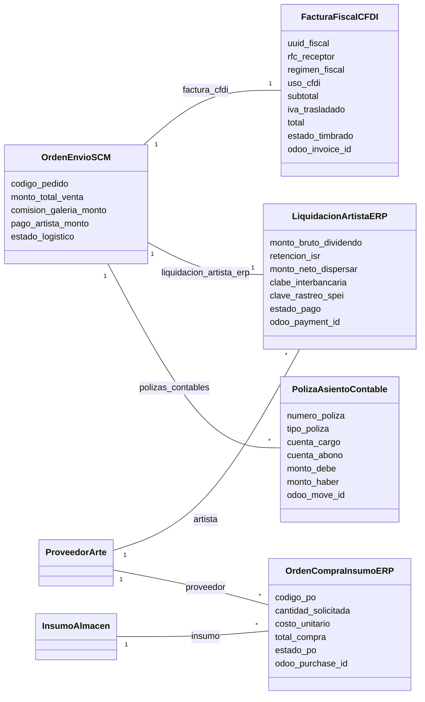
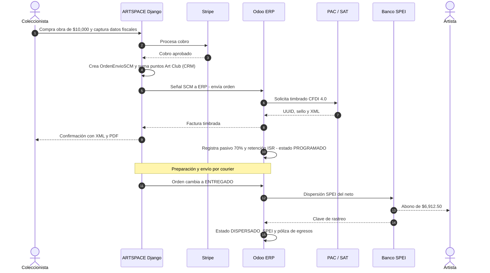
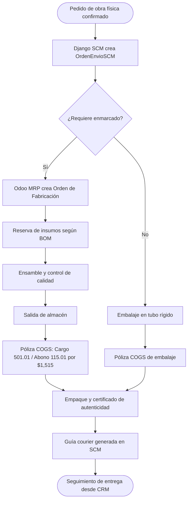
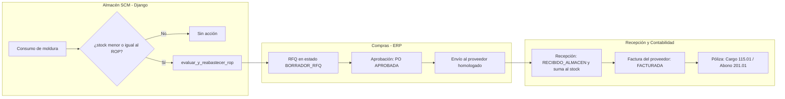
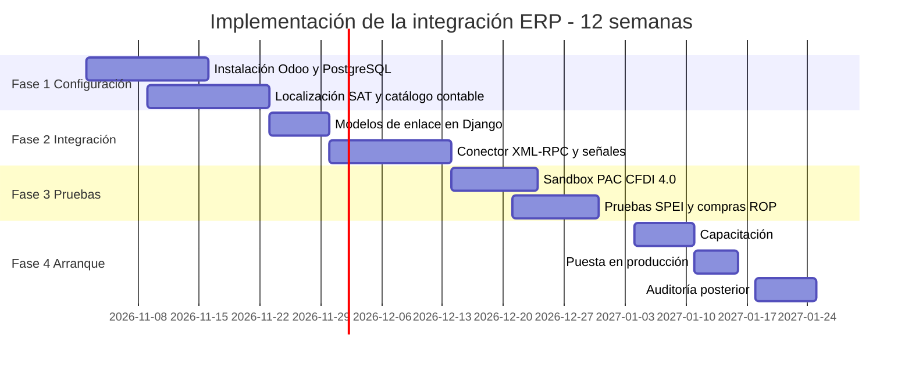

# 📑 PROPUESTA FORMAL DE INTEGRACIÓN DE MÓDULOS ERP Y DOCUMENTACIÓN DE ACTUALIZACIÓN DEL PROYECTO ELECTRÓNICO
## EJE 3: ARQUITECTURA INTEGRADA (DJANGO 5.X — ODOO ERP), FLUJOS DE PROCESO END-TO-END E IMPACTO OPERATIVO
### PROYECTO INTEGRADOR: ARTSPACE (E-COMMERCE DE ARTE CONTEMPORÁNEO Y DIGITAL)
#### Asignatura: Negocios Electrónicos II — Universidad Autónoma de Tlaxcala

---

## 🏛️ DATOS DE IDENTIFICACIÓN INSTITUCIONAL

* **Institución:** Universidad Autónoma de Tlaxcala (UATx)
* **Facultad:** Facultad de Ciencias Básicas, Ingeniería y Tecnología
* **Licenciatura / Ingeniería:** Ingeniería en Computación
* **Asignatura:** Negocios Electrónicos II
* **Eje de Entrega:** Eje 3 — Propuesta de Integración de Módulos ERP y Documentación de la Actualización del Proyecto
* **Proyecto Integrador:** ARTSPACE (Galería E-Commerce de Arte Contemporáneo y Digital)
* **Equipo de Desarrollo:** Equipo 3
* **Integrantes:**
  * *Almendra Valenzuela Rodrigo* (Líder Técnico & Desarrollador Backend)
* **Docente Titular:** M.C. / Dr. [Nombre del Docente]
* **Fecha de Emisión:** Octubre de 2026
* **Documentos Precedentes:**
  * [Eje 1: Ensayo Explicativo — Interrelación CRM - SCM - ERP](file:///c:/Users/AVRB9/Downloads/pagina/pagina/ensayo_interrelacion_crm_scm_erp.md)
  * [Eje 2: Evaluación del Avance del Proyecto y Diagnóstico de Cuellos de Botella](file:///c:/Users/AVRB9/Downloads/pagina/pagina/evaluacion_avance_proyecto_erp.md)

---

## 📋 RESUMEN EJECUTIVO

El presente documento da respuesta formal al **Eje 3** de la práctica *Ensayo Explicativo e Integración de Módulos ERP al Proyecto*. Partiendo del marco conceptual del **Eje 1** (flujo de datos y valor entre CRM, SCM y ERP) y del diagnóstico del **Eje 2** (cinco cuellos de botella: facturación fiscal manual, liquidación empírica a artistas, desconexión almacén–contabilidad, compras reactivas y ausencia de conciliación bancaria), se diseña la incorporación de módulos ERP al proyecto **ARTSPACE**, construido sobre **Django 5.x**, tomando como plataforma de referencia **Odoo ERP**.

La propuesta comprende seis módulos: **(1)** Ventas y Facturación Electrónica (CFDI 4.0); **(2)** Finanzas y Cuentas por Pagar con liquidación *Split* 70/30 a artistas; **(3)** Inventarios valuados y Costo de Ventas (COGS); **(4)** Compras y reabastecimiento por Punto de Reorden (ROP); **(5)** Manufactura del taller de enmarcado (MRP/BOM); y **(6)** Tesorería y conciliación bancaria. Se documenta la **arquitectura ajustada en cinco niveles**, el **modelo de datos de enlace implementado en Django**, los **diagramas de flujo integrados**, el **impacto esperado (KPIs y ROI)** y el **plan de implementación**.

---

## 🎯 OBJETIVOS

### Objetivo General
Diseñar una propuesta formal y fundamentada para integrar módulos ERP al negocio electrónico ARTSPACE, documentando la actualización del proyecto (arquitectura, flujos integrados y código) y el impacto esperado en su operación digital.

### Objetivos Específicos
1. Especificar funcionalmente los módulos ERP requeridos, vinculando cada uno con un cuello de botella del Eje 2.
2. Definir la arquitectura de software ajustada que acopla Django (Front-Office, CRM, SCM) con Odoo (Back-Office).
3. Modelar los flujos de proceso integrados de extremo a extremo (venta → factura → contabilidad → pago).
4. Implementar en el repositorio los modelos, servicios, señales y paneles de administración que materializan la integración.
5. Cuantificar el impacto operativo y financiero mediante KPIs y retorno de inversión.

---

# 🚀 1. JUSTIFICACIÓN DE LA PROPUESTA

## 1.1 Trazabilidad Diagnóstico (Eje 2) → Solución (Eje 3)

| Cuello de Botella (Eje 2) | Requerimiento | Módulo ERP Propuesto | Entidad Implementada en Django |
| :--- | :---: | :--- | :--- |
| CB1: Sin facturación fiscal CFDI 4.0 | REQ-ERP-01 | Ventas y Facturación (`account` + `l10n_mx_edi`) | `FacturaFiscalCFDI` |
| CB2: Liquidación empírica a artistas 70/30 | REQ-ERP-02 | Cuentas por Pagar y Pagos (`account`) | `LiquidacionArtistaERP` |
| CB3: Almacén desconectado de contabilidad | REQ-ERP-03 | Inventario valuado (`stock` + `account`) | `PolizaAsientoContable` |
| CB4: Alerta ROP sin orden de compra | REQ-ERP-04 | Compras (`purchase`) | `OrdenCompraInsumoERP` |
| — (taller sin BOM ni costeo) | REQ-ERP-05 | Manufactura (`mrp`) | Póliza COGS de ensamble |
| CB5: Sin conciliación bancaria | REQ-ERP-06 | Tesorería / Bancos (`account`) | `PolizaAsientoContable` (ingresos/egresos) |

## 1.2 Estado Anterior vs. Estado Propuesto



## 1.3 Selección de la Plataforma ERP: Odoo
Con base en la evaluación multicriterio documentada en [reporte_fundamentos_evaluacion_erp.md](file:///c:/Users/AVRB9/Downloads/pagina/pagina/reporte_fundamentos_evaluacion_erp.md), se ratifica **Odoo (v17)** por:
1. **Afinidad tecnológica:** Python + PostgreSQL, igual que el stack de Django; integración nativa vía XML-RPC / JSON-RPC.
2. **Localización mexicana:** módulo `l10n_mx_edi` para CFDI 4.0, catálogos SAT y conexión con PAC.
3. **Modularidad:** se instalan sólo los módulos necesarios (`sale`, `account`, `stock`, `purchase`, `mrp`).
4. **Costo total de propiedad bajo:** edición Community de código abierto, adecuada para una PyME digital en etapa de crecimiento.

---

# 📦 2. PROPUESTA DE MÓDULOS ERP

```
┌──────────────────────────────────────────────────────────────────────────┐
│                 ECOSISTEMA MODULAR ERP — ARTSPACE (ODOO 17)              │
├──────────────────┬──────────────────┬──────────────────┬─────────────────┤
│ 1. VENTAS Y      │ 2. FINANZAS /    │ 3. INVENTARIO    │ 4. COMPRAS      │
│    FACTURACIÓN   │    CUENTAS POR   │    VALUADO Y     │    ROP          │
│    CFDI 4.0      │    PAGAR 70/30   │    COGS          │    AUTOMÁTICO   │
├──────────────────┴──────────────────┼──────────────────┴─────────────────┤
│ 5. MANUFACTURA / TALLER (MRP · BOM) │ 6. TESORERÍA Y CONCILIACIÓN        │
└─────────────────────────────────────┴────────────────────────────────────┘
```

## 2.1 Módulo 1 — Ventas y Facturación Electrónica (CFDI 4.0)
* **Área:** Finanzas y cumplimiento fiscal.
* **Entradas:** orden de venta de Django, RFC, razón social, código postal fiscal, régimen fiscal y uso de CFDI del cliente.
* **Proceso:**
  1. Al confirmarse el pago, Django envía la orden al ERP.
  2. Odoo genera la factura con clave de producto SAT `60121000` (Arte y artesanías), unidad `H87` (Pieza) e IVA trasladado 16 %.
  3. El PAC timbra el comprobante y devuelve el **UUID**, sello digital y XML.
  4. Django almacena el UUID y los enlaces XML/PDF para descarga del cliente.
* **Regla de negocio:** si el cliente no solicita factura nominativa, la venta se incluye en la **factura global a Público en General** (RFC `XAXX010101000`).
* **Salidas:** CFDI timbrado, cuenta por cobrar saldada, póliza de ingresos.

## 2.2 Módulo 2 — Finanzas, Cuentas por Pagar y Liquidación a Artistas (*Split* 70/30)
* **Área:** Tesorería y relación con artistas.
* **Ejemplo con una venta de $10,000 MXN:**

| Concepto | Cuenta contable | Importe |
| :--- | :--- | ---: |
| Comisión de la galería (30 %) | 401.01 Ingresos por intermediación | $3,000.00 |
| Pasivo a favor del artista (70 %) | 201.05 Cuentas por pagar a artistas | $7,000.00 |
| Retención ISR RESICO (1.25 % del pasivo) | 216.10 Impuestos retenidos | −$87.50 |
| **Neto a dispersar vía SPEI** | 102.01 Bancos | **$6,912.50** |

* **Regla de negocio:** el pago se **programa** al crearse la orden y se **dispersa** únicamente cuando el SCM confirma el estado `ENTREGADO`, protegiendo a la galería ante devoluciones.

## 2.3 Módulo 3 — Inventario Valuado y Costo de Ventas (COGS)
* **Área:** Almacén y contabilidad de costos.
* **Proceso:** Django conserva el control físico (`InsumoAlmacen`); Odoo aplica valuación **PEPS (FIFO)** automatizada. Cada salida de almacén genera la póliza:
  * **Cargo:** 501.01 Costo de Ventas.
  * **Abono:** 115.01 Inventario de Materias Primas.
* **Resultado:** margen bruto real por obra y valor de inventario actualizado en tiempo real.

## 2.4 Módulo 4 — Compras y Reabastecimiento por ROP
* **Área:** Compras y proveedores.
* **Parámetros:** Stock de Seguridad (SS), Punto de Reorden (ROP) y lote de reposición (EOQ), ya definidos en el modelo SCM de la Unidad 2.
* **Proceso:** cuando `stock_actual <= punto_reorden`, se genera una **Solicitud de Cotización (RFQ)** al proveedor homologado → aprobación → **Orden de Compra (PO)** → recepción en almacén → factura del proveedor → póliza (Cargo 115.01 Inventarios / Abono 201.01 Proveedores).

## 2.5 Módulo 5 — Manufactura del Taller de Enmarcado (MRP)
Cada obra con enmarcado se fabrica contra una **Lista de Materiales (BOM)**:

| Componente | SKU | Cantidad | Unidad | Costo unitario | Subtotal |
| :--- | :--- | :---: | :---: | ---: | ---: |
| Varilla de nogal 4 cm | `INS-MAD-001` | 2.4 | m | $187.50 | $450.00 |
| Cristal museo anti-UV | `INS-CRIS-002` | 1 | pieza | $620.00 | $620.00 |
| Marialuisa pH neutro | `INS-PASP-003` | 1 | pliego | $110.00 | $110.00 |
| Trasera MDF sellada | `INS-MDF-004` | 1 | pieza | $75.00 | $75.00 |
| Herrajes inoxidables | `INS-HERR-005` | 1 | kit | $35.00 | $35.00 |
| Mano de obra (ebanista) | `MOD-MAESTRO` | 1.5 | h | $150.00 | $225.00 |
| **Costo directo de fabricación** | | | | | **$1,515.00** |

La orden de venta con "Enmarcado Premium" genera una **Orden de Fabricación**; al terminarla se consumen los insumos y se registra el COGS por $1,515.00.

## 2.6 Módulo 6 — Tesorería y Conciliación Bancaria
* **Problema:** el e-commerce registra el cobro bruto, pero el banco recibe el neto tras comisiones de la pasarela.
* **Ejemplo (venta de $10,000):** comisión Stripe 3.6 % + $3 + IVA = **$421.08** → registrada como gasto financiero (602.04); neto **$9,578.92** a bancos.
* **Resultado:** conciliación automática por referencia y monto entre el estado de cuenta y los cobros.

---

# 🏗️ 3. ARQUITECTURA AJUSTADA DEL PROYECTO



**Cambios respecto a la arquitectura de las Unidades 1 y 2:**
1. Se añade la **capa de modelos de enlace ERP** dentro de la app `gallery`.
2. Se añade el **servicio de integración** (`ERPIntegrationService`) que encapsula la comunicación con Odoo.
3. Las **señales** existentes (SCM → CRM) se amplían con una nueva señal **SCM → ERP**.
4. El ERP se convierte en la **Única Fuente de Verdad** contable y fiscal; Django sigue siendo dueño de la experiencia del cliente y de la logística.

## 3.1 Modelo de Datos de Enlace (implementado)



---

# 🔄 4. DIAGRAMAS DE FLUJO INTEGRADOS

## 4.1 Flujo 1 — Venta, Factura CFDI y Liquidación al Artista



## 4.2 Flujo 2 — Taller, Almacén y Costo de Ventas



## 4.3 Flujo 3 — Reabastecimiento por Punto de Reorden



---

# 💻 5. DOCUMENTACIÓN DE LA ACTUALIZACIÓN TÉCNICA

## 5.1 Archivos modificados y creados

| Archivo | Tipo | Cambio realizado |
| :--- | :---: | :--- |
| [gallery/models.py](file:///c:/Users/AVRB9/Downloads/pagina/gallery/models.py) | Modificado | Sección 8: cuatro modelos ERP. Sección 9: señal `disparar_integracion_erp_desde_orden`. |
| [gallery/erp_services.py](file:///c:/Users/AVRB9/Downloads/pagina/gallery/erp_services.py) | Nuevo | Clase `ERPIntegrationService` (CFDI, SPEI, COGS, ROP). |
| [gallery/admin.py](file:///c:/Users/AVRB9/Downloads/pagina/gallery/admin.py) | Modificado | Paneles de administración ERP con acciones masivas. |
| `gallery/migrations/0003_facturafiscalcfdi_liquidacionartistaerp_and_more.py` | Nuevo | Migración aplicada a la base de datos. |
| [pagina/seed_erp.py](file:///c:/Users/AVRB9/Downloads/pagina/pagina/seed_erp.py) | Nuevo | Script de poblamiento y demostración. |

## 5.2 Modelos de enlace
1. **`FacturaFiscalCFDI`** — UUID fiscal, RFC, régimen, uso de CFDI, subtotal, IVA 16 %, total, estado de timbrado e `odoo_invoice_id`.
2. **`LiquidacionArtistaERP`** — dividendo bruto 70 %, retenciones ISR/IVA, neto a dispersar, CLABE, clave de rastreo SPEI y estado (`PROVISIONADO → PROGRAMADO → DISPERSADO_SPEI → CONCILIADO`).
3. **`OrdenCompraInsumoERP`** — PO por insumo y proveedor, con estados `BORRADOR_RFQ → APROBADA → EN_TRANSITO → RECIBIDO_ALMACEN → FACTURADA`.
4. **`PolizaAsientoContable`** — póliza de diario, ingresos o egresos con partida doble (debe = haber).

## 5.3 Señal SCM → ERP
La señal `disparar_integracion_erp_desde_orden` (sobre `OrdenEnvioSCM`):
* **Al crear la orden:** genera la `FacturaFiscalCFDI` (IVA desglosado) y la `LiquidacionArtistaERP` con retención ISR RESICO de 1.25 % en estado `PROGRAMADO`.
* **Al pasar a `ENTREGADO`:** cambia la liquidación a `DISPERSADO_SPEI`, asigna clave de rastreo y fecha de dispersión.

## 5.4 Servicio de integración (extracto)

```python
class ERPIntegrationService:
    @classmethod
    def emitir_factura_cfdi(cls, orden, rfc="XAXX010101000", razon_social=None,
                            regimen="616", uso="S01"):
        subtotal = round(orden.monto_total_venta / Decimal('1.16'), 2)
        iva = round(orden.monto_total_venta - subtotal, 2)
        # ... crea FacturaFiscalCFDI con estado TIMBRADO y UUID

    @classmethod
    def dispersar_pago_artista_spei(cls, liquidacion): ...   # + póliza de egresos

    @classmethod
    def registrar_asiento_cogs_ensamble(cls, orden, costo_insumos=Decimal('1515.00')): ...

    @classmethod
    def evaluar_y_reabastecer_rop(cls, insumo, lote_reposicion=100): ...  # crea PO si stock <= ROP
```

> **Nota:** en el entorno académico, las llamadas al PAC, al banco y a Odoo se **simulan** (UUID y folios generados localmente). En producción, estos métodos se sustituyen por llamadas XML-RPC al servidor Odoo sin cambiar el resto del sistema.

## 5.5 Evidencia de ejecución (`seed_erp.py`)

| Módulo | Resultado obtenido |
| :--- | :--- |
| Facturación CFDI | 3 facturas timbradas: $12,500.00 · $6,500.00 · $4,200.00 |
| Liquidación a artistas | ART-SCM-2026-003: $10,000 − $125.00 = **$9,875.00** (programado) · ART-SCM-2026-002: $5,200 − $65.00 = **$5,135.00** (dispersado SPEI) · ART-SCM-2026-001: $3,360 − $42.00 = **$3,318.00** (programado) |
| Pólizas contables | POL-DIA-2026-001 (COGS $1,515) · POL-ING-2026-002 (ingresos $18,500) · POL-EGR-2026-003 (egresos $12,788.13), todas cuadradas |
| Compras ROP | PO-2026-OCT-001: 100 uds. de *Moldura Madera Nogal Sólido A2* por $42,000.00 |

Validación adicional: `python manage.py check` → *System check identified no issues*.

---

# 📊 6. IMPACTO ESPERADO EN LA OPERACIÓN

## 6.1 KPIs: antes vs. después

| Indicador | Línea base (sin ERP) | Proyección (con ERP) | Mejora |
| :--- | :---: | :---: | :---: |
| Tiempo de emisión de factura | 72 h | < 5 s | −99.9 % |
| Errores de captura fiscal | 12.5 % | ≈ 0 % | Eliminación de reprocesos |
| Tiempo de pago al artista | 15–20 días | 24 h tras la entrega | −88 % |
| Retención de artistas | 62 % | > 90 % | +28 pp |
| Exactitud inventario vs. libros | 71 % | 99 % | +28 pp |
| Quiebres de stock por trimestre | 8 | ≤ 1 | −87.5 % |
| Cierre contable mensual | 15 días | 1 día | −93 % |
| Margen neto por obra | 18.2 % | 24.8 % | +6.6 pp |

## 6.2 Impacto por área

| Área | Impacto |
| :--- | :--- |
| **Clientes (CRM)** | Factura inmediata en su perfil; menos tickets por facturación. |
| **Artistas** | Pagos puntuales y transparentes con comprobante SPEI y retenciones correctas. |
| **Almacén / Taller (SCM)** | Compras automáticas, menos quiebres y control de mermas por BOM. |
| **Finanzas** | Estados financieros en tiempo real, cumplimiento SAT y conciliación automática. |
| **Dirección** | Margen real por obra para decisiones de precio y curaduría. |

## 6.3 Retorno de inversión (año 1)

| Inversión | Monto |
| :--- | ---: |
| Servidor VPS + PostgreSQL | $4,800 |
| Timbres fiscales PAC | $2,200 |
| Configuración y pruebas | $18,000 |
| **Total** | **$25,000** |

| Beneficio anual estimado | Monto |
| :--- | ---: |
| Horas contables ahorradas | $28,800 |
| Menos fletes de emergencia | $14,500 |
| Menos mermas de moldura | $11,200 |
| Ventas por nuevos artistas | $45,000 |
| **Total** | **$99,500** |

$$ROI = \frac{99{,}500 - 25{,}000}{25{,}000} \times 100 = 298\%$$

---

# 📅 7. PLAN DE IMPLEMENTACIÓN



### Gestión del cambio y riesgos

| Riesgo | Mitigación |
| :--- | :--- |
| Resistencia del personal de taller | Interfaz simplificada (Iniciar / Pausar / Terminar) y capacitación práctica. |
| Caída del servidor ERP | Cola de reintentos en Django; la venta nunca se bloquea. |
| Errores en datos fiscales | Validación de RFC y régimen antes de timbrar; pruebas en sandbox del PAC. |
| Inconsistencia de datos entre sistemas | IDs de Odoo (`odoo_*_id`) en cada modelo de enlace para trazabilidad. |

---

# 🎯 8. CONCLUSIONES

1. La propuesta responde **uno a uno** a los cuellos de botella del Eje 2, cerrando la brecha entre el Front-Office (CRM), la logística (SCM) y el Back-Office (ERP) descrita en el Eje 1.
2. La actualización del proyecto **no es sólo documental**: se implementaron modelos, señal, servicio, panel administrativo y migración, validados con datos de prueba.
3. Con la integración, ARTSPACE pasa de ser una tienda con back-office desconectado a un **negocio electrónico integrado**, con cumplimiento fiscal, pagos transparentes a artistas y costos reales por obra.

---

# 📚 REFERENCIAS (APA 7.ª ed.)

* Davenport, T. H. (1998). Putting the enterprise into the enterprise system. *Harvard Business Review, 76*(4), 121–131.
* Laudon, K. C., & Laudon, J. P. (2020). *Management information systems: Managing the digital firm* (16th ed.). Pearson.
* Monk, E., & Wagner, B. (2013). *Concepts in enterprise resource planning* (4th ed.). Cengage Learning.
* Odoo S.A. (2024). *Odoo documentation 17.0*. https://www.odoo.com/documentation/17.0/
* Servicio de Administración Tributaria. (2023). *Anexo 20 y guía de llenado del CFDI 4.0*. SHCP.
* Turban, E., Outland, J., King, D., Lee, J. K., Liang, T.-P., & Turban, D. C. (2018). *Electronic commerce 2018: A managerial and social networks perspective*. Springer.

---

### 📂 Navegación de la Práctica
* [Eje 1: Ensayo Explicativo](file:///c:/Users/AVRB9/Downloads/pagina/pagina/ensayo_interrelacion_crm_scm_erp.md)
* [Eje 2: Evaluación del Avance del Proyecto](file:///c:/Users/AVRB9/Downloads/pagina/pagina/evaluacion_avance_proyecto_erp.md)
* [Eje 3: Propuesta de Integración ERP (este documento)](file:///c:/Users/AVRB9/Downloads/pagina/pagina/propuesta_integracion_modulos_erp.md)
