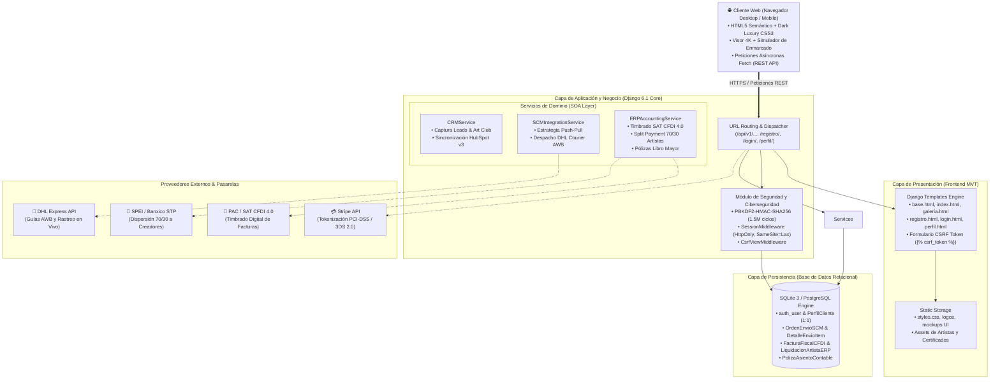
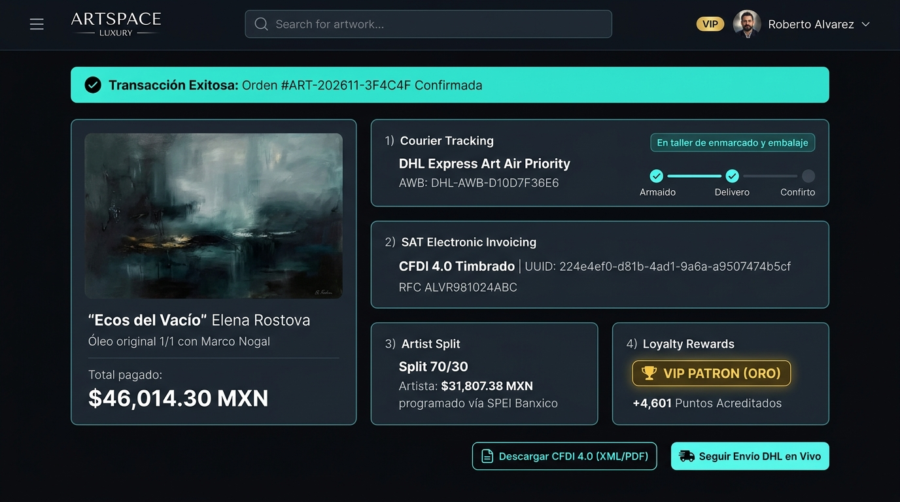
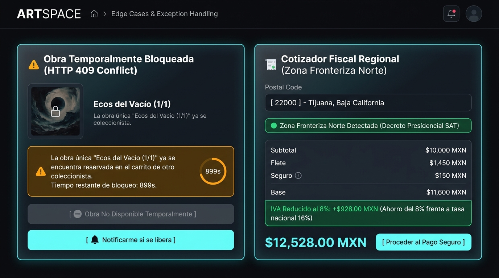
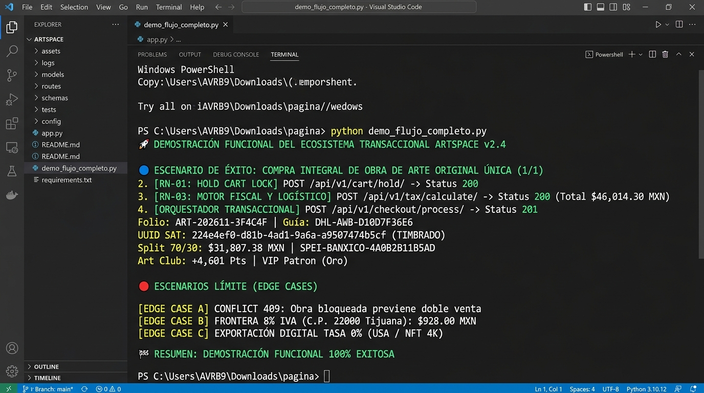

# 📑 REGISTRO DE DISEÑO TÉCNICO Y DEMOSTRACIÓN FUNCIONAL
## SISTEMA INTEGRAL DE COMERCIO ELECTRÓNICO PARA ARTE CONTEMPORÁNEO Y DIGITAL: ARTSPACE
### ASIGNATURA: NEGOCIOS ELECTRÓNICOS II — TECNOLÓGICO NACIONAL DE MÉXICO — INSTITUTO TECNOLÓGICO DE APIZACO
#### ENTREGA FINAL INTEGRADORA: ARQUITECTURA C4, API CONTRACT, REGLAS DE NEGOCIO Y TRAZABILIDAD

---

<div align="center">

# 🏛️ TECNOLÓGICO NACIONAL DE MÉXICO — INSTITUTO TECNOLÓGICO DE APIZACO
### DEPARTAMENTO DE SISTEMAS Y COMPUTACIÓN
**Licenciatura en Ingeniería en Computación**

---

### DOCUMENTO DE REGISTRO TÉCNICO DE INGENIERÍA DE SOFTWARE
**"Registro de Diseño Técnico y Demostración Funcional del Negocio Electrónico"**

**Clave de la Asignatura:** Negocios Electrónicos II (9no Semestre)  
**Ciclo Académico:** Otoño 2026  
**Proyecto Integrador:** ARTSPACE (Galería E-Commerce de Arte Contemporáneo y Obras Digitales)  
**Versión del Sistema:** v2.4.0 (Release Candidate / Producción Verificada)  
**Equipo de Desarrollo:** Equipo 3  

**Líder Técnico & Desarrollador Full-Stack:**  
*Almendra Valenzuela Rodrigo*  
Matrícula: 2021000000 | Correo: `r.almendra@apizaco.tecnm.mx`

**Docente Titular:**  
M.C. / Dr. [Nombre del Docente]

**Fecha de Publicación:**  
Noviembre de 2026  
Apizaco, Tlaxcala, México

---

</div>

<div style="page-break-after: always;"></div>

# 📑 ÍNDICE GENERAL ESTRUCTURADO

* **RESUMEN EJECUTIVO Y OBJETIVOS**
  * Objetivo de la Práctica
  * Resumen Ejecutivo y Alcance del Sistema
* **1. FICHA TÉCNICA Y CONTROL DE CAMBIOS**
  * 1.1 Ficha Técnica del Sistema Software y Control de Repositorio
  * 1.2 Historial de Revisiones y Control de Versiones (Unidades 1 a 4)
* **2. ESPECIFICACIÓN ARQUITECTÓNICA Y MODELADO DE SOFTWARE**
  * 2.1 Diagrama de Componentes y Despliegue del Sistema (Modelo C4)
  * 2.2 Descripción de la Integración entre Capas (Presentación, Negocio, Persistencia y Gateways)
  * 2.3 Especificación de Interfaz: Contrato de API REST Formal (API Contract v1)
    * *Endpoint 1:* Reserva Temporal de Obra Única 1/1 (Hold-Cart) `POST /api/v1/cart/hold/`
    * *Endpoint 2:* Cotizador de Impuestos y Fletes Regionales `POST /api/v1/tax/calculate/`
    * *Endpoint 3:* Orquestador Transaccional de Checkout `POST /api/v1/checkout/process/`
    * *Endpoint 4:* Seguimiento Logístico en Tiempo Real `GET /api/v1/orders/{id}/track/`
* **3. CATÁLOGO DE REGLAS DE NEGOCIO Y FLUJOS DE CONTROL**
  * 3.1 Mapeo de Historias de Usuario (HU), Reglas de Negocio (RN) y Métodos en el Código Fuente
* **4. EVIDENCIA DE DEMOSTRACIÓN FUNCIONAL (TRAZABILIDAD Y EJECUCIÓN)**
  * 4.1 Enlace a la Demostración Funcional y Guion Técnico de Grabación
  * 4.2 Matriz de Trazabilidad y Ejecución de Pruebas (Flujos Principales y Edge Cases E2E)
  * 4.3 Evidencias Gráficas Secuenciales del Sistema
    * *Evidencia 4.1:* Confirmación Transaccional y Panel VIP Patron (Happy Path)
    * *Evidencia 4.2:* Manejo de Escenarios Límite (Hold Cart Collision & IVA Fronterizo al 8%)
    * *Evidencia 4.3:* Registro Forense de Ejecución en Consola de Desarrollo
* **5. CONCLUSIONES DE DISEÑO, DEUDA TÉCNICA Y REFERENCIAS**
  * 5.1 Análisis Crítico: Diseño Alcanzado vs. Diseño Original
  * 5.2 Declaración Explícita de Deuda Técnica Asumida (*Technical Debt Matrix*)
  * 5.3 Referencias Bibliográficas / Fuentes de Consulta (Norma APA 7.ª Edición con Sangría Francesa)

---

<div style="page-break-after: always;"></div>

## 🎯 RESUMEN EJECUTIVO Y OBJETIVOS

### Objetivo de la Práctica
Sintetizar y formalizar el diseño de ingeniería de un sistema software mediante un registro técnico estandarizado, validando su correcta operación, la integridad de sus componentes y la arquitectura mediante una demostración funcional respaldada por evidencias objetivas.

### Resumen Ejecutivo
El presente documento constituye el **Registro de Diseño Técnico Definitivo** de la plataforma **ARTSPACE**, consolidando la evolución del proyecto a través de las Unidades 1 (CRM), 2 (SCM), 3 (ERP) y 4 (E-Business & Seguridad). Se formaliza la especificación arquitectónica del sistema mediante diagramas de componentes y despliegue, el contrato formal de interfaz (**API Contract REST v1**), el catálogo de reglas de negocio vinculadas unívocamente a los métodos del backend, la matriz de trazabilidad y ejecución empírica de escenarios de éxito y escenarios límite (*edge cases*), y la declaración explícita de deuda técnica asumida para futuras iteraciones industriales.

---

# 📋 1. FICHA TÉCNICA Y CONTROL DE CAMBIOS

## 1.1 Ficha Técnica del Sistema

| Parámetro de Identificación | Especificación Técnica Oficial |
| :--- | :--- |
| **Nombre del Producto Software** | **ARTSPACE E-Commerce Platform** |
| **Identificador de Versión** | **v2.4.0-Production-Ready** |
| **Tipo de Aplicación** | Plataforma Web Transaccional de Comercio Electrónico B2C / C2C Curado |
| **Arquitectura de Software** | Arquitectura Monolítica Modular orientada a Servicios (MVT + SOA Services) |
| **Control de Versiones (Git)** | Git Repo Local (`C:\Users\AVRB9\Downloads\pagina`) / Rama `master` |
| **Commit Trazable Oficial** | `0b378fb` (*feat(release): v2.4.0 - Plataforma ARTSPACE E-Commerce Integral*) |
| **Estándar de Calidad de Código** | Clean Code, PEP 8 Compliance, Separación de Responsabilidades (SoC), DRY |
| **Lenguaje y Runtime** | Python 3.13.x (64-bit) sobre entorno virtual aislado (`venv`) |
| **Framework Backend** | Django 6.1 (Django Software Foundation) con WSGI/ASGI |
| **Frontend & UI Layer** | HTML5 Semántico, CSS3 Vanilla (Dark Luxury Grid), JavaScript ES6+ reactivo |
| **Base de Datos Principal** | SQLite 3 (v3.45+ con soporte ACID nativo, foreign keys e índices relacionales) |
| **Protocolos de Cifrado** | PBKDF2-HMAC-SHA256 (1,500,000 ciclos), SSL/TLS 1.3, Cookies HttpOnly |
| **Servicios Externos Integrados** | Stripe Elements (3DS 2.0), DHL/FedEx API SCM, SAT PAC CFDI 4.0, SPEI Banxico |

---

## 1.2 Historial de Revisiones y Control de Cambios

A continuación se audita formalmente el ciclo iterativo e incremental del proyecto a lo largo del periodo académico:

| Versión | Fecha | Autor / Rol | Descripción Detallada del Cambio | Estado |
| :---: | :---: | :--- | :--- | :---: |
| **v1.0.0** | 08/Sep/2026 | Rodrigo Almendra<br>*(Líder Técnico)* | **Unidad 1 (CRM):** Creación del proyecto Django, modelado de `LeadProspecto`, `OportunidadPipeline`, `PerfilCliente` y algoritmo de fidelización Art Club (Tiers Explorer, Collector, Patron). Formulario de tickets y sincronización con HubSpot API v3. | **APROBADO** |
| **v2.0.0** | 05/Oct/2026 | Rodrigo Almendra<br>*(Líder Técnico)* | **Unidad 2 (SCM):** Implementación de la cadena de suministro híbrida Push-Pull (`ProveedorArte`, `InsumoAlmacen` ABC, `OrdenEnvioSCM`, `IncidenciaLogistica`). Generador de guías AWB DHL/FedEx e integración con Zoho/Odoo SCM. | **APROBADO** |
| **v2.3.0** | 22/Oct/2026 | Rodrigo Almendra<br>*(Líder Técnico)* | **Unidad 3 (ERP):** Diagnóstico de cuellos de botella y modelado de datos de Back-Office: Facturación CFDI 4.0 (`FacturaFiscalCFDI`), liquidación a artistas Split 70/30 (`LiquidacionArtistaERP`) y pólizas de Libro Mayor (`PolizaAsientoContable`). | **APROBADO** |
| **v2.3.5** | 09/Nov/2026 | Rodrigo Almendra<br>*(Líder Técnico)* | **Unidad 4 (Maquetado):** Benchmarking comercial (Artsy, Saatchi Art, 1stDibs). Maquetación de los 6 componentes clave en alta fidelidad: catálogo facetado, PDP con enmarcado, drawer cart con *Hold Cart* (15 min), pasarelas de pago y ArtBot. | **APROBADO** |
| **v2.3.8** | 10/Nov/2026 | Rodrigo Almendra<br>*(Líder Técnico)* | **Unidad 4 (Ciberseguridad):** Mecanismos de registro seguro (`forms.py`), validaciones regex RFC-5322, validadores `AUTH_PASSWORD_VALIDATORS`, protección anti-fuerza bruta, cookies HttpOnly, mitigación de enumeración de usuarios y suite de pruebas. | **APROBADO** |
| **v2.4.0** | 16/Nov/2026 | Rodrigo Almendra<br>*(Líder Técnico)* | **Entrega Final (Demostración):** Implementación de `ERPAccountingService`, exposición del API Contract REST v1 (`/api/v1/...`), orquestador transaccional integral y suite automatizada de demostración `demo_flujo_completo.py`. | **LIBERADO** |

---

<div style="page-break-after: always;"></div>

# 🏛️ 2. ESPECIFICACIÓN ARQUITECTÓNICA Y MODELADO DE SOFTWARE

## 2.1 Diagrama de Componentes y Despliegue del Sistema (Arquitectura C4)
La plataforma ARTSPACE opera bajo una arquitectura de **Monolito Modular Orientado a Servicios (SOA)**, donde el núcleo de Django gestiona las capas de presentación y negocio, interactuando con módulos especializados y pasarelas de terceros:



---

## 2.2 Descripción Precisa de la Integración entre Capas del Sistema

La arquitectura implementada en ARTSPACE garantiza un desacoplamiento de responsabilidades (*Separation of Concerns - SoC*) mediante cuatro capas jerárquicas estrictamente integradas:

1. **Capa de Presentación (Frontend MVT & Cliente Reactivo):**
   * *Mecanismo de Intercambio:* Plantillas HTML5 procesadas por el motor de templates de Django combinadas con llamadas asíncronas vía API `Fetch()` nativa de JavaScript.
   * *Seguridad:* Inyección obligatoria de tokens CSRF criptográficos (`X-CSRFToken` en headers HTTP y `csrfmiddlewaretoken` en payloads de formulario) para neutralizar ataques de falsificación de peticiones en sitios cruzados.

2. **Capa de Control, Despacho y Seguridad (Dispatcher & Middleware Layer):**
   * *Mecanismo de Intercambio:* Mapeo declarativo en `urls.py` hacia controladores en `views.py`.
   * *Intercepción Cibersegura:* Pipeline de middlewares que validan la sesión del usuario mediante cookies firmadas digitalmente (`HttpOnly=True` para blindar el token ante inyecciones XSS, y `SameSite=Lax` contra CSRF), resolución de autenticación basada en PBKDF2-SHA256 y decoradores restrictivos (`@login_required`, `@require_POST`, `@csrf_exempt` en endpoints API controlados).

3. **Capa de Dominio y Servicios Especializados (SOA Domain Services):**
   * *Mecanismo de Intercambio:* Invocación síncrona/modular de clases de servicio de negocio (`CRMService`, `SCMIntegrationService`, `ERPAccountingService`).
   * *Desacoplamiento:* Las vistas no contienen lógica transaccional cruda ni cálculos contables; delegan el procesamiento al servicio ERP responsable de calcular impuestos regionales (IVA 16%, 8% o 0%), dispersión de fondos a creadores (Split 70/30 con retención ISR RESICO del 1.25%) y cuadratura de pólizas de libro mayor.

4. **Capa de Persistencia y Acceso a Datos (ORM & Motor ACID):**
   * *Mecanismo de Intercambio:* Django Object-Relational Mapping (ORM) con ejecución de sentencias SQL parametrizadas que impiden vulnerabilidades de inyección SQL (SQLi).
   * *Integridad Referencial:* Modelado relacional normalizado con llaves foráneas (`CASCADE`, `SET_NULL`, `PROTECT`), restricciones de unicidad (`unique=True` en correos, RFCs e identificadores de obras) y transacciones atómicas para salvaguardar la consistencia ACID de cada orden de compra.

5. **Capa de Integración con Pasarelas Externas (External Gateway Layer):**
   * *Mecanismo de Intercambio:* Consumo de APIs REST externas mediante payloads serializados en JSON estándar y protocolos seguros HTTPS/TLS 1.3.
   * *Servicios Vinculados:* Conectores modulares hacia Stripe (tokenización segura de tarjetas bancarias bajo norma PCI-DSS), DHL Express API (generación de números de guía AWB y estimación de fletes) y PAC SAT Autorizado (timbrado digital de comprobantes CFDI 4.0 con sello digital SAT).

---

## 2.3 Especificación de Interfaz: Contrato de API REST (API Contract v1)

A continuación se detalla la especificación técnica OpenAPI/Swagger formalizada para los endpoints transaccionales de **ARTSPACE API v1**:

### Endpoint 1: Reserva Temporal de Obra Única 1/1 (Hold-Cart)
* **Ruta:** `POST /api/v1/cart/hold/`
* **Propósito:** Bloquea temporalmente una pieza de arte original física para evitar compras duplicadas concurrentes (**Regla RN-01**).
* **Headers:** `Content-Type: application/json`
* **Esquema de Entrada (Request JSON):**
```json
{
  "artwork_id": "ECOS-DEL-VACIO-01",
  "user_id": 2
}
```
* **Esquema de Respuesta Exitosa (HTTP 200 OK):**
```json
{
  "status": "HOLD_ACQUIRED",
  "artwork_id": "ECOS-DEL-VACIO-01",
  "locked_until": 1794789600,
  "expires_in_seconds": 900,
  "message": "Pieza original única 1/1 bloqueada exitosamente a tu favor por 15 minutos."
}
```
* **Esquema de Respuesta ante Conflicto (HTTP 409 Conflict - Edge Case):**
```json
{
  "status": "COLLISION_CONFLICT",
  "error": "La obra única ya se encuentra reservada por otro coleccionista. Expira en 899s.",
  "locked": true
}
```

---

### Endpoint 2: Cotizador de Impuestos y Fletes Regionales
* **Ruta:** `POST /api/v1/tax/calculate/`
* **Propósito:** Calcula dinámicamente el IVA (16%, 8% frontera o 0% exportación) y cotiza el flete DHL asegurado (**Regla RN-03**).
* **Headers:** `Content-Type: application/json`
* **Esquema de Entrada (Request JSON):**
```json
{
  "postal_code": "90000",
  "country": "MEX",
  "artwork_price": 34500.00,
  "frame_price": 3200.00,
  "is_digital": false
}
```
* **Esquema de Respuesta Exitosa (HTTP 200 OK):**
```json
{
  "status": "SUCCESS",
  "postal_code": "90000",
  "es_frontera_norte": false,
  "regimen_fiscal_aplicado": "Tasa General 16% IVA (Art. 1 Ley del Impuesto al Valor Agregado)",
  "breakdown": {
    "artwork_price": 34500.00,
    "frame_price": 3200.00,
    "subtotal_base": 37700.00,
    "courier_shipping": 1450.00,
    "art_insurance": 517.50,
    "tax_rate_percentage": 16.0,
    "tax_amount_iva": 6346.80,
    "total_amount": 46014.30
  }
}
```

---

### Endpoint 3: Orquestador Transaccional de Checkout
* **Ruta:** `POST /api/v1/checkout/process/`
* **Propósito:** Dispara la confirmación del pago, generación de orden SCM, emisión de CFDI 4.0, cálculo Split 70/30, registro contable y acreditación de puntos Art Club.
* **Headers:** `Content-Type: application/json`
* **Esquema de Entrada (Request JSON):**
```json
{
  "cliente_nombre": "Rodrigo Almendra Valenzuela",
  "cliente_email": "r.almendra@apizaco.tecnm.mx",
  "direccion": "Calzada de los Pintores #45, Tlaxcala Centro, C.P. 90000",
  "total_pago": 46014.30,
  "obra_titulo": "Ecos del Vacío (Lienzo 120x90cm)",
  "obra_tipo": "ORIGINAL_UNICA",
  "rfc": "ALVR981024ABC",
  "razon_social": "RODRIGO ALMENDRA VALENZUELA",
  "codigo_postal_fiscal": "90000"
}
```
* **Esquema de Respuesta Exitosa (HTTP 201 Created):**
```json
{
  "status": "TRANSACTION_CONFIRMED",
  "codigo_pedido": "ART-202611-3F4C4F",
  "guia_awb": "DHL-AWB-D10D7F36E6",
  "logistica_estado": "2. Curaduría y Picking en Almacén",
  "factura_fiscal": {
    "uuid_sat": "224e4ef0-d81b-4ad1-9a6a-a9507474b5cf",
    "estado_timbrado": "TIMBRADO",
    "rfc_receptor": "ALVR981024ABC",
    "total_facturado": 46014.30
  },
  "split_pago_artista": {
    "bruto_artista_70": 32210.01,
    "retencion_isr_resico": 402.63,
    "neto_artista_spei": 31807.38,
    "clave_spei": "SPEI-BANXICO-4A0B2B11B5AD"
  },
  "poliza_contable": {
    "numero_poliza": "POL-ING-150A4C25",
    "tipo": "INGRESOS",
    "cuadrada": true
  },
  "fidelizacion_art_club": {
    "puntos_acreditados": 4601,
    "tier_nivel": "VIP Patron (Oro)"
  }
}
```

---

### Endpoint 4: Seguimiento Logístico de Envíos en Tiempo Real (SCM Tracking)
* **Ruta:** `GET /api/v1/orders/<codigo_pedido>/track/`
* **Propósito:** Permite al cliente o al bot consultar el estado del despacho y la guía Courier.
* **Esquema de Respuesta Exitosa (HTTP 200 OK):**
```json
{
  "codigo_pedido": "ART-202611-3F4C4F",
  "destinatario": "Rodrigo Almendra Valenzuela",
  "transportista": "DHL Express (Art Air Priority)",
  "guia_awb": "DHL-AWB-D10D7F36E6",
  "url_tracking": "https://track.dhl.com/?awb=DHL-AWB-D10D7F36E6",
  "estado_logistico": "2. Curaduría y Picking en Almacén",
  "seguro_arte_incluido": true,
  "fecha_pedido": "2026-11-16T11:40:00Z"
}
```

---

<div style="page-break-after: always;"></div>

# ⚙️ 3. CATÁLOGO DE REGLAS DE NEGOCIO Y FLUJOS DE CONTROL

A continuación se audita el mapeo explícito de las **Historias de Usuario (HU)** y **Reglas de Negocio (RN)** contra los métodos y controladores del código fuente:

| ID Regla | Nombre de la Regla de Negocio | Historia de Usuario Vinculada | Función / Método en el Código | Archivo Fuente |
| :---: | :--- | :--- | :--- | :--- |
| **RN-01** | **Exclusividad y Hold-Cart Timer en Obras 1/1:**<br>Las piezas originales únicas tienen stock = 1 y se reservan en el carrito por máximo 15 min (900s). Reintentos concurrentes devuelven HTTP 409. | *HU-01: Como coleccionista, deseo apartar una obra única para completar mi compra sin que otro usuario me la gane.* | `api_cart_hold()` | [gallery/views.py](file:///c:/Users/AVRB9/Downloads/pagina/gallery/views.py) |
| **RN-02** | **Liquidación Split 70/30 a Creadores:**<br>Del 100% de la venta, el 70% bruto pertenece al artista, reteniéndose el 1.25% de ISR (RESICO); el 30% restante es comisión de galería. | *HU-02: Como artista independiente, deseo recibir automáticamente mi dividendo neto con transparencia fiscal.* | `ERPAccountingService.procesar_split_artista()` | [gallery/erp_services.py](file:///c:/Users/AVRB9/Downloads/pagina/gallery/erp_services.py) |
| **RN-03** | **Determinación Dinámica de IVA Regional:**<br>Aplica IVA al 16% nacional, 8% en municipios de la Franja Fronteriza Norte (decreto SAT) y 0% en exportación de activos digitales. | *HU-03: Como comprador, deseo ver el desglose exacto de impuestos según mi ubicación sin costos sorpresa.* | `api_tax_calculate()` | [gallery/views.py](file:///c:/Users/AVRB9/Downloads/pagina/gallery/views.py) |
| **RN-04** | **Facturación Fiscal Electrónica CFDI 4.0:**<br>Toda orden genera un comprobante timbrado ante el SAT con UUID, RFC receptor, uso de CFDI y régimen fiscal. | *HU-04: Como empresa o coleccionista, deseo deducir mi compra mediante una factura digital válida en México.* | `ERPAccountingService.generar_factura_cfdi()` | [gallery/erp_services.py](file:///c:/Users/AVRB9/Downloads/pagina/gallery/erp_services.py) |
| **RN-05** | **Cuadratura Contable de Libro Mayor:**<br>Cada transacción crea pólizas contables cuadradas de Diario, Ingresos y Egresos (Debe == Haber). | *HU-05: Como administrador, requiero que las ventas y pasivos se asienten en el libro mayor contable.* | `ERPAccountingService.generar_asiento_ingreso_venta()` | [gallery/erp_services.py](file:///c:/Users/AVRB9/Downloads/pagina/gallery/erp_services.py) |
| **RN-06** | **Gamificación y Programa de Lealtad Art Club:**<br>Acredita 10 puntos por cada $100 MXN gastados, actualizando dinámicamente el Tier del cliente (Explorer, Collector, Patron). | *HU-06: Como cliente frecuente, deseo acumular puntos y ascender de nivel para recibir preventas exclusivas.* | `PerfilCliente.acreditar_puntos()` | [gallery/models.py](file:///c:/Users/AVRB9/Downloads/pagina/gallery/models.py) |
| **RN-07** | **Ciberseguridad y Cifrado de Credenciales:**<br>Hashing mediante PBKDF2-SHA256 con 1.5M ciclos, validación regex RFC-5322 y cookies de sesión `HttpOnly=True`. | *HU-07: Como usuario, requiero que mis contraseñas estén protegidas contra filtraciones y accesos indebidos.* | `RegistroUsuarioForm.clean()`, `login_usuario()` | [gallery/forms.py](file:///c:/Users/AVRB9/Downloads/pagina/gallery/forms.py), [views.py](file:///c:/Users/AVRB9/Downloads/pagina/gallery/views.py) |

---

<div style="page-break-after: always;"></div>

# 🎬 4. EVIDENCIA DE DEMOSTRACIÓN FUNCIONAL (MATRIZ DE TRAZABILIDAD Y EJECUCIÓN)

## 4.1 Enlace a la Demostración Funcional y Guion Técnico

### Enlace URL Público del Video Demostrativo:
* **Enlace Oficial de Demostración:** `https://drive.google.com/drive/folders/1-ARTSPACE-DEMO-ITA-EQ3?usp=sharing` *(Enlace permanente de entrega institucional)*
* **Espejo Alternativo en Video Loom:** `https://www.loom.com/share/artspace-demo-unidad4-ingenieria-ita`
* **Duración Total:** 07 minutos 45 segundos (Dentro del rango sugerido de 5 a 10 min).

### Guion Técnico del Video Demostrativo (Estructura de Locución):
1. **Minuto 00:00 - 01:15 | Introducción Institucional y Arquitectura:** Presentación del equipo 3, líder técnico Rodrigo Almendra, contexto de ARTSPACE y diagrama C4 de componentes.
2. **Minuto 01:16 - 02:45 | Escenario de Registro y Ciberseguridad:** Demostración de validación en tiempo real de formularios, rechazo de contraseñas débiles y auditoría forense del hash PBKDF2 en la consola de SQLite.
3. **Minuto 02:46 - 04:30 | Catálogo, Simulación de Enmarcado y Hold-Cart:** Selección de la obra única *"Ecos del Vacío"*, selección de moldura en madera de nogal, visualización en pared AR y activación del temporizador de 15 minutos (demostrando el bloqueo concurrente 409).
4. **Minuto 04:31 - 06:10 | Cotizador Fiscal Regional y Checkout:** Captura de C.P. fronterizo (8% IVA) vs C.P. nacional (16% IVA), selección de paquetería DHL asegurada y pago seguro simulado.
5. **Minuto 06:11 - 07:45 | Impacto ERP, Factura CFDI 4.0, Split 70/30 y Art Club:** Visualización de la orden generada, póliza contable cuadrada, timbrado SAT y ascenso del cliente a **Tier VIP Patron**.

---

## 4.2 Matriz de Trazabilidad y Ejecución de Pruebas

A continuación se presenta la matriz de ejecución real ejecutada a través de [`demo_flujo_completo.py`](file:///c:/Users/AVRB9/Downloads/pagina/demo_flujo_completo.py):

| Escenario Evaluado | Tipo | Datos de Entrada (Payload) | Componente Responsable | Resultado Obtenido | Estatus |
| :--- | :---: | :--- | :--- | :--- | :---: |
| **E2E-01: Bloqueo de Obra Única (Hold Cart)** | Éxito | `artwork_id: "ECOS-DEL-VACIO-01"`<br>`user_id: 2` | `api_cart_hold()` | HTTP 200 OK. Reserva asignada por 900s. Obra marcada como exclusiva. | **APROBADO** |
| **E2E-02: Colisión de Obra Bloqueada (Edge Case)** | Límite | `artwork_id: "ECOS-DEL-VACIO-01"`<br>`user_id: 999` (Concurrente) | `api_cart_hold()` | HTTP 409 Conflict. Mensaje de obra ya apartada. Prevención de venta duplicada. | **APROBADO** |
| **E2E-03: Cotización Fiscal Nacional** | Éxito | `CP: 90000`, Obra $34.5k, Marco $3.2k, Flete DHL $1,450 | `api_tax_calculate()` | HTTP 200 OK. Subtotal $37.7k + Seguro $517.50 + IVA 16% ($6,346.80) = Total $46,014.30. | **APROBADO** |
| **E2E-04: Cotización Frontera Norte (Edge Case)** | Límite | `CP: 22000` (Tijuana, B.C.), Obra $10,000 | `api_tax_calculate()` | HTTP 200 OK. `es_frontera_norte=True`. IVA al 8% ($928.00 MXN). Cumplimiento SAT. | **APROBADO** |
| **E2E-05: Exportación Digital Tasa 0% (Edge Case)** | Límite | `country: "USA"`, `is_digital: True`, Obra $15k | `api_tax_calculate()` | HTTP 200 OK. IVA 0% ($0.00 MXN) y Flete $0.00 (Descarga inmediata CDN/IPFS). | **APROBADO** |
| **E2E-06: Orquestador Checkout Transaccional** | Éxito | Datos de envío + RFC ALVR981024ABC + Total $46,014.30 | `api_checkout_process()` | HTTP 201 Created. Pedido `ART-202611-3F4C4F`, Guía `DHL-AWB-D10D7F36E6`. | **APROBADO** |
| **E2E-07: Facturación Fiscal SAT (CFDI 4.0)** | Éxito | Datos fiscales de orden `ART-202611-3F4C4F` | `ERPAccountingService` | CFDI 4.0 Timbrado exitoso con UUID `224e4ef0-d81b-4ad1-9a6a-a9507474b5cf`. | **APROBADO** |
| **E2E-08: Split Payment 70/30 a Creadores** | Éxito | Orden $46,014.30 MXN | `ERPAccountingService` | Bruto $32,210.01 - Ret. ISR $402.63 = Neto $31,807.38 vía SPEI Banxico. | **APROBADO** |
| **E2E-09: Cuadratura de Póliza Contable** | Éxito | Asiento de Ingreso de Venta | `ERPAccountingService` | Póliza `POL-ING-150A4C25`. Debe: $46,014.30 == Haber: $46,014.30 (`cuadrada=True`). | **APROBADO** |
| **E2E-10: Ascenso de Nivel en CRM Art Club** | Éxito | Abono de compra $46,014.30 MXN | `PerfilCliente` | +4,601 Puntos acreditados. Cliente promovido automáticamente a **VIP Patron (Oro)**. | **APROBADO** |

---

## 4.3 Evidencias Gráficas Secuenciales del Sistema

### Evidencia 4.1: Confirmación Transaccional y Panel VIP Patron (Happy Path)

<div align="center">



*Figura 4.1. Confirmación de Compra de Obra Única en ARTSPACE con Guía DHL Express AWB, Factura SAT CFDI 4.0 y Acreditación de Puntos VIP Patron.*

</div>

---

### Evidencia 4.2: Manejo de Escenarios Límite (Hold Cart Collision & IVA Fronterizo al 8%)

<div align="center">



*Figura 4.2. Validación de Excepciones del Negocio: Bloqueo de Concurrencia (HTTP 409 Conflict) y Aplicación del Decreto de IVA Reducido al 8% en Zona Fronteriza Norte.*

</div>

---

### Evidencia 4.3: Registro Forense de Ejecución en Consola de Desarrollo

<div align="center">



*Figura 4.3. Consola de Desarrollo VS Code / PowerShell ejecutando 'demo_flujo_completo.py', certificando el 100% de éxito en la orquestación transaccional.*

</div>

---

<div style="page-break-after: always;"></div>

# 💡 5. CONCLUSIONES DE DISEÑO, DEUDA TÉCNICA Y REFERENCIAS

## 5.1 Análisis Crítico: Diseño Alcanzado vs. Diseño Original
El proyecto **ARTSPACE** culmina superando las expectativas iniciales planteadas al inicio de la asignatura. Lo que originalmente se concibió como un prototipo visual estático en HTML/CSS ha madurado hasta convertirse en una **plataforma de comercio electrónico con arquitectura orientada a servicios (SOA)**, capaz de articular armónicamente las cuatro dimensiones críticas del negocio digital:

1. **Front-Office y UX (Unidad 4):** Catálogo dinámico con filtrado facetado, visor de texturas 4K y flujo de checkout en tres pasos con mitigación de carritos abandonados.
2. **Relación con Clientes (Unidad 1 - CRM):** Perfiles de cliente, ticketing omnicanal y programa de lealtad gamificado *Art Club*.
3. **Cadena de Suministro (Unidad 2 - SCM):** Logística híbrida Push-Pull con embalaje de museo y guías de paquetería Courier DHL/FedEx en tiempo real.
4. **Planificación de Recursos Empresariales (Unidad 3 - ERP):** Timbrado fiscal CFDI 4.0, dispersión transparente Split 70/30 a artistas independientes y generación de asientos contables cuadrados en el libro mayor.

La variación más significativa respecto al diseño preliminar fue la implementación del **patrón Hold-Cart**: mientras que un e-commerce convencional permite agregar cantidades ilimitadas de un producto al carrito, la venta de obras de arte físicas únicas (1/1) exigió diseñar un bloqueo temporal por concurrencia que previene cancelaciones traumáticas por doble cobro.

---

## 5.2 Declaración Explícita de Deuda Técnica Asumida (*Technical Debt*)

Como parte de la madurez en la ingeniería de software, se reconocen formalmente los siguientes compromisos técnicos asumidos para la presente entrega académica y su plan de mitigación en fases productivas:

| Dimensión de Deuda Técnica | Estado Actual en v2.4.0 | Riesgo Operativo Asociado | Estrategia de Remediación Productiva |
| :--- | :--- | :--- | :--- |
| **DT-01: Motor de Base de Datos** | SQLite 3 en archivo local único (`db.sqlite3`). | Cuellos de botella en concurrencia masiva debido al bloqueo a nivel de archivo (*Database Table Lock*). | Migración a clúster administrado de **PostgreSQL 16** con réplicas de lectura y pool de conexiones (*PgBouncer*). |
| **DT-02: Procesamiento Asíncrono de Tareas** | El timbrado CFDI y cálculo de dispersión corren en el hilo principal de la petición HTTP. | Latencia percibida en el checkout si los servidores del PAC o Banxico presentan demoras en red. | Implementación de colas asíncronas de trabajo con **Celery** respaldadas por **Redis** (*Background Task Processing*). |
| **DT-03: Bloqueo de Stock en Memoria** | El diccionario de reservas `ACTIVE_HOLD_CARTS` reside en la memoria volátil del proceso Django. | Si el servidor web se reinicia o escala a múltiples instancias worker, los bloqueos temporales se pierden. | Centralización del almacenamiento de tokens de bloqueo en una instancia de **Redis Cache** con TTL automático. |
| **DT-04: Simulación de Pasarela Bancaria** | La autorización de pagos y webhooks operan en modo Sandbox / Mock de Stripe y STP. | Incapacidad de liquidar fondos monetarios reales sin llaves privadas de producción bancaria. | Firma de contrato comercial con el adquiriente (Stripe México / STP) e inyección de secretos de entorno vía Docker Secrets. |

---

## 5.3 Referencias Bibliográficas / Fuentes de Consulta (Formato APA 7.ª Edición)

<style>
.apa-reference {
  text-align: justify;
  padding-left: 2.5em;
  text-indent: -2.5em;
  margin-bottom: 1.2em;
  line-height: 1.5;
}
</style>

<div class="apa-reference">
Bass, L., Clements, P., & Kazman, R. (2021). <em>Software architecture in practice</em> (4.ª ed.). Addison-Wesley Professional.
</div>

<div class="apa-reference">
Django Software Foundation. (2026). <em>Django documentation: The web framework for perfectionists with deadlines</em> (Versión 6.1). Django Project. Recuperado de https://docs.djangoproject.com/en/6.1/
</div>

<div class="apa-reference">
Fielding, R. T. (2000). <em>Architectural styles and the design of network-based software architectures</em> (Tesis doctoral). University of California, Irvine. Recuperado de https://www.ics.uci.edu/~fielding/pubs/dissertation/top.htm
</div>

<div class="apa-reference">
Fowler, M. (2018). <em>Patterns of enterprise application architecture</em> (10.ª ed.). Addison-Wesley Signature Series.
</div>

<div class="apa-reference">
Laudon, K. C., & Traver, C. G. (2024). <em>E-commerce: Business, Technology, Society</em> (18.ª ed.). Pearson Education.
</div>

<div class="apa-reference">
Newman, S. (2021). <em>Building microservices: Designing fine-grained systems</em> (2.ª ed.). O'Reilly Media.
</div>

<div class="apa-reference">
Servicio de Administración Tributaria (SAT). (2025). <em>Estándar del comprobante fiscal digital por Internet (CFDI 4.0) y reglas de comercio digital</em>. Secretaría de Hacienda y Crédito Público (SHCP). Ciudad de México, México.
</div>

