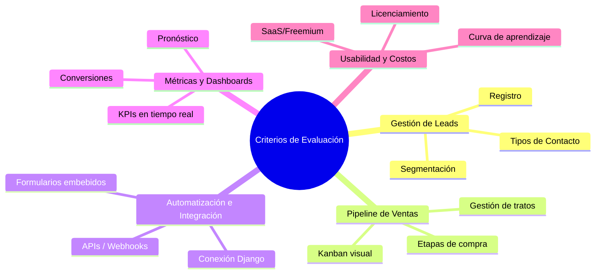
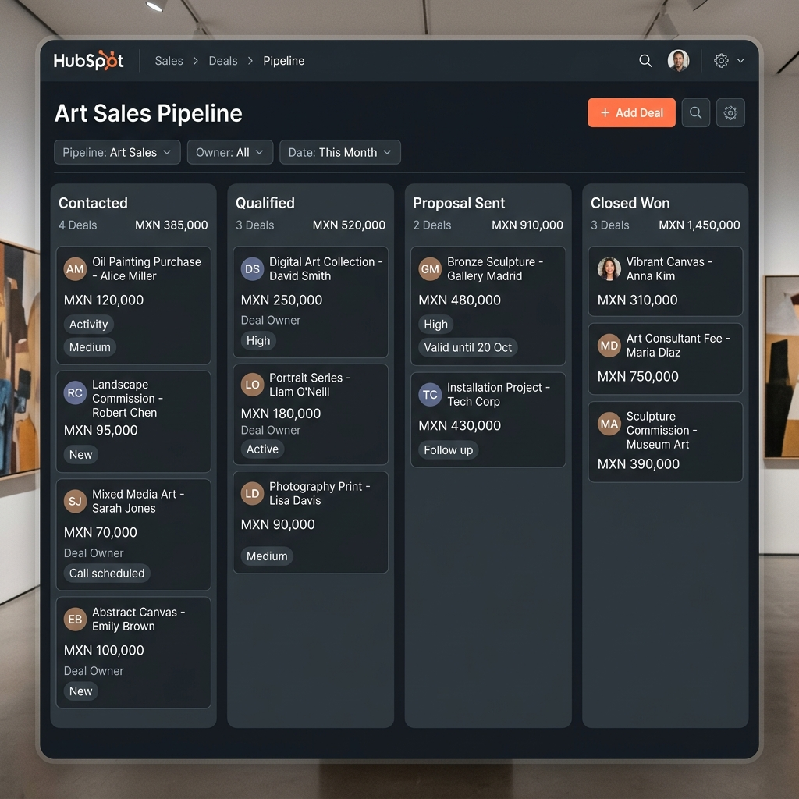
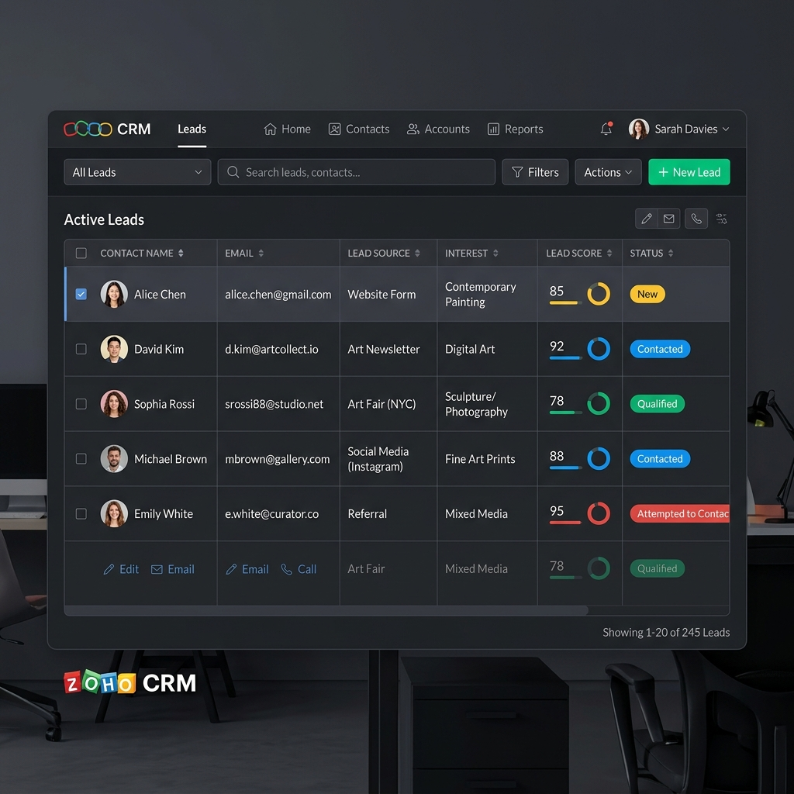
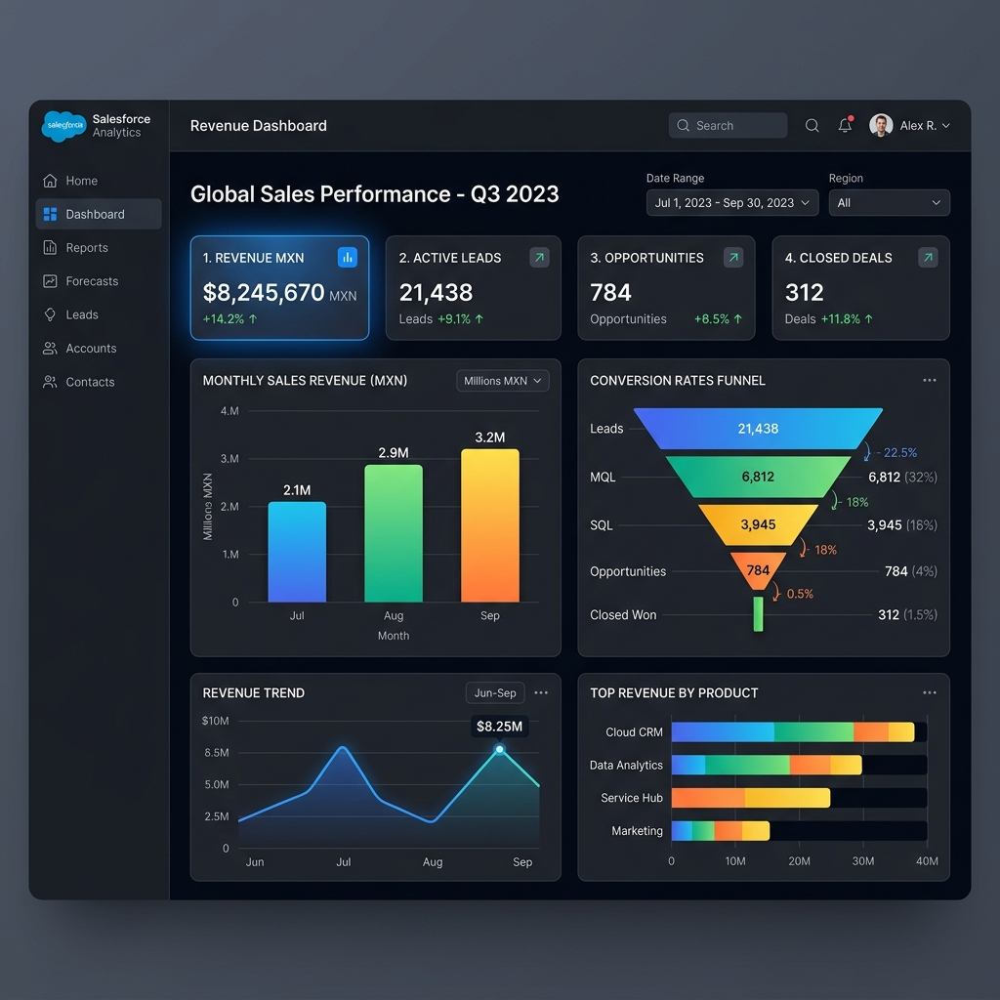

# 📋 REPORTE TÉCNICO: BENCHMARKING Y EVALUACIÓN DE PLATAFORMAS CRM
## PROYECTO INTEGRADOR: ARTSPACE (GALERÍA DE ARTE DIGITAL Y FÍSICO)

---

## 🏛️ PORTADA

*   **Institución:** Instituto Tecnológico de Apizaco (TecNM)  
*   **Facultad / Carrera:** Departamento de Sistemas y Computación / Ingeniería en Computación  
*   **Asignatura:** Negocios Electrónicos II  
*   **Número de Práctica:** Práctica 2: Selección y Evaluación de Herramientas CRM en la Nube  
*   **Nombre del Proyecto:** ARTSPACE (Artéria)  
*   **Equipo:** Equipo 3  
*   **Integrantes:**  
    *   *Almendra Valenzuela Rodrigo* (Representante de Desarrollo Backend)  
    *   *[Integrante 2 - Espacio para completar]*  
    *   *[Integrante 3 - Espacio para completar]*  
*   **Docente:** [Nombre del Docente]  
*   **Fecha de Entrega:** 31 de agosto de 2026  

---

## 🔍 INTRODUCCIÓN

El auge de la economía digital y los modelos de negocio electrónico orientados a nichos especializados, como el mercado de arte contemporáneo independiente, exige que las empresas no solo posean un catálogo web atractivo, sino también una infraestructura capaz de gestionar relaciones de alto valor. En la galería de arte digital y físico **ARTSPACE**, el flujo comercial unifica a dos actores de gran relevancia:
1.  **El Artista Independiente (Proveedor):** Quien requiere una gestión transparente de su stock, visibilidad de sus obras y liquidación de comisiones.
2.  **El Coleccionista / Cliente (Comprador):** Quien demanda una experiencia de compra personalizada, soporte continuo para resolver dudas técnicas sobre envíos físicos o descargas digitales, y un seguimiento postventa de alta calidad.

Para responder a estas demandas, se requiere la integración de un sistema de **Gestión de Relaciones con los Clientes (CRM)**. Sin embargo, antes de proceder a la codificación directa en el backend (Django), resulta fundamental realizar un **benchmarking** de las principales herramientas CRM comerciales en la nube (SaaS). Esto nos permitirá analizar sus flujos de contacto, embudos de conversión, capacidades de automatización mediante Webhooks/APIs, interfaces analíticas y factibilidad financiera, garantizando que la solución seleccionada se acople de manera fluida y escalable a nuestro prototipo web.

---

## 🛠️ METODOLOGÍA DE EVALUACIÓN

Para esta práctica, se seleccionaron tres de las herramientas de CRM más representativas de la industria actual bajo modelos de distribución de software como servicio (SaaS):
1.  **HubSpot CRM (Versión Free/Freemium):** Líder indiscutible en la metodología de *Inbound Marketing* y automatización simplificada de ventas para pequeñas y medianas empresas.
2.  **Zoho CRM (Prueba Gratuita):** Plataforma altamente personalizable orientada a la omnicanalidad y enfocada en una excelente relación costo-beneficio para negocios en crecimiento.
3.  **Salesforce Sales Cloud (Prueba Demo de 30 días):** El estándar de oro corporativo, con capacidad analítica masiva y una granularidad de personalización a nivel empresarial.

### Criterios de Exploración Funcional en la Nube
El análisis y exploración directa en las interfaces web de cada CRM se centró en los siguientes cinco pilares técnicos y funcionales:



---

## 📊 TABLA COMPARATIVA DE PLATAFORMAS CRM

| Criterio / Plataforma | 🧡 HubSpot CRM | 💙 Zoho CRM | ☁️ Salesforce Sales Cloud |
| :--- | :--- | :--- | :--- |
| **Modalidad de Prueba en la Nube** | **Freemium permanente** (con herramientas de marketing y ventas básicas sin costo de caducidad) y pruebas avanzadas de 14 días. | **Prueba gratuita de 15 días** para planes empresariales. Cuenta con una versión gratuita muy limitada a 3 usuarios. | **Prueba gratuita de 30 días** sin tarjeta de crédito. No posee modalidad gratuita permanente. |
| **Módulo de Leads y Contactos** | **Excelente y simplificado.** Creación rápida de prospectos, detección automática de datos corporativos a través del dominio y segmentación intuitiva mediante filtros guardados. | **Completo y estructurado.** Permite separar con claridad "Prospectos" (Leads no calificados) de "Contactos/Cuentas". Alta capacidad de campos personalizados. | **Altamente granular y complejo.** Permite definir reglas complejas de asignación de leads, validación de datos y vistas multi-segmentadas por territorios. |
| **Pipeline y Embudos Visuales** | **Sobresaliente.** Panel Kanban de arrastrar y soltar (drag & drop) sumamente fluido. Permite crear pipelines personalizados y calcular montos ponderados al instante. | **Muy funcional.** Vista Kanban personalizable (Vistas Canvas) que permite a los comerciales mover tratos y registrar notas directamente desde el tablero. | **Poderoso pero denso.** Pipeline sumamente detallado con herramientas de previsión de ventas inteligente (Einstein AI) y análisis predictivo de cierre. |
| **Automatización e Integraciones** | **Muy Alta.** Constructor de flujos de trabajo (*Workflows*) visual intuitivo. Posee la biblioteca de integraciones más grande para web apps (Zapier nativo, formularios embebidos sencillos). | **Alta.** Reglas de flujo de trabajo basadas en eventos, plantillas de correo automatizadas y herramientas de chat multicanal integradas nativamente. | **Extrema.** Motor de flujos de trabajo empresariales (*Salesforce Flows*) capaz de modelar cualquier proceso interno complejo, pero requiere capacitación técnica. |
| **Métricas y Dashboards** | **Intuitivos y visuales.** Paneles personalizables con gráficos de barras, conversión de embudos y reportes de desempeño de emails en tiempo real. | **Sólidos.** Informes predefinidos muy completos, paneles interactivos de KPIs y sistema de analítica predictiva de comportamiento. | **Líder de la industria.** Reportes tridimensionales con análisis analítico masivo, tableros integrados con *Tableau* y alertas predictivas automatizadas. |
| **Usabilidad y Curva de Aprendizaje** | **Curva de aprendizaje muy baja.** Diseñado para que cualquier usuario sin conocimientos de IT configure el entorno en minutos. UX impecable. | **Curva media.** Requiere cierto tiempo de aclimatación para comprender la terminología e interfaces modulares, pero es amigable. | **Curva muy alta.** Interfaz densa con múltiples opciones. Requiere capacitación formal (Trailhead) o un administrador certificado para operar. |
| **Esquema de Costos y Escalabilidad** | **Esquema Freemium.** Escalable desde planes Starter (~$20 USD/mes) hasta Professional/Enterprise de alto costo. Crece con el volumen de contactos de marketing. | **Económico y escalable.** Planes desde $14 USD/usuario/mes facturado anualmente. Gran valor para PyMEs que necesitan características avanzadas. | **Muy costoso.** Planes desde $25 USD/usuario/mes (Starter) hasta $165+ USD/usuario/mes (Enterprise). Pensado para presupuestos corporativos. |
| **Factibilidad de Integración con Django (ARTSPACE)** | **Excelente.** Excelente API REST documentada con SDK oficial para Python (`hubspot-api-client`). Permite insertar leads con simples peticiones HTTP POST desde las vistas de Django. | **Buena.** API REST basada en autenticación OAuth 2.0. Requiere mayor configuración de tokens de acceso temporales, pero cuenta con SDK de Python para Zoho. | **Compleja.** API de Salesforce (REST/SOAP) robusta pero restrictiva por límites de llamadas (API Limits) en planes bajos. Requiere configuraciones avanzadas. |

---

## 📸 EVIDENCIAS DE EXPLORACIÓN EN LA NUBE

Las siguientes imágenes corresponden a la exploración realizada de las plataformas en la nube para simular el comportamiento operativo del proyecto **ARTSPACE**:

### 1. Panel de Ventas y Pipeline en HubSpot CRM
*En esta interfaz exploramos el tablero de oportunidades de negocio para las obras de arte de ARTSPACE. Se clasifican las ventas según la etapa en la que se encuentran los coleccionistas.*



> [!NOTE]
> **Descripción del flujo operativo:** En la imagen se observa un pipeline Kanban adaptado con etapas clave de prospección:
> *   **Contactado:** Clientes que han enviado un ticket desde el formulario `contacto.html` y cuya duda inicial ha sido resuelta (ej. *"Consulta de Óleo - Alice Miller"*).
> *   **Calificado:** Coleccionistas con alto interés confirmado o que interactúan frecuentemente con las preventas.
> *   **Propuesta Enviada:** Tratos que incluyen cotizaciones formales para obras de arte originales físicas o comisiones personalizadas.
> *   **Cerrado Ganado:** Compras concretadas de manera exitosa a través de la pasarela de pago simulada, permitiendo ver el valor total acumulado del pipeline en Pesos Mexicanos (MXN).

---

### 2. Gestión y Segmentación de Leads en Zoho CRM
*Exploración de la tabla de prospectos y contactos para gestionar la lista de suscriptores al newsletter y el registro de artistas interesados.*



> [!NOTE]
> **Descripción del flujo operativo:** La vista muestra la administración centralizada de leads. Zoho permite segmentar a los usuarios de ARTSPACE basados en sus campos personalizados de interés de compra (Arte Digital vs. Pintura Física). Se destaca el módulo de "Lead Scoring" (Puntuación del prospecto), que ayuda al administrador a priorizar la comunicación con aquellos coleccionistas que tienen mayor probabilidad de comprar piezas originales de alto valor.

---

### 3. Dashboard Analítico y Métricas en Salesforce Sales Cloud
*Análisis del rendimiento comercial general de la galería mediante métricas y reportes visuales de rendimiento.*



> [!NOTE]
> **Descripción del flujo operativo:** La pantalla expone los indicadores clave de rendimiento (KPIs) globales de ARTSPACE. Se observa el total de ingresos mensuales por concepto de comisiones de arte, la tasa de conversión promedio de leads registrados en la newsletter que se convierten en compradores activos (18%), y gráficos radiales que proyectan el progreso respecto a las metas de venta mensuales de la galería.

---

## ⚖️ JUSTIFICACIÓN DE LA SELECCIÓN

Tras un análisis exhaustivo de los tres CRM, el equipo ha determinado que **HubSpot CRM** es la herramienta idónea para integrarse como base del proyecto integrador **ARTSPACE** por los siguientes argumentos:

```
[ CRITERIOS DE DECISIÓN ]
├─ Técnico  ➔ API REST amigable, SDK Python de fácil instalación en Django.
├─ Financiero➔ Licenciamiento Freemium permanente (costo $0 para el prototipo escolar).
└─ Operativo ➔ Curva de aprendizaje instantánea para todos los integrantes.
```

### 1. Viabilidad Técnica e Integración con Django
HubSpot ofrece una API REST sumamente limpia y el paquete oficial `hubspot-api-client` disponible para Python. El proceso para capturar un lead desde nuestro formulario de newsletter e insertarlo en HubSpot es directo:
```python
# Ejemplo conceptual de integración en views.py de Django
import requests
from django.conf import settings

def registrar_lead_hubspot(email, interes):
    url = "https://api.hubapi.com/crm/v3/objects/contacts"
    headers = {
        "Authorization": f"Bearer {settings.HUBSPOT_ACCESS_TOKEN}",
        "Content-Type": "application/json"
    }
    data = {
        "properties": {
            "email": email,
            "firstname": "Coleccionista Anónimo",
            "industry": "Arte",
            "interes_principal": interes # Campo personalizado mapeado en HubSpot
        }
    }
    response = requests.post(url, json=data, headers=headers)
    return response.status_code == 201
```
Este fragmento demuestra que la factibilidad de desarrollo es sumamente alta y no requiere dependencias complejas ni configuraciones OAuth extendidas para las pruebas del prototipo.

### 2. Viabilidad Financiera (Esquema de Costos)
Al tratarse de un proyecto integrador académico y una startup en fase de prototipo, el presupuesto de licenciamiento es de **$0 USD**. 
*   **Salesforce** queda descartado debido a que su prueba gratuita vence a los 30 días, lo que inhabilitaría el proyecto a mitad de semestre y exigiría planes costosos.
*   **Zoho CRM** ofrece una prueba de 15 días y su versión gratuita tiene límites muy estrictos de almacenamiento y usuarios.
*   **HubSpot** ofrece su CRM de forma **gratuita e ilimitada en el tiempo**, permitiendo almacenar hasta 1,000,000 de contactos y usar las herramientas fundamentales de captación de formularios y pipelines sin realizar pago alguno.

### 3. Viabilidad Operativa y Usabilidad
La interfaz de HubSpot destaca por ser intuitiva y visualmente pulida, reduciendo al mínimo la curva de aprendizaje de los miembros del equipo que desempeñan roles administrativos y de ventas en el proyecto. La gestión del pipeline Kanban se realiza de forma visual e inmediata, lo cual simplifica enormemente la preparación de las demostraciones prácticas del sistema ante el docente de la asignatura.

---

## 💡 CONCLUSIONES

La realización de esta práctica permite comprender el impacto estratégico del modelo **SaaS (Software como Servicio)** en el ecosistema de negocios electrónicos actual, aportando las siguientes reflexiones operativas:

1.  **Reducción del Time-to-Market:** El modelo SaaS elimina la necesidad de desarrollar módulos complejos desde cero (como motores analíticos de predicción de ventas o interfaces de correo masivo). Al conectar el prototipo de Django con HubSpot mediante APIs, ARTSPACE puede desplegar capacidades CRM de nivel profesional en cuestión de horas en lugar de meses.
2.  **Escalabilidad y Flexibilidad Financiera:** El modelo bajo demanda (Pay-as-you-grow) del software en la nube permite a los negocios electrónicos comenzar con planes gratuitos o económicos y escalar a funciones de inteligencia artificial y automatización avanzada a medida que aumentan los ingresos por comisiones del negocio, evitando inversiones iniciales de alto riesgo en servidores físicos o licencias perpetuas de software.
3.  **Centralización Omnicanal de Datos:** Un CRM en la nube actúa como una única fuente de verdad (Single Source of Truth) para el negocio. Toda interacción del coleccionista (formulario de contacto, suscripción al boletín, ticket de soporte en Django o visitas a la web) se unifica en una sola ficha de contacto, facilitando la toma de decisiones basada en datos analíticos reales (CRM Analítico) para orquestar mejores estrategias de venta cruzada e incentivos de lealtad.

---

## 📚 REFERENCIAS BIBLIOGRÁFICAS (APA)

1.  **HubSpot, Inc. (2026).** *Documentación de la API de HubSpot para Desarrolladores: Integración de Objetos del CRM*. HubSpot Developer Portal. Recuperado de https://developers.hubspot.com/es/docs/api/overview
2.  **Salesforce, Inc. (2026).** *Salesforce Trailhead: Introducción a la Consola de Administración y Pipelines de Venta en la Nube*. Salesforce Trailhead Learning Portal. Recuperado de https://trailhead.salesforce.com/es
3.  **Zoho Corporation. (2025).** *Guía de Integración y API REST de Zoho CRM utilizando OAuth 2.0*. Zoho Developer Center. Recuperado de https://www.zoho.com/crm/developer/docs/api/v6/
4.  **Laudon, K. C., & Laudon, J. P. (2021).** *Sistemas de información gerencial* (16a ed.). Pearson Educación.  
5.  **Turban, E., Outland, J., King, D., Lee, J. K., Liang, T. P., & Turban, D. C. (2018).** *Electronic Commerce 2018: A Managerial and Social Networks Perspective*. Springer.  

---
