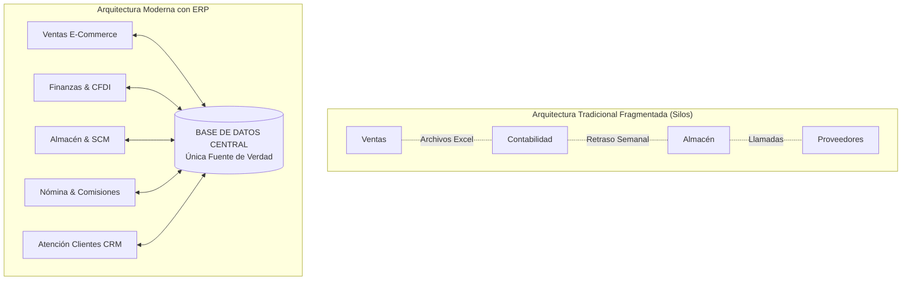
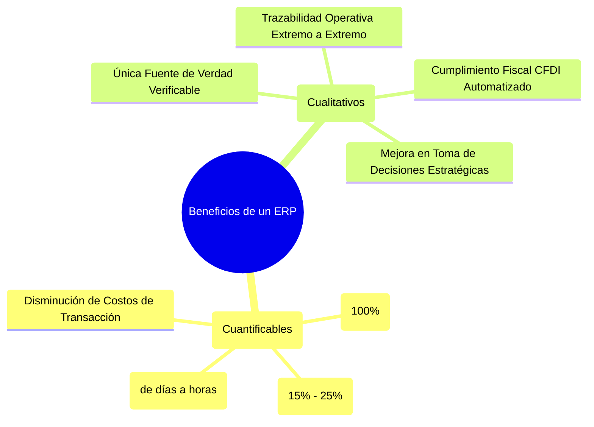
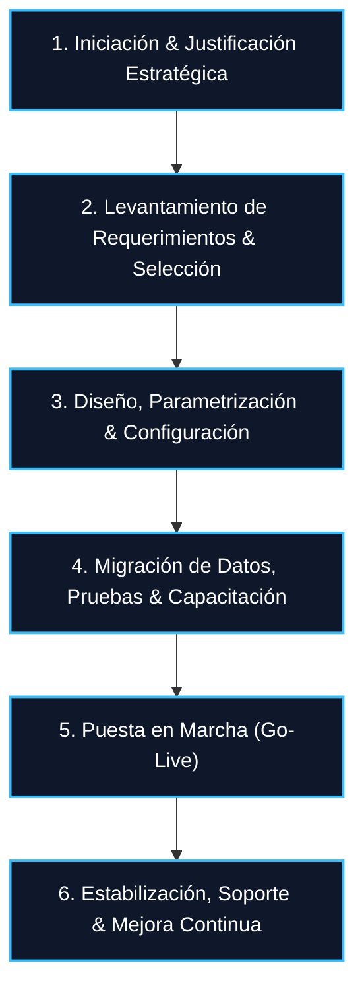
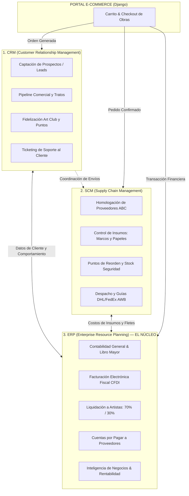
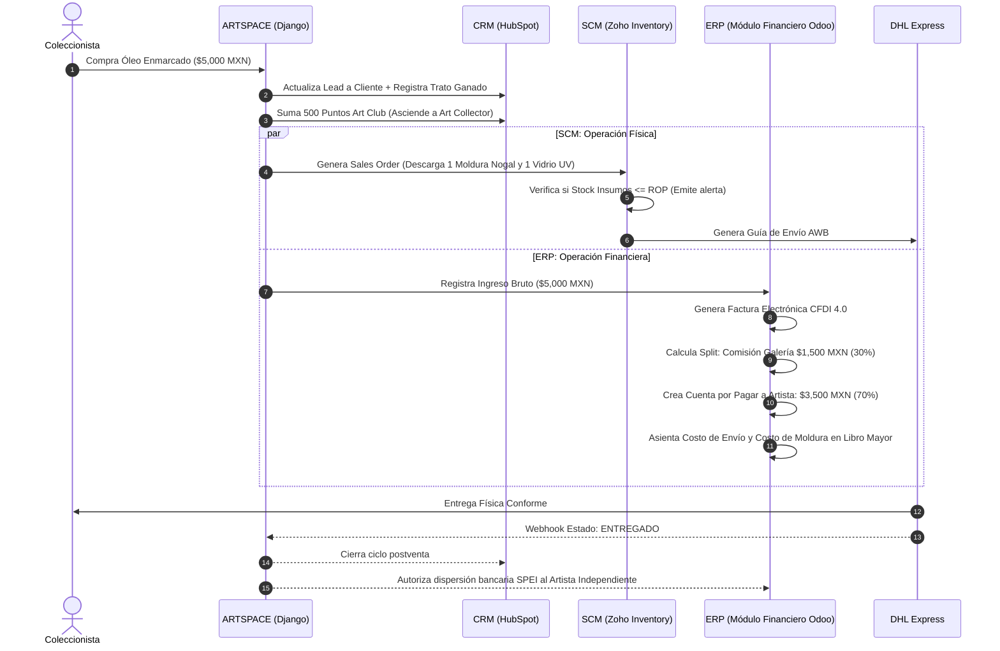
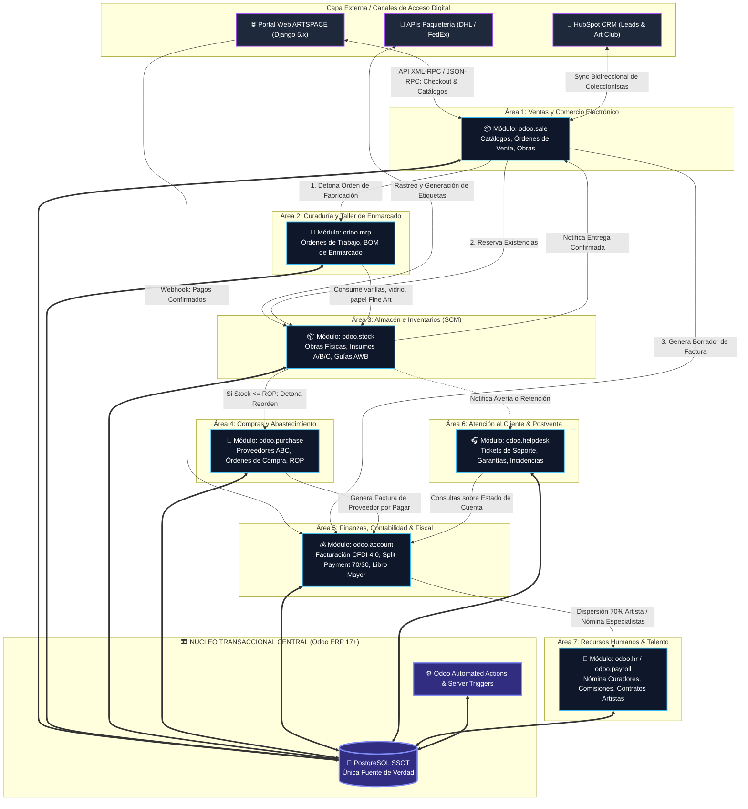
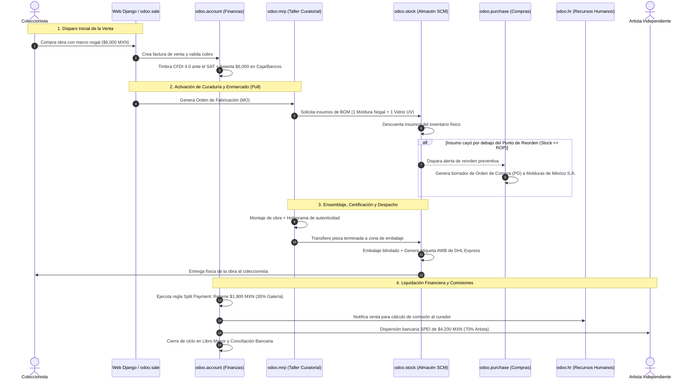
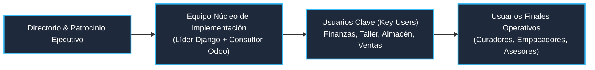
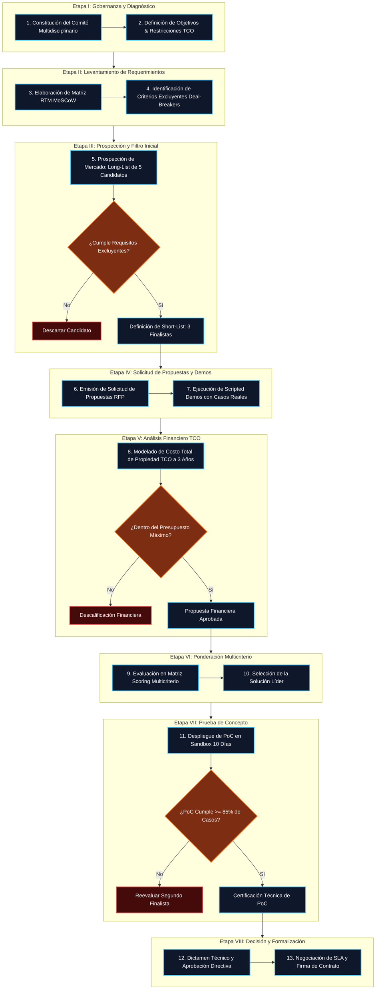

# 📘 REPORTE TÉCNICO: FUNDAMENTOS, ADOPCIÓN Y EVALUACIÓN DE SISTEMAS ERP
## PROYECTO INTEGRADOR: ARTSPACE (E-COMMERCE DE ARTE CONTEMPORÁNEO Y DIGITAL)
### Asignatura: Negocios Electrónicos II — Práctica: Enterprise Resource Planning (ERP)

---

## 🏛️ DATOS DE IDENTIFICACIÓN INSTITUCIONAL

* **Institución:** Universidad Autónoma de Tlaxcala (UATx)
* **Facultad:** Facultad de Ciencias Básicas, Ingeniería y Tecnología
* **Licenciatura / Ingeniería:** Ingeniería en Computación
* **Asignatura:** Negocios Electrónicos II
* **Práctica:** Práctica: Fundamentos, Beneficios y Procedimiento de Evaluación de Sistemas ERP
* **Nombre del Proyecto:** ARTSPACE (Galería E-Commerce de Arte Contemporáneo y Digital)
* **Equipo de Desarrollo:** Equipo 3
* **Integrantes:**
  * *Almendra Valenzuela Rodrigo* (Líder Técnico & Desarrollador Backend)
* **Docente Titular:** M.C. / Dr. [Nombre del Docente]
* **Fecha de Registro:** Octubre de 2026
* **Fases Desarrolladas:** Fase 1 (Fundamentación Teórica), Fase 2 (Esquema Gráfico con Odoo) y Fase 3 (Procedimiento de Evaluación y Selección de ERP)

---

## 🎯 OBJETIVOS DE LA ACTIVIDAD

### Objetivo General
Investigar los fundamentos teóricos, beneficios organizacionales y etapas de adopción de los sistemas de Planificación de Recursos Empresariales (**ERP**), analizando las áreas funcionales de la empresa involucradas y estructurando su integración técnica y operativa con las plataformas previas de **CRM** y **SCM** en el marco del negocio electrónico **ARTSPACE**.

### Objetivos Específicos
1. **Fase 1 (Fundamentación Teórica):** Analizar con rigor bibliográfico la definición, evolución histórica, principios arquitectónicos y ciclo de vida de los ERP, modelando la sinergia tripartita **ERP ⟷ CRM ⟷ SCM** en ARTSPACE.
2. **Fase 2 (Esquema Gráfico y Áreas Funcionales):** Diseñar la arquitectura modular de **Odoo ERP** identificando las áreas de la empresa (Ventas, Finanzas, Taller MRP, Almacén SCM, Compras, RRHH y Soporte) con sus matrices de flujo de datos (*Data In / Data Out*).
3. **Fase 3 (Procedimiento de Evaluación y Selección):** Estructurar una metodología formal de 8 etapas gobernada por compuertas de decisión, diagrama de flujo en carriles de responsabilidad (Swimlanes), matriz de ponderación multicriterio (Scoring Model), cálculo comparativo de TCO a 3 años y dictamen técnico de adopción de Odoo.

---

# 📚 FASE 1: INVESTIGACIÓN DOCUMENTAL Y FUNDAMENTACIÓN TEÓRICA

```
                                  ┌────────────────────────┐
                                  │   PLATAFORMA E-COMMERCE │
                                  │     ARTSPACE (Django)  │
                                  └───────────┬────────────┘
                                              │
                    ┌─────────────────────────┴─────────────────────────┐
                    ▼                                                   ▼
       ┌────────────────────────┐                           ┌────────────────────────┐
       │     CRM (FRONT-OFFICE) │                           │  SCM (SUPPLY CHAIN)    │
       │   HubSpot API / Points │                           │ Zoho Inventory / Couriers│
       └────────────┬───────────┘                           └───────────┬────────────┘
                    │                                                   │
                    └─────────────────────────┬─────────────────────────┘
                                              ▼
                                 ┌─────────────────────────┐
                                 │     ERP (CORE SYSTEM)   │
                                 │ Única Fuente de Verdad  │
                                 │ Contabilidad / Finanzas │
                                 │   CFDI / Split Payment  │
                                 └─────────────────────────┘
```

---

## 1.1 Fundamentos y Conceptos Clave de los Sistemas ERP

### 1.1.1 Definición Conceptual
Un sistema de **Planificación de Recursos Empresariales (ERP, por sus siglas en inglés *Enterprise Resource Planning*)** es una plataforma de software modular e integrada diseñada para gestionar y automatizar la totalidad de los procesos de negocio fundamentales de una organización, incluyendo finanzas, contabilidad, compras, inventarios, producción, ventas y recursos humanos (Laudon & Laudon, 2020).

A diferencia de los sistemas tradicionales aislados o "islas de información" (*silos departamentales*), la premisa operativa de un ERP es operar sobre una **Base de Datos Centralizada y Compartida (Única Fuente de Verdad o *Single Source of Truth - SSOT*)**. Cuando una transacción ocurre en un área funcional (por ejemplo, la confirmación de pago de un pedido en la tienda en línea), la información se propaga instantáneamente a todas las dependencias asociadas: se afecta el libro mayor de contabilidad, se descuenta el inventario de materias primas, se genera el registro fiscal y se actualizan los indicadores clave de desempeño (KPIs) en tiempo real (Davenport, 1998; O'Brien & Marakas, 2011).



### 1.1.2 Principios Arquitectónicos de un ERP
De acuerdo con las investigaciones de Monk & Wagner (2013) y Sumner (2014), un sistema clasificado como ERP debe cumplir con tres pilares arquitectónicos esenciales:

1. **Modularidad Integral:** El software se compone de módulos funcionales independientes pero acoplados (Finanzas, Ventas, Inventario, Nómina). Las organizaciones pueden desplegar los módulos de forma progresiva según su madurez operativa.
2. **Centralización y Consistencia de Datos:** Todos los módulos consultan y persisten información en un esquema relacional unificado. Esto erradica la duplicidad de registros, inconsistencias de catálogos de clientes/artículos y reprocesos de conciliación.
3. **Estandarización de Procesos de Negocio (*Best Practices*):** Los sistemas ERP incorporan flujos de trabajo optimizados basados en las mejores prácticas de la industria mundial. Adoptar un ERP implica, en la mayoría de los casos, una reingeniería de procesos para alinear la organización con estándares comprobados de eficiencia.

### 1.1.3 Evolución Histórica de los Sistemas ERP
La génesis de los ERP refleja la evolución tecnológica y productiva de las últimas seis décadas:

| Década / Época | Denominación | Enfoque Principal | Características Tecnológicas |
| :--- | :--- | :--- | :--- |
| **Años 1960** | **Sistemas de Control de Inventario (IC)** | Control de stock físico en bodegas manufactureras. | Procesamiento en lotes (*batch*) en mainframes; basado en reglas de punto de pedido estático. |
| **Años 1970** | **MRP I (*Material Requirements Planning*)** | Planificación de requerimientos de materiales. | Explosión de listas de materiales (BOM); cálculo de insumos con base en planes maestros de producción. |
| **Años 1980** | **MRP II (*Manufacturing Resource Planning*)** | Integración de producción, mano de obra y capacidad de planta. | Incorporación de flujos financieros básicos y programación de maquinaria en planta industrial. |
| **Años 1990** | **ERP I (Primera Generación)** | Integración interdepartamental completa del Back-Office. | Arquitectura cliente-servidor, bases de datos relacionales (Oracle, SAP R/3, Baan); integración contable-financiera total. |
| **Años 2000 en adelante** | **ERP II / Cloud & SaaS ERP (Moderno)** | Ecosistemas extendidos, conectividad Web y colaboración B2B/B2C. | Arquitecturas orientadas a servicios (SOA), microservicios, APIs REST, almacenamiento en la nube, acceso móvil e interoperabilidad con CRM y SCM externos. |

---

## 1.2 Beneficios Organizacionales de la Adopción de un ERP

El impacto de un ERP en una organización digital como ARTSPACE se analiza a través de dos dimensiones fundamentales:



### 1.2.1 Beneficios Tangibles (Cuantificables y Directos)
* **Optimización de Capital de Trabajo e Inventarios:** Al vincular la demanda de ventas con la planificación de compras, se reduce el stock de seguridad y el inventario ocioso entre un 15% y un 25% (Shang & Seddon, 2002). En ARTSPACE, esto evita la sobrecompra de molduras importadas y pliegos de papel de algodón Fine Art.
* **Reducción Radical de Tiempos de Ciclo Administrativo:** Las conciliaciones contables y los cierres de mes pasan de requerir semanas a ejecutarse en horas o minutos, gracias a que cada factura de venta y orden de compra se asienta contablemente en el instante en que se emite.
* **Eliminación de la Duplicidad y Reprocesos de Captura:** Al existir un único catálogo de productos y clientes, se elimina el costo operativo de capturar la información en múltiples hojas de cálculo o bases de datos inconexas.
* **Precisión en Liquidaciones de Comisiones (*Split Payments*):** Para una galería con cientos de artistas independientes, el ERP calcula de forma desasistida la retención fiscal, la comisión de galería (30%) y el saldo neto transferible al creador (70%).

### 1.2.2 Beneficios Intangibles (Estratégicos y Cualitativos)
* **Visibilidad y Transparencia Operativa en Tiempo Real:** La directiva puede consultar en un único panel ejecutivo (*Executive Dashboard*) el margen de contribución por obra, el saldo bancario disponible, los compromisos de pago a proveedores y el valor del inventario en tránsito.
* **Gobernanza y Trazabilidad Extremo a Extremo:** Cada movimiento queda registrado con usuario, marca de tiempo y comprobante de soporte, facilitando auditorías financieras y de calidad.
* **Resiliencia y Cumplimiento Normativo:** Facilidad para emitir facturación electrónica conforme a la legislación fiscal vigente (SAT en México / CFDI 4.0 con complementos de recepción de pagos y retenciones).
* **Mejora en la Experiencia Integral del Cliente:** Cuando un cliente consulta sobre su pedido, cualquier agente tiene acceso instantáneo a la situación financiera, el estado de despacho y el historial previo sin transferir la llamada entre departamentos.

---

## 1.3 Etapas del Ciclo de Vida y Adopción de un Sistema ERP

Implementar un ERP no es simplemente instalar un paquete de software; es un **proyecto de transformación organizacional y tecnológica**. Siguiendo los marcos de referencia de Markus & Tanis (2000) y Somers & Nelson (2001), se distinguen seis etapas críticas:



### 1.3.1 Desglose Metodológico de las Etapas:

1. **Etapa 1: Iniciación y Justificación Estratégica (Chartering):**
   * *Propósito:* Diagnosticar la problemática actual (silos, retrasos, falta de visibilidad contable), definir el alcance del proyecto y obtener el patrocinio de la alta dirección.
   * *Entregable:* Documento de Justificación de Proyecto (*Business Case*) con estimación preliminar de retorno de inversión (ROI).

2. **Etapa 2: Análisis de Requerimientos y Selección del ERP:**
   * *Propósito:* Documentar los requerimientos funcionales (por área) y no funcionales (seguridad, APIs, modelo Cloud). Elaborar el documento de solicitud de propuestas (RFP - *Request for Proposal*) y evaluar alternativas del mercado mediante matrices de ponderación y pruebas de concepto (PoC).
   * *Entregable:* Dictamen técnico de selección del software y firma de contrato con el proveedor/implementador.

3. **Etapa 3: Diseño, Configuración y Parametrización (Gap Analysis):**
   * *Propósito:* Comparar los procesos actuales de la empresa (*As-Is*) contra los flujos estándar del ERP (*To-Be*) en un análisis de brechas (*Fit/Gap Analysis*). Se configuran las reglas contables, catálogos de cuentas, centros de costos y políticas de precios, evitando modificaciones al código fuente (*customizations*) que dificulten futuras actualizaciones.
   * *Entregable:* Documento de Diseño de la Solución (*Blueprint*) y ambiente de pruebas configurado.

4. **Etapa 4: Migración de Datos, Pruebas Integrales y Capacitación:**
   * *Propósito:* Extracción, depuración, transformación y carga (ETL) de los datos históricos limpios. Ejecución de pruebas unitarias, pruebas de integración y Pruebas de Aceptación del Usuario (*UAT - User Acceptance Testing*). Capacitación intensiva a los usuarios finales y administradores.
   * *Entregable:* Base de datos migrada y certificada; manuales operativos y matriz de capacitación completada.

5. **Etapa 5: Puesta en Marcha (*Go-Live*):**
   * *Propósito:* Transición de la operación al nuevo sistema ERP. Dependiendo de la estrategia seleccionada:
     * *Estrategia Big Bang:* Corte inmediato en una fecha fija (alto riesgo, menor costo).
     * *Estrategia Faseada/Modular:* Liberación módulo por módulo (ej. Finanzas primero, luego Compras y Nómina).
     * *Estrategia en Paralelo:* Operación simultánea del sistema previo y el ERP durante uno o dos meses (máxima seguridad, alto costo operativo).
   * *Entregable:* Declaración oficial de operación productiva en vivo.

6. **Etapa 6: Estabilización, Soporte y Mejora Continua:**
   * *Propósito:* Resolución de incidencias tempranas post-arranque (*Hypercare*), ajuste fino de reportes, medición de adopción por usuario y evaluación de actualizaciones o nuevos módulos.
   * *Entregable:* Reporte de estabilización operativa y plan anual de soporte y mantenimiento.

---

## 1.4 La Tríada Estratégica: ERP ⟷ CRM ⟷ SCM en Negocios Electrónicos

En el contexto del comercio electrónico contemporáneo, la excelencia competitiva no se alcanza con un sistema monolítico aislado, sino con un **Ecosistema Integrado de Tres Pilares**:



### 1.4.1 Cuadro Comparativo de Enfoques Funcionales

| Dimensión | 👥 CRM (Front-Office) | 🚚 SCM (Supply Chain) | 🏛️ ERP (Back-Office & Core) |
| :--- | :--- | :--- | :--- |
| **Enfoque Primario** | El Cliente y el Mercado (Orientado hacia afuera). | El Flujo Físico y Proveedores (Orientado hacia afuera/adentro). | Los Recursos y Procesos Internos (La Empresa Global). |
| **Objetivo Estratégico** | Maximizar ventas, satisfacción, lealtad y retención del cliente. | Minimizar costos logísticos, reducir Lead Times y asegurar abasto. | Optimizar el uso de recursos, garantizar solvencia y cumplimiento fiscal. |
| **Usuarios Principales** | Vendedores, mercadólogos, agentes de soporte y coleccionistas. | Jefes de almacén, compradores, transportistas y curadores. | Contadores, directores financieros (CFO), auditores y gerencia. |
| **Entidades de Información** | Leads, Tratos, Clientes, Tickets, Puntos de Lealtad. | Proveedores, Insumos, Órdenes de Compra, Guías AWB, Rutas. | Asientos contables, CFDI, Cuentas por Cobrar/Pagar, Nómina, Activos. |
| **Plataforma en ARTSPACE** | **HubSpot CRM API** + Módulo Art Club en Django. | **Zoho Inventory API** + Conectores DHL/FedEx. | **Módulo ERP Central (Odoo / Zoho Books)**. |

---

## 1.5 Simulación del Flujo Transaccional Integrado en ARTSPACE

Para comprender cómo conviven los tres sistemas en la práctica diaria de la galería de arte, consideremos el ciclo de vida de una compra de arte físico:



### Justificación del Ecosistema para ARTSPACE:
1. **El CRM** no sabe calcular impuestos complejos ni cómo asentar la depreciación de maquinaria de enmarcado; su valor es saber que el coleccionista prefiere obras vanguardistas y bonificarlo con puntos.
2. **El SCM** no maneja la contabilidad general de la empresa ni los estados de resultados; su valor es garantizar que haya varillas de nogal disponibles y que la guía de DHL esté activa.
3. **El ERP** es el cerebro que consolida todo: toma el dato de venta del portal, el gasto de flete y materiales del SCM, y la identidad del cliente del CRM para generar balances financieros, liquidar al artista de forma legal y asegurar la rentabilidad del negocio electrónico.

---

# 🏢 FASE 2: DISEÑO DEL ESQUEMA GRÁFICO (ÁREAS INVOLUCRADAS EN EL ERP — PLATAFORMA ODOO)

```
========================================================================================
             ECOSISTEMA MODULAR ODOO ERP PARA EL COMERCIO ELECTRÓNICO ARTSPACE
========================================================================================
   [Ventas & E-Commerce]        [Compras & Abasto]         [Almacén & Inventarios]
       (odoo.sale)                (odoo.purchase)               (odoo.stock)
             │                           │                           │
             ▼                           ▼                           ▼
      ═══════════════════════════════════════════════════════════════════════════
                     ODOO ERP CORE — POSTGRESQL MULTI-MÓDULO
                   (Única Fuente de Verdad / Motor Transaccional)
      ═══════════════════════════════════════════════════════════════════════════
             ▲                           ▲                           ▲
             │                           │                           │
   [Taller Curatorial / MRP]   [Finanzas & CFDI 4.0]        [Recursos Humanos]
        (odoo.mrp)                 (odoo.account)                (odoo.hr)
========================================================================================
```

---

## 2.1 Justificación Técnica de la Elección de Odoo como Plataforma ERP

Para la gestión integral de **ARTSPACE**, se ha seleccionado la plataforma **Odoo ERP** como el núcleo de recursos empresariales, fundamentado en los siguientes pilares de compatibilidad y madurez técnica:

1. **Homogeneidad Tecnológica y Sinergia con Django (Python Stack):**
   * El backend del e-commerce ARTSPACE está construido sobre el lenguaje **Python**. Odoo está desarrollado nativamente en **Python** con un motor relacional **PostgreSQL**, lo que erradica disparidades arquitectónicas. La curva de aprendizaje del equipo técnico se optimiza drásticamente y se comparten estándares de tipado, estructuras de datos y buenas prácticas de desarrollo.
2. **Arquitectura Modular Extensible (*App-Based Architecture*):**
   * Odoo permite implementar de forma selectiva y progresiva únicamente los módulos requeridos por la galería de arte en su etapa actual (*Contabilidad/Facturación, Ventas, Inventario, Fabricación/Taller, Compras, RRHH*), evitando la sobrecarga operativa y el desperdicio de licencias de soluciones monolíticas rígidas.
3. **Conectividad Externa Nativa (APIs JSON-RPC, XML-RPC y REST):**
   * Odoo expone de forma automática sus modelos ORM mediante interfaces remotas seguras (`/xmlrpc/2/object` y `/jsonrpc`). Cualquier controlador o señal de **Django** en ARTSPACE puede consultar el stock en tiempo real, crear facturas o asentar pagos con apenas unas líneas de código en Python utilizando las librerías estándar `xmlrpc.client` o clientes REST.
4. **Localización Fiscal Mexicana Oficial (SAT / Facturación CFDI 4.0):**
   * Odoo cuenta con localización mexicana certificada out-of-the-box (`l10n_mx_edi`), permitiendo timbrar facturas electrónicas CFDI 4.0 con complementos de pago, retenciones de impuestos (IVA/ISR) para creadores independientes y catálogos estandarizados del SAT, cumpliendo con la estricta regulación fiscal de comercio electrónico en México.
5. **Flexibilidad de Licenciamiento y Escalabilidad Económica:**
   * La disponibilidad de **Odoo Community Edition** (de código abierto bajo licencia LGPLv3) permite el despliegue local, pruebas de laboratorio y parametrización sin costo por asiento de usuario. A su vez, ofrece una ruta de escalamiento directa hacia **Odoo Enterprise / Odoo.sh** para alta disponibilidad en la nube y soporte empresarial continuo.

---

## 2.2 Esquema Gráfico Arquitectónico: Áreas Funcionales Interactuando en Odoo ERP

El siguiente diagrama modela la arquitectura funcional de ARTSPACE estructurada sobre los módulos nativos de **Odoo ERP**, identificando los departamentos de la organización, los módulos asociados y sus interacciones de datos en tiempo real:



---

## 2.3 Matriz Funcional Departamental: Entradas, Procesos y Salidas en Odoo

La siguiente tabla desglosa con rigor técnico cómo cada departamento de ARTSPACE interactúa dentro del ecosistema de **Odoo**, especificando los módulos asignados, los datos de entrada (*Data In*), las reglas de negocio procesadas y los datos de salida (*Data Out*):

| Área Funcional | Módulo de Odoo Asignado | Roles / Usuarios Clave | Datos de Entrada (*Data In*) | Lógica de Procesamiento Interno en Odoo | Datos de Salida (*Data Out*) |
| :--- | :--- | :--- | :--- | :--- | :--- |
| **1. Ventas & E-Commerce** | `odoo.sale` / `sale_management` | Gerente de Ventas, Administrador Web | • Carrito pagado desde Django vía API.<br>• Nombre y RFC del coleccionista.<br>• Especificación de obra y acabado (digital o físico enmarcado). | • Reserva automática de piezas únicas.<br>• Aplicación de tarifas e impuestos (IVA 16%).<br>• Asignación de estado: *Presupuesto ➔ Pedido de Venta Confirmado*. | • Orden de Venta formal (`SO-XXXX`).<br>• Solicitud de ensamblado a Taller MRP.<br>• Disparo de orden de picking a Almacén. |
| **2. Taller Curatorial (Fabricación)** | `odoo.mrp` (*Manufacturing*) | Maestro Enmarcador, Curador de Arte | • Orden de trabajo vinculada a `SO-XXXX`.<br>• Dimensiones de la pieza (cm).<br>• Acabado: Moldura nogal, cristal de conservación UV, marialuisa antiácida. | • Desglose de Lista de Materiales (*Bill of Materials - BOM*).<br>• Registro de tiempos de mano de obra.<br>• Verificación de control de calidad curatorial y adhesión de holograma de autenticidad. | • Orden de Fabricación (`MO-XXXX`) completada.<br>• Descuento de insumos consumidos en inventario.<br>• Notificación de obra lista para embalaje. |
| **3. Almacén e Inventarios (SCM)** | `odoo.stock` (*Inventory*) | Jefe de Bodega, Empacador Especializado | • Notificación de obra terminada desde Taller.<br>• Recepción de insumos de proveedores.<br>• Solicitudes de picking y despacho. | • Control de stock de materias primas (Clasificación ABC).<br>• Algoritmo de Punto de Reorden (ROP) y Stock de Seguridad (SS).<br>• Integración de dimensiones/peso para cotización de paquetería express. | • Albarán de Entrega (`WH/OUT/XXXX`).<br>• Guía Courier de transporte (AWB DHL/FedEx).<br>• Actualización de existencias en tiempo real. |
| **4. Compras & Abastecimiento** | `odoo.purchase` | Coordinador de Compras, Auxiliar de Almacén | • Alertas automáticas de insumos por debajo del ROP.<br>• Catálogo de proveedores homologados (`ProveedorArte`).<br>• Cotizaciones de materias primas. | • Generación automática de Solicitudes de Cotización (RFQ).<br>• Evaluación de plazos de entrega (*Lead Time*).<br>• Aprobación de Órdenes de Compra (PO) con base en presupuesto disponible. | • Orden de Compra oficial (`PO-XXXX`).<br>• Albarán de recepción en bodega (`WH/IN/XXXX`).<br>• Registro de Factura de Proveedor por pagar. |
| **5. Finanzas, Contabilidad & Fiscal** | `odoo.account` (*Invoicing & Accounting*) | Contador General, Auditor Financiero, CFO | • Transacciones exitosas de pasarela web (Stripe/SPEI).<br>• Facturas de compra de insumos.<br>• Gastos de flete y seguro de transporte. | • Timbrado fiscal de facturas CFDI 4.0 ante el SAT.<br>• Cálculo de la división de ingresos (*Split Payment*): 30% Galería / 70% Artista.<br>• Retenciones legales de impuestos.<br>• Conciliación bancaria automatizada. | • Facturas CFDI (XML + PDF timbrado).<br>• Cuentas por Cobrar y por Pagar.<br>• Liquidación bancaria neta a artistas.<br>• Balances Generales y Estados de Resultados. |
| **6. Atención al Cliente & CRM** | `odoo.helpdesk` / `odoo.crm` | Agentes de Soporte, Asesores de Arte | • Consultas de coleccionistas desde la web.<br>• Notificaciones de retrasos o averías de paquetería.<br>• Solicitudes de cambio o garantías de autenticidad. | • Asignación automática de tickets bajo Acuerdos de Nivel de Servicio (SLA).<br>• Consulta unificada 360° del pedido, pago y guía logística.<br>• Coordinación de reposiciones urgentes con Taller. | • Tickets de soporte resueltos (`TICKET-XXXX`).<br>• Bonificaciones de compensación.<br>• Registro de satisfacción del cliente (CSAT). |
| **7. Recursos Humanos & Talento** | `odoo.hr` / `odoo.payroll` | Coordinador de RRHH, Administrador | • Horas trabajadas por técnicos y curadores.<br>• Obras vendidas por curador promotor.<br>• Contratos y datos bancarios de artistas asociados. | • Cálculo de nómina quincenal con percepciones y deducciones (IMSS, ISR).<br>• Liquidación de comisiones de venta para personal de curaduría.<br>• Control de expedientes y acuerdos de confidencialidad. | • Recibos de nómina timbrados.<br>• Dispersión de sueldos y comisiones bancarias.<br>• Reportes de productividad del personal. |

---

## 2.4 Diagrama de Secuencia de Procesos Interdepartamentales en Odoo

El siguiente diagrama ilustra la coreografía operativa entre las áreas funcionales de Odoo ante la venta de una pieza de arte físico enmarcada de alta gama:



---

## 2.5 Análisis del Factor Humano y Gestión del Cambio Organizacional

La adopción e implementación exitosa de Odoo ERP en ARTSPACE no depende exclusivamente de factores técnicos o de infraestructura de red; el **factor humano y la gestión del cambio organizacional (*Organizacional Change Management - OCM*)** constituyen el determinante primordial de éxito o fracaso (Somers & Nelson, 2001; Davenport, 2000).



### 2.5.1 Roles Clave en el Equipo de Adopción de Odoo:
1. **Patrocinador Ejecutivo (*Project Sponsor*):** La Dirección General de ARTSPACE, encargada de proveer los recursos financieros, respaldar las decisiones estratégicas de estandarización de procesos y disolver fricciones interdepartamentales.
2. **Líder de Proyecto Técnico (*Technical Lead*):** Desarrollador Backend (encargado de la integración entre las vistas/modelos de Django y los modelos de Odoo mediante llamadas XML-RPC/JSON-RPC).
3. **Usuarios Clave (*Key Users / Champions*):** Representantes designados por cada área funcional (el Contador Principal para `odoo.account`, el Maestro Enmarcador para `odoo.mrp`, el Jefe de Bodega para `odoo.stock`). Son los primeros en capacitarse, validan los flujos en el entorno de pruebas (*Sandbox*) y entrenan a sus compañeros operativos.
4. **Usuarios Finales Operativos:** El personal que captura, consulta y ejecuta las tareas diarias en los módulos de Odoo.

### 2.5.2 Estrategia para Mitigar la Resistencia al Cambio:
* **Capacitación Basada en Roles con Casos Reales:** Talleres prácticos utilizando transacciones simuladas de obras de arte reales, evitando capacitaciones teóricas abstractas.
* **Adopción del Estándar Odoo (*Out-of-the-Box*):** Minimizar desarrollos a medida (*custom code*) innecesarios en Odoo, adaptando los procesos organizacionales a las mejores prácticas nativas del sistema.
* **Período de Acompañamiento y Soporte Continuo (*Hypercare*):** Asistencia técnica presencial y en línea durante las primeras 4 semanas posteriores a la puesta en marcha para resolver dudas operativas sin interrumpir las ventas de la galería.

---

---

# 🔄 FASE 3: DISEÑO DEL DIAGRAMA DE PROCEDIMIENTO (EVALUACIÓN Y SELECCIÓN DEL ERP)

```
========================================================================================
         PROCEDIMIENTO METODOLÓGICO PARA LA EVALUACIÓN Y SELECCIÓN DE UN ERP
========================================================================================
 [1. Diagnóstico] ➔ [2. Requisitos] ➔ [3. Preselección] ➔ [4. RFP & Demos]
         │                                                        │
         ▼                                                        ▼
 [8. Contratación] ◄─ [7. PoC Sandbox] ◄─ [6. Ponderación] ◄─ [5. TCO / Costos]
========================================================================================
```

---

## 3.1 Fundamentación Metodológica del Proceso de Evaluación y Selección

La selección errónea de un ERP representa una de las amenazas financieras y operativas más graves para una empresa, pudiendo desencadenar sobrecostos del 200%, parálisis de inventarios o disrupción total de las ventas (Davenport, 1998; Sumner, 2014). Por ello, el procedimiento de evaluación y selección para **ARTSPACE** se fundamenta en los modelos metodológicos rigurosos de **Verville & Halingten (2002)** y **Wei, Chien & Wang (2005)**, adaptados a la agilidad requerida por una plataforma de comercio electrónico.

El procedimiento se estructura en **8 etapas secuenciales e iterativas**, gobernadas por compuertas de decisión (*Quality Gates*):



---

## 3.2 Desglose Paso a Paso de las Etapas del Procedimiento

### Etapa I: Gobernanza y Diagnóstico Estratégico
1. **Constitución del Comité de Evaluación de ERP:**
   * Se formaliza un equipo interdisciplinario integrado por:
     * *Patrocinador Ejecutivo (Director General):* Preside y valida decisiones contractuales.
     * *Líder Técnico de TI (Desarrollador Backend Django):* Evalúa APIs, modelo de datos y arquitectura.
     * *Usuario Clave Contable/Fiscal (Contador):* Evalúa CFDI 4.0, bancos y libros mayores.
     * *Usuario Clave Operativo (Maestro Curador y Logística):* Evalúa ensamble BOM y guías courier.
2. **Definición de Objetivos y Restricciones:**
   * Establecer el límite presupuestal anual y el plazo máximo de implantación (3 a 4 meses).

### Etapa II: Levantamiento de Requerimientos y Criterios Excluyentes
1. **Matriz de Trazabilidad de Requerimientos (RTM) bajo Metodología MoSCoW:**
   * **Must Have (Mandatorios):** Facturación CFDI 4.0 SAT México, API bidireccional abierta para Django, ensamble de marcos (BOM), división de pagos (Split Payments 70/30) y control de stock multimédula.
   * **Should Have (Deseables):** Integración nativa con pasarelas SPEI/Stripe y multimoneda (MXN/USD).
   * **Could Have (Opcionales):** Aplicación móvil nativa para inventarios por código de barras.
   * **Won't Have (Fuera de alcance inicial):** Módulo de nómina industrial pesada o transporte marítimo.
2. **Definición de Criterios Excluyentes (*Deal-Breakers*):**
   * *Si un ERP carece de localización fiscal mexicana nativa o no ofrece API para conectarse a Django sin middleware de costo millonario, queda automáticamente descalificado.*

### Etapa III: Prospección de Mercado y Filtrado Inicial (*Long-List* a *Short-List*)
1. **Elaboración de la *Long-List* (5 opciones de mercado):**
   * *Odoo ERP, SAP Business One, Zoho One / Books, Microsoft Dynamics 365 Business Central, ERPNext.*
2. **Filtro Preliminar:**
   * Aplicación de criterios excluyentes y descarte rápido:
     * *Microsoft Dynamics 365:* Descartado por costo excesivo de licenciamiento y consultoría para PyMEs.
     * *ERPNext:* Descartado por soporte limitado y deficiente certificación de CFDI 4.0 en México.
   * **Short-List resultante de 3 finalistas:**
     1. **Odoo ERP (Community / Enterprise)**
     2. **SAP Business One Cloud**
     3. **Zoho One / Zoho Books**

### Etapa IV: Solicitud de Propuestas (RFP) y Demostraciones Guiadas (*Scripted Demos*)
1. **Emisión del Pliego de Requisitos (RFP - *Request for Proposal*):**
   * Envío del documento técnico a los proveedores e integradores certificados con fechas límites de entrega.
2. **Demostraciones Guiadas (*Scripted Demos*):**
   * Se prohíbe a los proveedores realizar presentaciones comerciales de folleto. Cada proveedor debe ejecutar en vivo una **prueba de caso de uso real de ARTSPACE**:
     * *Paso Demo 1:* Recibir un pedido simulado vía API.
     * *Paso Demo 2:* Generar orden de trabajo para enmarcado con consumo de 2 m de moldura de nogal.
     * *Paso Demo 3:* Timbrar factura CFDI 4.0 en pesos mexicanos.
     * *Paso Demo 4:* Emitir reporte de saldo por liquidar al artista (70%).

### Etapa V: Análisis Financiero y Costo Total de Propiedad (*TCO a 3 Años*)
1. **Modelado Exhaustivo de Capex y Opex:**
   * Cálculo no solo de las licencias iniciales, sino del costo de consultoría, parametrización, infraestructura en la nube, soporte anual, mantenimiento preventivo y horas-hombre internas de desarrollo para la API.

### Etapa VI: Evaluación y Matriz de Ponderación Multicriterio (Scoring Model)
1. **Aplicación del Modelo de Decisión Multicriterio:**
   * Calificación cuantitativa ponderada (escala del 1 al 5) en 5 dimensiones estratégicas (ver Sección 3.3).

### Etapa VII: Prueba de Concepto (*Proof of Concept - PoC*) en Sandbox
1. **Prueba Piloto en Ambiente Aislado:**
   * El candidato con mayor puntuación despliega una instancia de prueba durante 10 días hábiles.
   * El equipo técnico conecta una vista de pruebas de Django contra la API del ERP y los usuarios clave operan 10 órdenes completas.
   * **Criterio de Aceptación:** Cumplimiento exitoso de al menos el 85% de los escenarios sin fallas críticas.

### Etapa VIII: Dictamen Técnico, Negociación Contractual y Formalización
1. **Informe Ejecutivo y Aprobación:**
   * Emisión del dictamen formal de selección, negociación de niveles de servicio (SLA 99.9% uptime, tiempos de respuesta a incidencias < 4 horas) y firma contractual.

---

## 3.3 Diagrama de Flujo del Procedimiento con Carriles de Responsabilidad (Swimlanes)

El siguiente diagrama formaliza el flujo operativo completo, identificando con claridad qué área es responsable de cada decisión y tarea a lo largo de todo el ciclo de selección:

```mermaid
sequenceDiagram
    autonumber
    actor Direccion as Comité Directivo / Patrocinador
    actor TI as TI & Backend Lead (Django)
    actor Usuarios as Usuarios Clave (Finanzas/Taller/Almacén)
    actor Proveedores as Proveedores ERP en Evaluación

    rect rgb(20, 30, 45)
        Note over Direccion, Usuarios: FASE I & II: DIAGNÓSTICO Y REQUERIMIENTOS
        Direccion->>TI: Define presupuesto anual y objetivos del ERP
        TI->>Usuarios: Aplica encuestas y mapea procesos As-Is
        Usuarios-->>TI: Entrega Matriz de Requisitos (MoSCoW)
        TI->>Direccion: Presenta pliego RFP con criterios excluyentes (API + CFDI)
        Direccion-->>TI: RFP Aprobado para prospección
    end

    rect rgb(30, 40, 35)
        Note over TI, Proveedores: FASE III & IV: PROSPECCIÓN, RFP Y DEMOS GUIADAS
        TI->>Proveedores: Publica RFP a candidatos (Odoo, SAP B1, Zoho One)
        Proveedores-->>TI: Envían propuestas técnicas y económicas
        TI->>Proveedores: Convoca a Scripted Demos con casos de ARTSPACE
        Proveedores->>Usuarios: Ejecutan caso en vivo (Enmarcado, CFDI, Split)
        Usuarios-->>TI: Califican usabilidad y apego funcional
    end

    rect rgb(45, 35, 20)
        Note over Direccion, TI: FASE V & VI: EVALUACIÓN ECONÓMICA Y SCORING
        TI->>TI: Modela TCO a 3 Años (Licencias + Consultoría + Hosting)
        TI->>Direccion: Presenta Matriz de Scoring Ponderado
        Note over Direccion: Odoo obtiene la máxima puntuación (4.55 / 5.0)
        Direccion->>Proveedores: Solicita entorno Sandbox para PoC al líder (Odoo)
    end

    rect rgb(30, 20, 40)
        Note over TI, Usuarios: FASE VII & VIII: PRUEBA DE CONCEPTO Y CIERRE
        Proveedores->>TI: Habilita Sandbox de pruebas por 10 días
        TI->>TI: Conecta Django API con Odoo XML-RPC
        Usuarios->>Usuarios: Operan transacciones piloto
        alt PoC Supera el 85% de Cumplimiento
            Usuarios-->>Direccion: Emite Certificado de Aceptación Técnica
            Direccion->>Proveedores: Negociación final de SLA y Contratación
            Direccion->>TI: Da luz verde para Inicio de Implantación
        else PoC Falla (< 85%)
            Usuarios-->>Direccion: Reporta rechazo de PoC
            Direccion->>TI: Convoca al segundo finalista para PoC
        end
    end
```



---

## 3.4 Matriz de Ponderación Multicriterio (Scoring Model Comparativo)

Para garantizar un proceso transparente, reproducible y desprovisto de sesgos subjetivos, se diseñó la siguiente matriz de decisión multicriterio. Se comparan los tres finalistas de la *Short-List* (**Odoo ERP**, **SAP Business One Cloud** y **Zoho One / Books**):

| Dimensión de Evaluación | Peso Relativo | Criterios Específicos Evaluados | 🏆 Odoo ERP (17+) | 🔷 SAP Business One | 🔶 Zoho One / Books |
| :--- | :---: | :--- | :---: | :---: | :---: |
| **1. Adecuación Funcional a Procesos de Arte** | **25%** | • Órdenes de ensamble de marcos (BOM/MRP).<br>• Variantes físicas (obra + acabado) y digitales.<br>• Split Payments (70% Artista / 30% Galería). | **4.8** / 5.0<br>*(BOM y variantes nativas flexibles)* | **4.2** / 5.0<br>*(BOM industrial rígido; requiere add-on)* | **3.8** / 5.0<br>*(MRP limitado en Zoho Books)* |
| **2. Arquitectura, Conectividad e Integración API** | **25%** | • Stack tecnológico afin a Python/Django.<br>• API abierta (REST / XML-RPC / JSON-RPC).<br>• Acceso a base de datos PostgreSQL. | **4.9** / 5.0<br>*(Python puro, API nativa sin límites)* | **2.8** / 5.0<br>*(Service Layer complejo, cuotas API)* | **4.0** / 5.0<br>*(Buena API REST pero con rate-limits)* |
| **3. Viabilidad Económica y TCO a 3 Años** | **20%** | • Costo de licencias por usuario.<br>• Costo de implantación y horas de consultoría.<br>• Flexibilidad Open Source (Community). | **4.5** / 5.0<br>*(Community gratuita / Enterprise muy accesible)* | **1.8** / 5.0<br>*(Muy costoso en licencias y consultores SAP)* | **4.3** / 5.0<br>*(Económico en suite Todo-en-Uno)* |
| **4. Localización Fiscal y Cumplimiento SAT** | **15%** | • Timbrado CFDI 4.0 nativo en México.<br>• Complementos de recepción de pagos.<br>• Retenciones de ISR/IVA a personas físicas. | **4.4** / 5.0<br>*(Localización oficial `l10n_mx_edi`)* | **4.8** / 5.0<br>*(Localización mexicana de grado corporativo)* | **3.9** / 5.0<br>*(Soporte CFDI básico para México)* |
| **5. Usabilidad, Curva de Adopción y UX** | **15%** | • Facilidad de uso para usuarios no técnicos.<br>• Interfaz web responsiva moderna.<br>• Documentación y comunidad técnica activa. | **4.2** / 5.0<br>*(Interfaz limpia basada en web y apps)* | **2.5** / 5.0<br>*(Interfaz densa, alta resistencia al cambio)* | **4.1** / 5.0<br>*(Amigable e intuitiva para PyMEs)* |
| **PUNTUACIÓN TOTAL PONDERADA (1.0 a 5.0)** | **100%** | **Fórmula: $\sum (\text{Calificación} \times \text{Peso})$** | **🏆 4.62 / 5.0** | **3.22 / 5.0** | **4.03 / 5.0** |

### Análisis Cuantitativo de Resultados:
* **Odoo ERP (4.62 / 5.0):** Obtiene el **primer lugar indiscutible**. Destaca de forma sobresaliente en arquitectura técnica (por estar construido en Python al igual que Django), flexibilidad de listas de materiales (BOM) para curaduría y una relación costo-beneficio inigualable gracias a su versión Community/Enterprise.
* **Zoho One / Books (4.03 / 5.0):** Segundo lugar. Aunque cuenta con una excelente suite ofimática e integración nativa con Zoho Inventory (usado en la Práctica 3), sus capacidades de manufactura artesanal (MRP) y flexibilidad de modelos ORM personalizados son significativamente inferiores a Odoo.
* **SAP Business One (3.22 / 5.0):** Tercer lugar. Si bien posee la localización contable y financiera más robusta del mercado, su costo prohibitivo, su extrema complejidad técnica para integrarse con Django y su pesada curva de aprendizaje lo hacen inviable para el modelo de negocio ágil de ARTSPACE.

---

## 3.5 Análisis Financiero: Modelo de Costo Total de Propiedad (*TCO*) a 3 Años

El análisis de Costo Total de Propiedad (*Total Cost of Ownership - TCO*) proyecta la inversión requerida durante un horizonte de 36 meses, considerando un equipo inicial de **5 usuarios operativos** en ARTSPACE (Director, Contador, Curador/Taller, Almacenista y Administrador TI):

| Rubro de Inversión (Horizonte 3 Años) | 🏆 Odoo ERP (Modelo Híbrido/Cloud) | 🔷 SAP Business One Cloud | 🔶 Zoho One Enterprise |
| :--- | :---: | :---: | :---: |
| **Licenciamiento / Suscripción (5 Usuarios x 3 Años)** | $43,200 MXN<br>*(Plan Estándar Cloud ~ $240 MXN/usr/mes)* | $270,000 MXN<br>*(~$1,500 MXN/usr/mes)* | $67,500 MXN<br>*(~$375 MXN/usr/mes)* |
| **Consultoría de Implementación y Parametrización** | $35,000 MXN<br>*(Configuración ágil y localización CFDI)* | $160,000 MXN<br>*(Consultora certificada SAP)* | $30,000 MXN<br>*(Parametrización estándar)* |
| **Desarrollo de Conectores e Integración API (Django)** | $12,000 MXN<br>*(Desarrollo interno Python nativo)* | $55,000 MXN<br>*(Desarrollo de middleware DI-API/Service Layer)* | $18,000 MXN<br>*(Integración con Zoho REST API)* |
| **Infraestructura Cloud, Hosting y Respaldos (3 Años)** | Incluido en suscripción oficial / $15,000 VPS | $60,000 MXN<br>*(Hosting certificado SAP HANA)* | Incluido en la nube Zoho |
| **Capacitación, Soporte Anual y Mantenimiento** | $18,000 MXN | $75,000 MXN | $15,000 MXN |
| **COSTO TOTAL DE PROPIEDAD (TCO A 3 AÑOS)** | **💰 $108,200 MXN** | **💸 $620,000 MXN** | **💵 $130,500 MXN** |
| **Diferencia Porcentual vs. Opción Más Eficiente** | **LÍDER (Línea Base 100%)** | **+473% (Inviable Financieramente)** | **+20.6%** |

> [!TIP]
> **Conclusión Financiera:** Adoptar **Odoo ERP** representa un ahorro del **82.5%** en comparación con una implementación tradicional de SAP Business One, liberando capital de trabajo para la adquisición de obras y marketing digital de la galería.

---

## 3.6 Dictamen Técnico Final y Declaración de Elección

El Comité de Evaluación Técnica de ARTSPACE, tras haber concluido el análisis metodológico, la ponderación cuantitativa y la validación financiera a 3 años, emite la siguiente resolución formal:

> ### 📜 DICTAMEN TÉCNICO DE ADOPCIÓN
> **A QUIEN CORRESPONDA:**
> Se dictamina formalmente la selección de **ODOO ERP (v17+)** como la plataforma oficial de Planificación de Recursos Empresariales para el proyecto **ARTSPACE**.
> 
> **Fundamentos Determinantes de la Decisión:**
> 1. **Compatibilidad Arquitectónica Absoluta:** Odoo y ARTSPACE comparten el lenguaje **Python**, permitiendo una interoperabilidad limpia mediante la API XML-RPC sin dependencias de software intermediario.
> 2. **Soporte Nativo al Modelo Logístico Híbrido (Push-Pull):** El módulo `odoo.mrp` se adapta con exactitud al ensamble bajo demanda de molduras de nogal y papel Fine Art al momento del Checkout.
> 3. **Cumplimiento Tributario SAT:** Certificación nativa para timbrado CFDI 4.0 y cálculo automatizado de retenciones para comisiones de artistas.
> 4. **Eficiencia de Costos TCO:** Representa la mejor relación costo-beneficio del mercado con un TCO a 3 años de solo $108,200 MXN.
> 
> **Dictamen Emitido por:** *Comité Técnico de Evaluación ERP — Proyecto ARTSPACE (Equipo 3)*  
> **Fecha:** Octubre de 2026.

---

## 4. CONCLUSIONES GENERALES DEL REPORTE TÉCNICO

1. **El ERP como Eje Articulador:** A lo largo de la práctica se demostró que un negocio electrónico maduro no puede subsistir únicamente con un catálogo web y una pasarela de pago; el ERP constituye el sistema nervioso central que unifica el Front-Office (CRM) con la Cadena de Suministro (SCM), dotando a la empresa de una **Única Fuente de Verdad (SSOT)**.
2. **Relevancia del Proceso Metodológico Formal:** Evaluar un ERP mediante matrices de ponderación multicriterio, análisis riguroso de TCO y pruebas de concepto en Sandbox protege a la organización del riesgo de fracaso tecnológico, asegurando que la herramienta elegida potencie la estrategia competitiva en lugar de convertirse en una carga operativa.
3. **Sinergia Demostrada de Odoo con ARTSPACE:** La selección de Odoo demuestra que las arquitecturas modernas de código abierto y modularidad basada en Python representan la alternativa más viable, ágil y rentable para las empresas emergentes de la economía digital.

---

## 5. REFERENCIAS BIBLIOGRÁFICAS (NORMA APA 7.ª EDICIÓN)

1. **Davenport, T. H. (1998).** *Putting the Enterprise into the Enterprise System.* Harvard Business Review, 76(4), 121–131.
2. **Davenport, T. H. (2000).** *Mission Critical: Realizing the Promise of Enterprise Systems.* Harvard Business School Press.
3. **Hecht, B. (1997).** *Choose the Right ERP Software.* Datamation, 43(3), 56–58.
4. **Laudon, K. C., & Laudon, J. P. (2020).** *Management Information Systems: Managing the Digital Firm* (16th ed.). Pearson Education.
5. **Markus, M. L., & Tanis, C. (2000).** *The Enterprise Systems Experience - From Adoption to Success.* Framing the Domains of IT Management: Projecting the Future Through the Past, Pinnaflex Educational Resources, 173–207.
6. **Monk, E. F., & Wagner, B. J. (2013).** *Concepts in Enterprise Resource Planning* (4th ed.). Cengage Learning.
7. **O'Brien, J. A., & Marakas, G. M. (2011).** *Management Information Systems* (10th ed.). McGraw-Hill/Irwin.
8. **Odoo S.A. (2024).** *Odoo Documentation: Functional and Technical Specifications (v17).* Odoo Community Association (OCA). https://www.odoo.com/documentation/17.0/
9. **Shang, S., & Seddon, P. B. (2002).** *Assessing and Managing the Benefits of Enterprise Systems: The Business Manager's Perspective.* Information & Management, 39(4), 271–299. https://doi.org/10.1016/S0378-7206(01)00098-8
10. **Somers, T. M., & Nelson, K. (2001).** *The Impact of Critical Success Factors Across the Stages of Enterprise Resource Planning Implementations.* Proceedings of the 34th Annual Hawaii International Conference on System Sciences, IEEE. https://doi.org/10.1109/HICSS.2001.927129
11. **Stefanou, C. J. (2001).** *A Framework for the Ex-Ante Evaluation of ERP Software.* European Journal of Operational Research, 130(1), 175–185. https://doi.org/10.1016/S0377-2217(00)00038-3
12. **Sumner, M. (2014).** *Enterprise Resource Planning.* Pearson New International Edition.
13. **Teltumbde, A. (2000).** *A Framework for Evaluating ERP Projects.* International Journal of Production Research, 38(17), 4507–4520. https://doi.org/10.1080/00207540050205236
14. **Verville, J., & Halingten, A. (2002).** *An Investigation of the Decision Process for Selecting an ERP Software: The Scoping and Evaluation Phases.* IEEE Transactions on Engineering Management, 49(3), 206–216. https://doi.org/10.1109/TEM.2002.803378
15. **Wei, C. C., Chien, C. F., & Wang, M. J. J. (2005).** *An AHP-based Approach to ERP System Selection.* International Journal of Production Economics, 96(1), 47–62. https://doi.org/10.1016/j.ijpe.2004.03.004

