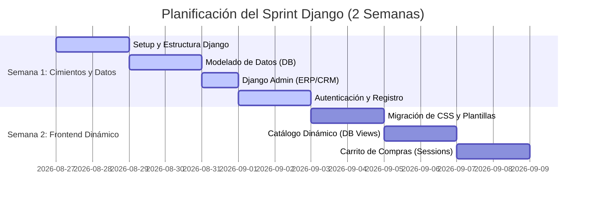

# 📅 Roadmap de Migración a Django (2 Semanas: 27 Ago - 8 Sep)

Este plan de trabajo detalla los objetivos diarios y semanales para migrar la base estática actual de **ARTSPACE** a un entorno dinámico con **Django**, cubriendo de forma práctica los temas clave del temario de *Negocios Electrónicos II*.

---

## 🏁 Objetivos Principales para el 8 de Septiembre

1.  **Migración Completa de Frontend:** Todos los archivos HTML y CSS integrados como plantillas (`templates`) y archivos estáticos (`static`) de Django.
2.  **Base de Datos Relacional Activa:** Modelado de datos para `Artistas` y `Obras de Arte`.
3.  **Panel de Control Operativo (ERP/CRM Básico):** Administración completa de inventario a través de Django Admin.
4.  **Autenticación de Clientes:** Registro, inicio y cierre de sesión de usuarios funcional.
5.  **Catálogo Dinámico y Carrito de Compras (Sesión):** Obras de arte cargadas desde la BD con capacidad de agregarse a un carrito dinámico.

---

## 🗓️ Cronograma Detallado

### 🧱 Semana 1 (27 de Agosto - 2 de Septiembre): Estructura del Servidor y Base de Datos

*   **Jueves 27 y Viernes 28 de Agosto:** *Inicialización del Entorno*
    *   Creación del entorno virtual de Python (`venv`) e instalación de Django.
    *   Creación del proyecto Django (`artspace_project`) y la app principal (`gallery`).
    *   Configuración inicial de rutas (`urls.py`) y settings.
*   **Sábado 29 y Domingo 30 de Agosto:** *Capa de Datos (Data Layer - U4.2 & U5.2)*
    *   Diseño de modelos en `gallery/models.py`:
        *   `Artista` (Nombre, biografía, foto de perfil, redes).
        *   `ObraArte` (Título, artista [relación ForeignKey], descripción, precio, imagen, tipo [original/print], stock, activo).
    *   Ejecución de migraciones a la base de datos local.
*   **Lunes 31 de Agosto:** *Capa de Negocio Básica (ERP/CRM - U1 & U3)*
    *   Configuración personalizada de **Django Admin** para gestionar de forma visual los Artistas y Obras.
    *   Carga inicial de datos de prueba (las obras que ya están en el index estático y las imágenes del carrusel).
*   **Martes 1 y Miércoles 2 de Septiembre:** *Registro y Autenticación (U4.3)*
    *   Implementación del sistema de login, logout y registro de clientes utilizando los formularios nativos de Django (`UserCreationForm`).
    *   Vistas de redirección de inicio de sesión seguro.

---

### 🎨 Semana 2 (3 de Septiembre - 8 de Septiembre): Integración del Frontend y Carrito de Compras

*   **Jueves 3 y Viernes 4 de Septiembre:** *Migración de la Capa de Presentación (U5.1)*
    *   Configuración de directorios `/templates/` y `/static/` en Django.
    *   Creación de una plantilla base (`base.html`) que contenga el `<header>` y `<footer>` dinámicos para evitar duplicar código.
    *   Migración de los HTMLs estáticos a templates heredados (``).
    *   Configuración de `styles.css` e imágenes en la carpeta estática.
*   **Sábado 5 y Domingo 6 de Septiembre:** *Vistas Dinámicas (Catálogo y Detalle - U4.1.1)*
    *   Modificación de la página principal (`index.html`) y `galeria.html` para renderizar en bucle (``) los productos de la base de datos.
    *   Despliegue del carrusel de colecciones leyendo las imágenes guardadas en el modelo.
*   **Lunes 7 y Martes 8 de Septiembre:** *Carrito de Compras (U4.1.3) y Entrega de Hito*
    *   Lógica del carrito de compras basada en la sesión del usuario (`request.session`) para agregar, remover y ver productos del carrito sin requerir base de datos externa.
    *   Pruebas generales del sistema integrado y preparación de reporte final para la entrega escolar del 8 de Septiembre.
